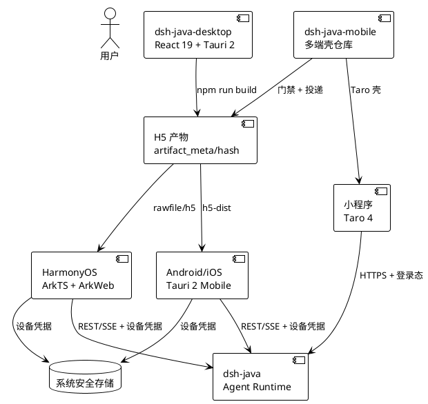
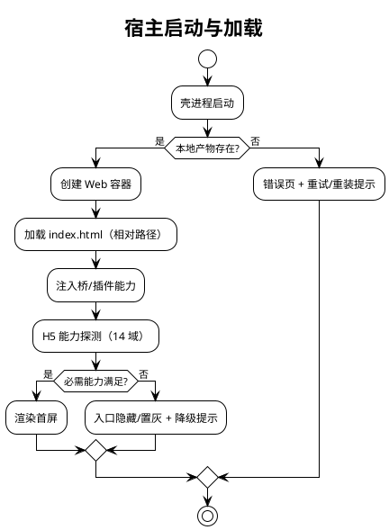
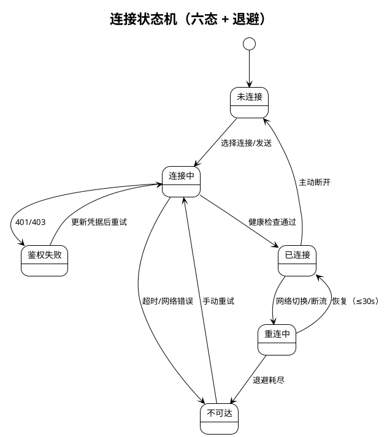
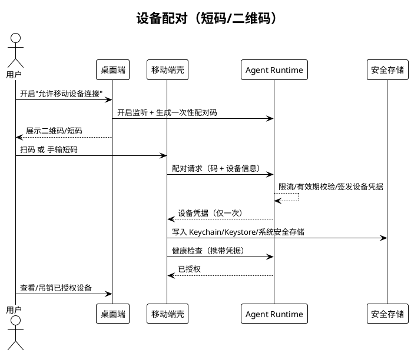
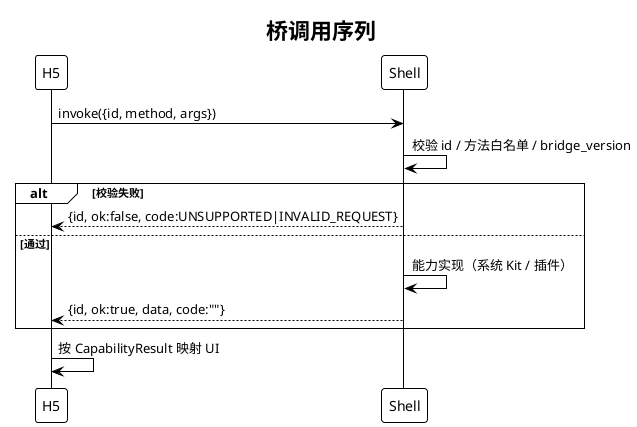
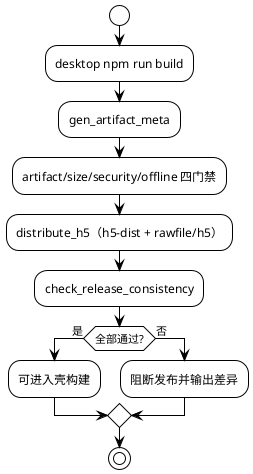

# DSH Java Mobile v0.2.0 实现方案文档

> 版本：`v0.2.0` | 基线：`v0.1.0` | 主线：多端壳与"同一份 H5 产物"落地 | 架构：多端壳工程（Tauri 2 Mobile / ArkTS + ArkWeb / Taro 4），不承载 React 业务源码
>
> 本文档承接 `docs/0.2.0/spec.md`，描述 v0.2.0 的"怎么做（How）"。事实基线为仓库实际代码：`src-tauri/`（共享 Rust 壳）、`harmony/`（ArkTS 壳）、`miniapp/`（Taro 壳）、`scripts/`（12 个构建与门禁脚本）、`h5-dist/` 与 `harmony/entry/src/main/resources/rawfile/h5/`（同一份产物）。
>
> **架构约束（强制）**：UI 事实源在 `../dsh-java-desktop`；本仓库不新增 React 业务入口；壳层不含业务规则；四端共享 `contractVersion=1` 与 `bridge_version=1`。
>
> **v0.2.0 定位**：完成"产物流水线 + 共享壳骨架 + 平台契约 + 配对/连接 + 工程回归"；Android/iOS 真机闭环与鸿蒙六项实测列为后续里程碑（见 `tasks.md` 与 spec §7.4）。

---

# 一、需求与存量功能关系分析

## 1.1 需求功能与存量功能对比

### 1.1.1 已实现功能（可直接复用的存量骨架）

| 能力 | 存量资产 | 复用方式 |
| --- | --- | --- |
| H5 产物唯一性 | `scripts/gen_artifact_meta.mjs`、`check_h5_artifact.mjs`、`check_h5_size.mjs`、`check_h5_security.mjs`、`h5_offline_check.mjs` | 每次构建直接复用，作为发布前置 |
| 双宿主投递 | `scripts/distribute_h5.mjs` 写入 `h5-dist/` 与 `harmony/entry/src/main/resources/rawfile/h5/` | 保持单次构建、两处投递 |
| 跨仓库哈希一致性 | `scripts/check_release_consistency.mjs`、`verify_artifact_consistency.mjs`、`verify_hosted_hash.mjs` | 发布与回归复用 |
| 一键回归 | `scripts/desktop_regression.mjs`（11 步） | 发布前置，失败即中断 |
| 共享 Rust 壳 | `src-tauri/src/lib.rs`：`#[cfg_attr(mobile, tauri::mobile_entry_point)]` + 5 个官方插件 | Android/iOS 共用，不新增自定义命令 |
| 鸿蒙 ArkWeb 壳 | `harmony/entry/src/main/ets/pages/Index.ets` 加载 `$rawfile("h5/index.html")`；`bridge/DshBridge.ets` 白名单 10 方法 | 直接复用容器与桥骨架 |
| 鸿蒙安全配置 | `network_config.json`（默认禁用明文）、`module.json5`（仅 `ohos.permission.INTERNET`、`dsh://connect` 深链） | 复用并补充权限用途说明 |
| 小程序壳 | `miniapp/`（Taro 4 + React 18，`src/sdk/{http,auth,device}.ts`） | 复用协议 SDK 与模型，不新建 UI 栈 |
| 能力矩阵 | `docs/specs/mobile_app_evolution/capability_matrix.md`（14 域 × 5 端） | 作为单一事实源，版本内更新 |
| 发布物料 | `release_checklist.md`、`store_compliance.md`、`security_acceptance.md`、`performance_acceptance.md`、`acceptance_evidence.md` | 直接作为发布依据 |

### 1.1.2 需要扩展的功能

| 功能 | 现状 | 扩展点 |
| --- | --- | --- |
| 版本一致性 | `package.json=0.2.0`，`Cargo.toml`/`tauri.conf.json`/`miniapp/package.json`/`version_matrix.md` 仍为 `0.1.0` | 统一四处版本；`DshBridge.app.version` 硬编码 `0.1.0` 改为读取壳版本 |
| 鸿蒙桥能力 | 白名单与分发骨架存在，但 `storage`/`clipboard`/`network`/`external`/`share`/`diagnostics` 多为桩返回 | 逐方法接系统 Kit，保持白名单与返回模型不变 |
| 产物元数据 | `artifact_meta.json` 的 `artifact_version` 仍为 `0.1.0` | 与壳版本联动，发布时写入 `0.2.0` |
| 回归可执行性 | 脚本齐备，但本机缺 `node_modules`、缺三端工具链 | 增加环境预检；工具链就绪后接入 CI |
| 小程序登录 | 后端接口与 SDK 已具备 | 待微信 AppID/AppSecret，补齐登录态与订阅消息 |

### 1.1.3 需要新增的功能或接口

| 新增项 | 说明 | 落位 |
| --- | --- | --- |
| iOS 原生工程 | `tauri ios init` 生成 `src-tauri/gen/apple/` | 新增（生成物） |
| iOS Info.plist 策略 | ATS 本地网络、`NSLocalNetworkUsageDescription`、Bonjour、相机/相册、`CFBundleURLTypes` | `gen/apple/**/Info.plist` 或 `bundle.iOS.infoPlist` |
| iOS/Android 安全存储 | Keychain / Keystore 插件 | `src-tauri/plugins/credential_{ios,android}/` |
| iOS/Android 文件与分享 | DocumentPicker / ActivityViewController；SAF / FileProvider | `file_{ios,android}` 插件 |
| Android 工程 | `tauri android init` 生成 `src-tauri/gen/android/` | 新增（生成物） |
| 环境预检脚本 | 检查 Xcode/CocoaPods/Rust target/Android SDK/DevEco | `scripts/`（后续） |
| 三端 CI | Android/iOS/HarmonyOS 构建工作流 | `.github/workflows/`（后续） |

### 1.1.4 与 desktop 0.2.2 资产对位映射（总览）

| desktop 资产 | mobile 消费方式 | 约束 |
| --- | --- | --- |
| `dist/`（React 19 构建产物） | `h5-dist/`（Android/iOS 内嵌）、鸿蒙 `rawfile/h5/` | 不修改产物内容，只投递 |
| `src/platform/contract.ts`（14 域 / 29 方法） | 壳侧实现同名能力；缺失返回 `UNSUPPORTED` | 不新增端专属协议文件 |
| `docs/spec/0.2.2/contract/`（7 份 fixtures） | 契约测试引用，不复制 | `contractVersion=1` |
| `src-tauri/src/lib.rs`（1890 行 / 26 命令） | 仅抽取移动可复用插件；不迁移 Agent/Git 命令 | 移动端不注册 `start_agent`/`stop_agent`/`agent_status` 与 Git 五件套 |
| 配对 UI 与"允许移动设备连接"开关 | 移动端扫码/短码消费端 | 开关默认关闭、开启后强制鉴权 |

## 1.2 存量功能详细分析

### 1.2.1 壳层边界与命令收口

- `src-tauri/Cargo.toml`：`crate-type = ["staticlib", "cdylib", "rlib"]`，Android/iOS 共用；`edition = 2021`。
- `src-tauri/src/lib.rs`：仅注册 `tauri_plugin_http`、`clipboard_manager`、`notification`、`deep_link`、`os` 五个插件，**无 `.invoke_handler(...)` 自定义命令**，因此桌面端的 Agent 生命周期与 Git 命令天然不存在。
- `src-tauri/tauri.conf.json`：`frontendDist = "../h5-dist"`；CSP 限制 `script-src 'self'`，`connect-src` 允许回环与 https。
- `capabilities/mobile.json`：`platforms = ["android", "iOS"]`，权限为 `core:default`、`http:default`、`clipboard-manager:default`、`notification:default`、`deep-link:default`、`os:default`。

### 1.2.2 平台适配契约 seam

业务层只依赖契约；壳侧提供实现。四条实现路径：

1. **Android/iOS**：Tauri 插件 + `src/platform/impl/tauri_*.ts`（由 desktop 产物按运行时动态加载）。
2. **HarmonyOS**：`DshBridge` JSBridge 白名单。
3. **小程序**：Taro API + `src/sdk/*`。
4. **纯浏览器**：降级实现（`memory_credential`、`browser_transport`）。

### 1.2.3 H5 产物流水线

现有脚本链已验证可执行：

```bash
node scripts/gen_artifact_meta.mjs ../dsh-java-desktop/dist
node scripts/check_h5_artifact.mjs ../dsh-java-desktop/dist
node scripts/check_h5_size.mjs ../dsh-java-desktop/dist
node scripts/check_h5_security.mjs ../dsh-java-desktop/dist
node scripts/h5_offline_check.mjs ../dsh-java-desktop/dist
node scripts/distribute_h5.mjs ../dsh-java-desktop/dist
node scripts/check_release_consistency.mjs ..
```

实测产物基线：18 个文件、4,327,273 字节、`content_hash=cc78a10a2091b126198e32a2d1a7d381bde207cb8cd69e9467e42abdd3759f40`，`h5-dist` 与鸿蒙 `rawfile/h5` 一致。

### 1.2.4 鸿蒙桥白名单

`DshBridge` 约束：单命名空间 `dshBridge`、`version=1`、同步返回、超时由 H5 侧控制。

- 请求：`{ id, method, args }`；响应：`{ id, ok, data, code }`。
- 非法请求 → `INVALID_REQUEST`；非白名单方法 → `UNSUPPORTED`；解析异常 → `BRIDGE_ERROR`。
- 当前 `dispatch` 多为桩（`storage.get` 返回 `null`、`clipboard.read` 返回空串、`network.status` 固定在线），属骨架态，v0.2.0 不宣称能力已落地。

### 1.2.5 版本与回归脚本

- 单一回归入口：`node scripts/desktop_regression.mjs ../dsh-java-desktop .`，11 步：
  1. 桌面构建（含 tsc）
  2. 桌面单元/契约测试
  3. 平台边界检查
  4. 生成产物元数据
  5. 产物绝对路径检查
  6. 产物体积门禁
  7. 产物安全扫描
  8. 离线/CDN 校验
  9. H5 静态闭环
  10. 投递到各宿主
  11. 跨仓库一致性校验
- 任一步失败即中断并汇总 PASS/FAIL。

---

# 二、增量设计方案

## 2.1 实现模型

### 2.1.1 上下文视图



### 2.1.2 服务/组件总体架构

| 层 | 组件 | 职责 |
| --- | --- | --- |
| 产物层 | `h5-dist/`、`rawfile/h5/` | 静态资源，带 `artifact_meta.json` |
| 门禁层 | `scripts/*.mjs` | 元数据、路径、体积、安全、离线、一致性 |
| 壳层（Android/iOS） | `src-tauri/`（Rust + 5 插件） | 容器、权限、生命周期、版本、安全存储 |
| 壳层（HarmonyOS） | `Index.ets` + `DshBridge.ets` | ArkWeb 容器、桥白名单、深链、错误兜底 |
| 壳层（小程序） | `miniapp/`（Taro） | 登录、受限能力、包体控制 |
| 业务层 | desktop 产物内 `src/platform/impl/*` | 能力探测、传输选择、凭据引用 |
| 发布层 | `docs/specs/mobile_app_evolution/*` | 版本矩阵、能力矩阵、检查单、合规 |

### 2.1.3 实现设计文档

#### 2.1.3.1 应用启动与产物加载



分支策略：
- **产物缺失**：不白屏，显示可读错误页。
- **桥缺失**（浏览器或旧壳）：探测返回 `UNAVAILABLE`，不抛异常。
- **契约不兼容**：进入只读/兼容模式并上报诊断，不静默错误。

#### 2.1.3.2 连接状态机



- 退避曲线：1s → 2s → 4s → 8s → 15s 封顶；连续失败 3 次进入退避态并暴露"立即重试"。
- 流式超时：连接 15s；已建立后 120s 无字节 → 中断并转对账；对账轮询 5s。
- 续传：按 `afterSeq` 补拉，重复事件丢弃，缺口补齐后恢复。

#### 2.1.3.3 设备配对时序



- 配对码：一次性、≤10 分钟、限流；过期/复用给出明确提示。
- 凭据：服务端只存 SHA-256 摘要；本地只存安全存储；吊销后 401 并清理本地。

#### 2.1.3.4 桥调用与版本协商



审计：拒绝事件记录方法名与 `bridge_version`，不记录参数明文。

## 2.2 接口设计

### 2.2.1 总体设计

- **能力契约**：业务层唯一依赖面；14 域 / 29 方法；返回 `CapabilityResult<T>`。
- **桥协议**：鸿蒙以 JSON 字符串同步返回；与能力契约一一映射。
- **Tauri 插件面**：Android/iOS 直接使用官方插件；自定义能力以插件形式逐步补齐。
- **脚本 CLI**：构建与门禁命令固定，作为 CI 唯一入口。

### 2.2.2 接口清单

#### （1）鸿蒙 JSBridge

```typescript
// harmony/entry/src/main/ets/bridge/DshBridge.ets
interface BridgeRequest { id: string; method: string; args: string; }

class DshBridge {
  getVersion(): number;                  // 固定 1
  invoke(requestJson: string): string;   // 返回 JSON 字符串
}
```

白名单（10 个）：

| 方法 | 当前实现 | v0.2.0 状态 |
| --- | --- | --- |
| `app.version` | `{version:"0.1.0", bridgeVersion:1}` | 骨架（版本待联动） |
| `storage.get` | `{value:null}` | 桩 |
| `storage.set` / `storage.remove` | `{ok:true}` | 桩 |
| `clipboard.write` | `{ok:true}` | 桩 |
| `clipboard.read` | `{value:""}` | 桩 |
| `network.status` | `{online:true, type:"unknown"}` | 桩 |
| `external.openUrl` / `share.open` | `{ok:true}` | 桩 |
| `diagnostics.export` | `{host:"harmony", bridgeVersion:1, artifactHash:""}` | 骨架（哈希待注入） |

> 桩实现只保证协议形状与白名单正确，**不宣称系统能力已可用**；真实实现见 `tasks.md` 6.6–6.10。

#### （2）能力契约（14 域 / 29 方法）

| 能力域 | 方法 |
| --- | --- |
| transport | `request` / `stream` / `cancel` |
| credential | `save` / `read` / `delete` / `exists` |
| file | `pick` / `readText` / `readBinary` / `writeText` / `stat` / `listDir` / `export` |
| export_share | `share.open` |
| external_open | `openUrl` / `openFile` / `reveal` |
| notify | `send` / `permission` |
| clipboard | `write` / `read` |
| network | `status` / `onChange` |
| app_info | `version` |
| update | `check` |
| lifecycle | `onForeground` / `onBackground` |
| deeplink | `onOpen` / `parse` |
| git | `branch` / `branches` / `switch` / `changes` / `diff`（移动端 `NONE`） |
| diagnostics | `export` |
| storage | `get` / `set` / `remove` / `clear` |

#### （3）Tauri 插件注册（现有）

```rust
// src-tauri/src/lib.rs
#[cfg_attr(mobile, tauri::mobile_entry_point)]
pub fn run() {
    tauri::Builder::default()
        .plugin(tauri_plugin_http::init())
        .plugin(tauri_plugin_clipboard_manager::init())
        .plugin(tauri_plugin_notification::init())
        .plugin(tauri_plugin_deep_link::init())
        .plugin(tauri_plugin_os::init())
        .run(tauri::generate_context!())
        .expect("error while running tauri application");
}
```

#### （4）脚本 CLI

| 命令 | 作用 | 失败行为 |
| --- | --- | --- |
| `npm run regression` | 11 项一键回归 | 任一步失败即中断 |
| `npm run deploy:h5` | 投递产物到两宿主 | 缺失 source 即失败 |
| `npm run consistency` | 跨仓库哈希一致性 | 差异即失败 |
| `npm run check:artifact` | 绝对路径/残留扫描 | 命中即失败 |
| `npm run check:size` | 体积门禁 | 超限即失败 |
| `npm run check:security` | 远程脚本/热更新扫描 | 命中即失败 |
| `npm run check:offline` | CDN 依赖扫描 | 命中即失败 |
| `npm run ios:init` / `ios:build` | iOS 工程初始化/构建 | 工具链缺失即失败 |

## 2.3 数据模型

### 2.3.1 ConnectionProfile

| 字段 | 类型 | 约束 |
| --- | --- | --- |
| `id` | string | 唯一 |
| `name` | string | 1–40 字符 |
| `channel` | enum | `LOCAL`/`LAN`/`HTTPS` |
| `base_url` | string | HTTPS 必须 `https://`；LOCAL 必须回环 |
| `auth_mode` | enum | 与 `credential_ref` 配套 |
| `credential_ref` | string | 仅引用，禁止明文 |
| `last_status` | enum | 六态投影 |
| `last_used_at` | timestamp | 可空 |

### 2.3.2 设备配对记录

| 字段 | 说明 |
| --- | --- |
| `pairCode` | 一次性，≤10 分钟 |
| `deviceId` | 稳定设备标识 |
| `credentialDigest` | 服务端 SHA-256 摘要（不存明文） |
| `status` | 已授权/已吊销 |
| `lastActiveAt` | 最后活跃时间 |

### 2.3.3 artifact_meta.json

```json
{
  "artifact_version": "0.1.0",
  "contract_version": 1,
  "min_bridge_version": 1,
  "built_at": "2026-11-06T16:04:54.863Z",
  "commit": "c5ed82a",
  "content_hash": "cc78a10a2091b126198e32a2d1a7d381bde207cb8cd69e9467e42abdd3759f40",
  "total_bytes": 4327273,
  "files": []
}
```

约束：`files[]` 为相对路径 + 字节 + SHA-256；禁止绝对路径、`file://`、sourcemap。

### 2.3.4 矩阵

- `capability_matrix.md`：14 域 × 5 端，`FULL/DEGRADED/NONE`。
- `version_matrix.md`：端 × 版本 × 契约版本 × 最低桥版本 × 兼容范围 × 状态。

## 2.4 分层落位清单

| 落位 | 文件/目录 | 职责 |
| --- | --- | --- |
| 共享 Rust 壳 | `src-tauri/src/lib.rs`、`src-tauri/Cargo.toml` | 移动入口与插件注册 |
| 壳权限 | `src-tauri/capabilities/mobile.json` | Android/iOS 最小权限 |
| 壳配置 | `src-tauri/tauri.conf.json` | `frontendDist`、CSP、bundle |
| 鸿蒙容器 | `harmony/entry/src/main/ets/pages/Index.ets` | ArkWeb `Web` 组件与错误兜底 |
| 鸿蒙桥 | `harmony/entry/src/main/ets/bridge/DshBridge.ets` | 白名单与协议响应 |
| 鸿蒙能力/配置 | `entryability/EntryAbility.ets`、`module.json5`、`network_config.json` | 生命周期、权限、明文策略、深链 |
| 小程序 | `miniapp/src/{app.ts,sdk/*,pages/index}` | 登录、协议 SDK、轻量页面 |
| 产物门禁 | `scripts/*.mjs` | 11 项回归与投递 |
| 矩阵与发布 | `docs/specs/mobile_app_evolution/*` | 版本/能力矩阵、检查单、合规 |

## 2.5 安全设计

| 面 | 措施 | 验收 |
| --- | --- | --- |
| 传输 | 公网强制 HTTPS；明文仅回环/显式确认的局域网 | 公网 http 被拒；局域网需确认 |
| 凭据 | 只存引用；系统安全存储；服务端存摘要 | 文件系统无明文；吊销后 401 |
| 配对 | 一次性、≤10 分钟、限流、单设备吊销 | 过期/复用提示；A/B 设备隔离 |
| 产物 | 无远程脚本/热更新；CSP `script-src 'self'` | 安全与离线扫描通过 |
| 桥 | 白名单 + 版本校验 + 审计（不含明文） | 未知方法返回 `UNSUPPORTED` |
| 诊断 | 四类脱敏（Bearer/sk/password/token/X-API-Key） | 脱敏单测通过 |
| 鸿蒙 | `cleartextTrafficPermitted=false`，仅 INTERNET 权限 | 明文被拦并给出可执行提示 |

## 2.6 构建与产物投递



## 2.7 版本与发布治理

- 版本单一来源：`package.json`；其余声明必须对齐（v0.2.0 实测未对齐，见 spec §7.1）。
- 发布顺序：服务端兼容 → 桌面端 → Android 灰度 → iOS TestFlight → 鸿蒙 AGC → 小程序灰度。
- 观测指标：崩溃率、连接成功率、配对成功率、流式首字节时延、对账触发次数。
- 回滚：保留上一版产物与 `artifact_meta.json`；商店回退到上一版本号。

## 2.8 iOS 落地设计（v0.2.0 后的首个工程动作）

### 2.8.1 工具链状态与前置

本机实测：完整 Xcode 在 `/Applications/Xcode.app`，但 `xcode-select -p` 指向 `/Library/Developer/CommandLineTools`；`xcodebuild` 不可用；无 iOS 模拟器 runtime；无 CocoaPods；Rust 仅 `x86_64-apple-darwin`；无 `src-tauri/gen/apple`。配置步骤见同目录 `XCode.md`。

### 2.8.2 工程与签名

| 项 | 方案 |
| --- | --- |
| 工程生成 | `npm run ios:init` → `src-tauri/gen/apple/` |
| Bundle Identifier | `net.linlan.dsh`（与 Android 对齐） |
| 最低版本 | iOS 15.0（`bundle.iOS.minimumSystemVersion`） |
| 签名 | Xcode 选择 Team；真机需开发者证书；TestFlight 需 App Store Connect 应用记录 |
| 构建 | `tauri ios dev`（模拟器）、`tauri ios dev --device`（真机）、`tauri ios build`（archive） |

### 2.8.3 Info.plist 策略

| 键 | 值/用途 |
| --- | --- |
| `NSAppTransportSecurity.NSAllowsLocalNetworking` | `true`（允许局域网明文；禁止 `NSAllowsArbitraryLoads`） |
| `NSLocalNetworkUsageDescription` | 说明"连接局域网内的 Agent 服务" |
| `NSBonjourServices` | 如启用自动发现，声明 `_dsh._tcp`（后续 mDNS 规划） |
| `NSCameraUsageDescription` | 扫码配对 |
| `NSPhotoLibraryUsageDescription` | 文件/图片选择 |
| `CFBundleURLTypes` | `dsh://` scheme（优先方案） |
| 通知 | `UNUserNotificationCenter` 运行时申请，不预置权限弹窗 |

### 2.8.4 与 Android 的一致性

- 同一份 `h5-dist`、同一 `contractVersion`/`bridge_version`。
- 同一 Bundle Identifier 语义（Android `applicationId` 与 iOS Bundle ID 同为 `net.linlan.dsh`）。
- 同一安全存储语义：仅存引用，卸载重装不可恢复。
- 同一最低系统版本策略：Android API 26 / iOS 15.0。

## 2.9 测试策略

| 层级 | 内容 | 位置 |
| --- | --- | --- |
| 产物门禁 | 元数据/路径/体积/安全/离线/一致性 | `scripts/*.mjs` |
| 契约测试 | 7 份 fixtures × 5 宿主 | desktop `tests/unit/contract.test.ts` |
| 连接与流式 | 断流、续传、退避、对账 | desktop 单测 |
| 脱敏 | 四类敏感信息 | `diagnostics.test.ts` |
| 桥协议 | 白名单/未知方法/版本 | 鸿蒙单测或真机调用 |
| 真机闭环 | 安装→连接→对话→审批→文件→通知 | `docs/specs/mobile_app_evolution/test_records/` |
| 回归 | 11 项一键 | `desktop_regression.mjs` |

## 2.10 风险与回滚

| 风险 | 触发 | 回滚/缓解 |
| --- | --- | --- |
| 工具链缺位 | 无 Xcode/Android SDK/DevEco | 先补 iOS；其余任务并行推进 H5 侧 |
| 产物漂移 | 手工替换 `h5-dist` | 回归强制哈希一致；禁止手工改元数据 |
| 桥桩误用 | 把桩当已实现 | 文档标注"桩"，能力矩阵维持 `DEGRADED/NONE` |
| 签名/审核失败 | 证书或物料缺失 | 保留上一版构建；补齐合规物料 |
| 版本漂移 | 多处版本声明 | tasks 第 13 组统一收口 |

---

# 三、0.1.0 → 0.2.0 差异与后续演进

## 3.1 变更清单

| 类别 | 变更 |
| --- | --- |
| 版本 | `package.json` 升至 0.2.0；CHANGELOG 新增 0.2.0 |
| 能力 | 新增版本矩阵、能力裁剪矩阵；产物元数据与契约版本对齐声明 |
| 产物 | 内嵌产物随 desktop 0.2.2 同步；跨宿主哈希一致性校验 |
| 文档 | 新增 `version_matrix.md`、`capability_matrix.md` 与四件套（本目录） |
| 未变 | 壳层插件集合、桥白名单、脚本数量 |

## 3.2 后续里程碑

| 里程碑 | 内容 | 前置 |
| --- | --- | --- |
| M2 Android | `tauri android init`、传输/混合内容、Keystore、文件分享、通知、深链、签名、真机闭环 | Android SDK/NDK |
| M3 HarmonyOS | 六项可行性实测、桥真实实现、生命周期与后台流式、真机闭环 | DevEco + 鸿蒙真机 |
| M4 iOS | `tauri ios init`、ATS/本地网络、Keychain、文件分享、通知/深链、TestFlight | Xcode 启用 + CocoaPods + Rust iOS target |
| M5 发布 | 三端 CI、产物哈希验收、性能/包体验收、附录 F 全项验收 | M2–M4 |
| 可选 | 小程序深化、mDNS/Bonjour 自动发现、可观测性、SSH/Relay 选型 | 用户决策 |

> 交叉引用：任务拆分见 `tasks.md`；完整逐条任务见 `docs/specs/mobile_app_evolution/tasks.md`（116 子任务，72 已完成 / 44 待办）。