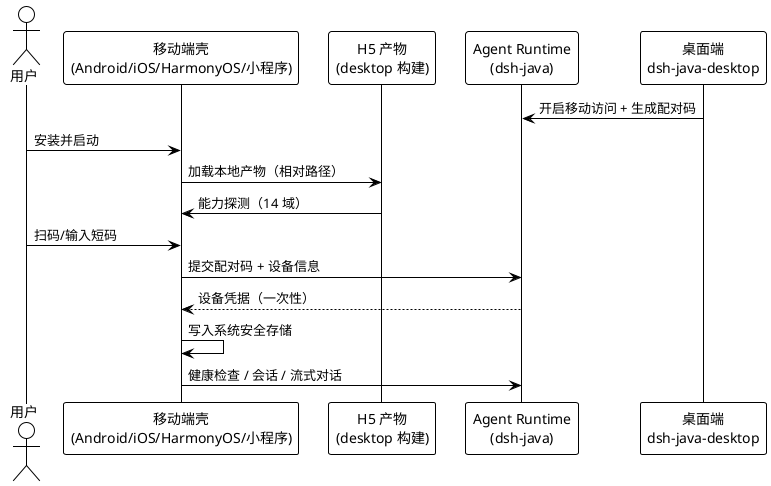
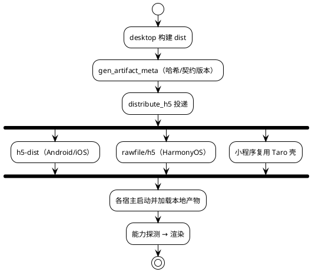
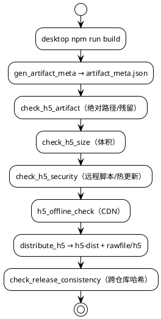
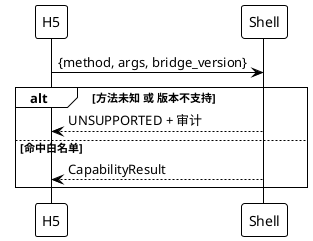
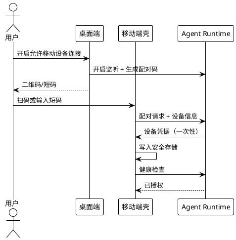
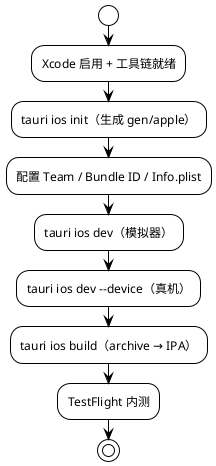

# DSH Java Mobile v0.2.0 需求规格

> 版本：`v0.2.0` | 基线：`v0.1.0` | 主线：多端壳与"同一份 H5 产物"落地 | 发布日期：2026-11-08
>
> 本规格定义 `dsh-java-mobile` 在 v0.2.0 范围内的全部需求。事实来源为：本仓库实际代码与脚本（`src-tauri/`、`harmony/`、`miniapp/`、`scripts/`）、`docs/specs/mobile_app_evolution/spec.md`（多端演进总规格）、`CHANGELOG.md` 与 `../dsh-java-desktop` 0.2.2 产物。
>
> **版本范围声明**：v0.2.0 四件套统一归档于 `docs/0.2.0/`，分别为 `spec.md`（本需求规格）、`design.md`（技术方案）、`tasks.md`（任务清单）、`release-v0.2.0-development-notes.md`（开发说明）。iOS 工具链配置指南见同目录 `XCode.md`。
>
> **依赖新增声明**：v0.2.0 **不新增第三方依赖**。壳层仅使用 Tauri 2 官方插件（`http`、`clipboard-manager`、`notification`、`deep-link`、`os`）；鸿蒙壳仅使用系统 Kit；小程序仅使用 Taro 4 既有依赖。**不新增 Maven 模块，不内嵌 JRE/JAR**。
>
> **命名隔离声明**：本仓库是**多端壳工程**，不承载 React 业务源码。UI 事实源为 `../dsh-java-desktop`；本仓库只承载壳层、原生桥、构建脚本与产物消费。禁止在本仓库新建第二个 React 业务入口。
>
> **本阶段边界**：本文档只定义"做什么（What）"与验收标准，不含类签名、算法与部署实现等"怎么做（How）"细节；实现细节见 `design.md`，任务拆分见 `tasks.md`。

---

# 1. 组件定位

## 1.1 核心职责

本组件负责把 `dsh-java-desktop` 已验证的「壳层 + React 业务界面 + 可连接 Agent Runtime」路径交付到移动端与小程序：**一次构建 H5 产物，由 Android、iOS、HarmonyOS、小程序四个宿主各自消费**，壳层差异化，业务 UI 不分叉。

## 1.2 核心输入

1. **desktop H5 产物**：`../dsh-java-desktop/dist`（React 19 + Vite），含 `index.html`、`assets/*`、`dsh-icon.png` 与 `artifact_meta.json`。
2. **客户端契约 v1**：`../dsh-java/docs/spec/0.2.2/contract/`，含接口映射、事件流规范与 7 份 canonical fixtures（`contractVersion=1`）。
3. **Agent 承载点**：桌面端托管的 Agent（回环/局域网）、局域网自建服务、云侧 HTTPS 服务；移动端不内嵌 Agent。
4. **配对凭据**：桌面端生成的短码/二维码、服务端一次性签发的设备凭据。
5. **构建与发布信号**：`package.json` 壳版本、`distribute_h5.mjs` 投递目标、`desktop_regression.mjs` 回归结果。

## 1.3 核心输出

1. **四端壳工程**：Tauri 2 Mobile 共享 Rust 壳（Android/iOS）、ArkTS/ArkUI + ArkWeb 壳（HarmonyOS）、Taro 4 壳（小程序）。
2. **同一份 H5 产物副本**：`h5-dist/`（Android/iOS 内嵌）与 `harmony/entry/src/main/resources/rawfile/h5/`（鸿蒙内嵌），两者 `content_hash` 必须一致。
3. **平台能力实现**：14 个能力域 / 29 个方法（Android 与 iOS 为完整实现目标，鸿蒙按 ArkWeb 桥降级，小程序按平台裁剪）。
4. **产物门禁报告**：元数据、绝对路径、体积、安全、离线、跨宿主哈希一致性六类检查结果。
5. **版本与发布物料**：版本矩阵、能力裁剪矩阵、发布检查单、商店合规与隐私物料、开发说明。

## 1.4 责任边界

本组件**不负责**：

1. **React 业务 UI 开发**：页面、组件、状态管理、协议 SDK 全部位于 `dsh-java-desktop`；本仓库只消费构建产物。
2. **Agent 运行期**：模型调用、工具执行、审批、会话存储由 `dsh-java` 与桌面托管进程负责；移动端不内嵌 JRE、不打包 Agent。
3. **Git 能力**：移动壳不注册桌面端 Git 五件套命令，`git` 能力域在移动端为 `NONE`，入口隐藏。
4. **服务端协议演进**：移动端只按 `contractVersion=1` 消费；服务端破坏性变更须另开版本，不在本仓库内改协议。
5. **应用内热更新/静默更新**：禁止远程脚本与热更新；更新仅提示跳转应用商店。
6. **多 IM 渠道、SSH/Relay 的具体选型**：v0.2.0 未落地，相关任务留待后续里程碑（见 §7.2）。

---

# 2. 领域术语

| 术语 | 定义 |
| --- | --- |
| H5 产物 | `dsh-java-desktop` 构建出的静态前端包，含内容哈希与契约版本，是四端唯一 UI 事实源 |
| 宿主（Host） | 承载 H5 产物的壳：Android、iOS、HarmonyOS、小程序 |
| 壳（Shell） | 宿主侧原生工程与桥接层，不含业务规则 |
| 能力域 / 能力契约 | 业务层可依赖的原生能力接口集合，共 14 域 29 方法 |
| 桥协议（Bridge） | 鸿蒙壳向 H5 暴露的白名单方法通道，带 `bridge_version=1` |
| 能力状态 | `FULL`（完整）、`DEGRADED`（降级）、`NONE`（不支持） |
| 能力探测表 | 启动时上报的能力可用性表（AVAILABLE/DEGRADED/UNAVAILABLE） |
| 连接配置 | `ConnectionProfile`，描述目标 Agent 的地址、通道、鉴权方式与凭据引用 |
| 设备配对 | 桌面端生成一次性短码/二维码，移动端换取设备凭据的过程 |
| 凭据引用 | `credential_ref`，仅存引用键，不存明文凭据 |
| 产物哈希 | 对产物文件集计算的稳定 `content_hash`，用于跨宿主一致性校验 |
| 版本矩阵 | 端 × 版本 × 契约版本 × 最低桥版本的兼容矩阵 |
| 回归基线 | `desktop_regression.mjs` 的 11 项检查，发布前必须全绿 |

---

# 3. 角色与边界

## 3.1 核心角色

| 角色 | 职责 |
| --- | --- |
| 桌面端用户 | 开启"允许移动设备连接"、生成配对码、查看与吊销已授权设备 |
| 移动端用户 | 扫码/输入短码配对、选择连接、对话与审批、文件选择/导出/分享 |
| 发布工程师 | 执行回归、构建三端产物、校验哈希一致性、发布与回滚 |
| 小程序用户 | 通过微信登录态使用轻量入口（受限能力） |

## 3.2 外部系统

| 系统 | 交互 |
| --- | --- |
| `dsh-java-desktop` | 提供 H5 产物与配对 UI；作为本仓库 UI 事实源 |
| `dsh-java`（Agent Runtime） | 提供 REST/SSE、配对码与设备凭据接口 |
| 应用商店 / TestFlight / AGC / 微信平台 | 分发、签名、灰度与审核 |
| 系统安全存储 | Android Keystore/EncryptedSharedPreferences、iOS Keychain、鸿蒙系统安全存储 |

## 3.3 交互上下文

---

# 4. DFX 约束

## 4.1 性能

1. 移动 App 冷启动到"可操作界面"（可发起连接或进入上次会话）在中端机型上不得超过 2.5 秒。
   a. 验收条件：真机冷启动 3 次取中位数 ≤ 2.5s，证据归档。
2. 首屏关键资源（gzip）≤ 1 MB，完整产物（gzip）≤ 4 MB。
   a. 验收条件：`node scripts/check_h5_size.mjs ../dsh-java-desktop/dist` 退出码 0。
3. 鸿蒙壳冷启动到"H5 首屏可交互"不得超过 3.0 秒，其中 Web 容器创建到首屏渲染 ≤ 1.5 秒。
   a. 验收条件：DevEco 真机冷启动录屏与时间戳。
4. 安装包体积：Android ≤ 30 MB、iOS ≤ 45 MB、HAP ≤ 40 MB、小程序主包 ≤ 2 MB / 总包 ≤ 20 MB。
   a. 验收条件：构建产物实测字节数归档；超限即阻断发布。

## 4.2 可靠性

1. 网络切换（Wi-Fi ↔ 蜂窝）导致的连接中断必须在 30 秒内自动恢复，失败时提供"重试/切换连接"入口。
   a. 验收条件：断网 30 秒恢复录屏；失败态有可操作入口。
2. 流式连接连续 120 秒无字节必须转对账，成功对账视为本轮完成，不向用户抛错。
   a. 验收条件：`StreamIdleError` → 对账链路单测与真机验证。
3. 重连必须按 `afterSeq` 续传，客户端不得重复渲染已确认事件。
   a. 验收条件：注入重复/乱序/缺口 fixture，界面不重复、不回退。
4. 离线时必须能查看最近一次加载成功的会话列表与消息，并标注"离线/可能不是最新"。
   a. 验收条件：飞行模式打开应用 → 有内容且带离线标识。
5. 壳层 Web 容器渲染进程异常退出时必须能重建容器并恢复会话，不得白屏。
   a. 验收条件：鸿蒙 `Index.ets` 错误态 + 重新加载；H5 `ErrorBoundary` 兜底。

## 4.3 安全性

1. 公网连接必须 `https://`；仅回环与用户显式确认的局域网地址允许明文。
   a. 验收条件：公网 `http://` 被拒绝；局域网明文需 `allow_lan_plaintext` 显式确认。
2. 设备凭据必须存放在系统安全存储，禁止明文写入普通配置、Web 存储或日志。
   a. 验收条件：检查设备文件系统与容器存储，无长期凭据明文；卸载重装后旧凭据不可恢复。
3. 配对码一次性有效，有效期 ≤ 10 分钟；设备可单独吊销，吊销后请求返回 401。
   a. 验收条件：过期/复用提示正确；吊销后设备 A 401、设备 B 正常。
4. 诊断导出必须脱敏：`Bearer`、`sk-*`、`password|secret|token=`、`X-API-Key` 四类不得出现明文。
   a. 验收条件：`diagnostics.test.ts` 四类脱敏用例通过。
5. H5 产物禁止远程脚本、远程动态 `import()`、热更新入口；Tauri CSP `script-src 'self'`。
   a. 验收条件：`check_h5_security.mjs` 与 `h5_offline_check.mjs` 退出码 0。
6. 鸿蒙原生桥必须白名单化，未知方法与未知 `bridge_version` 一律拒绝并记录审计事件（不含凭据明文）。
   a. 验收条件：调用未声明方法返回 `UNSUPPORTED`，H5 不崩溃。

## 4.4 可维护性

1. 四端共享同一套协议 SDK 与契约 fixtures，任一端不得私自分叉协议模型。
   a. 验收条件：`contractVersion=1` 在四端一致；仓库仅一个 React 入口。
2. 平台差异只允许出现在壳层与 `src/platform/impl/`，业务组件禁止端判断分支。
   a. 验收条件：`check_platform_boundary.mjs` 0 违规。
3. 每个发布版本必须生成"端 × 协议版本 × 最低桥版本"兼容矩阵。
   a. 验收条件：`version_matrix.md` 与 `capability_matrix.md` 同版本更新。
4. 同一份 H5 产物必须带唯一内容标识（哈希 + 提交 + 构建时间），四宿主构建记录可证明同源。
   a. 验收条件：`check_release_consistency.mjs` 通过；`artifact_meta.json` 三字段齐全。
5. 新增能力必须同时更新能力契约、各端实现状态与降级说明。
   a. 验收条件：能力矩阵新增行；壳实现或返回 `UNSUPPORTED` 有据可查。

## 4.5 兼容性

1. 最低系统版本：Android 8.0（API 26）、iOS 15.0、HarmonyOS NEXT（API 12 / 5.0.0）、微信基础库 ≥ 3.0.0。
   a. 验收条件：低于下限给出明确不支持提示，不得安装后白屏。
2. `contractVersion` 不一致时必须明确提示并限制不兼容功能，不得静默错误。
   a. 验收条件：旧壳加载新产物提示"请升级应用"；新壳加载旧产物功能可用。
3. 移动端接入不得改变服务端既有接口语义；desktop 与 mobile 可同时在线。
   a. 验收条件：同 Agent 同时连接 desktop 与移动端，双方功能正常。
4. H5 产物必须支持非站点根路径加载，资源引用不得依赖固定域名根路径。
   a. 验收条件：产物复制到任意子目录后入口、JS、CSS 均 200。

---

# 5. 核心能力

## 5.1 多端形态与共享边界

### 5.1.1 业务规则

1. **四端共享一份 H5 产物**：Android/iOS 内嵌 `h5-dist/`，鸿蒙内嵌 `rawfile/h5/`，小程序复用 Taro 壳；禁止 fork 移动端专用 React 工程。
   a. 验收条件：四处 `content_hash` 一致。
2. **壳层不含业务规则**：壳只做容器、桥接、权限、生命周期与版本上报。
   a. 验收条件：壳工程无业务判定代码；业务逻辑仅存在于 H5 与 `dsh-java`。
3. **移动端不内嵌 Agent**：不打包 JRE/JAR，不注册 `start_agent`/`stop_agent`/`agent_status` 与 Git 五件套命令。
   a. 验收条件：`grep` 壳命令注册无 Agent/Git 命令；产物无 JAR。
4. **平台差异以能力状态表达**：同一能力在不同端呈现 `FULL/DEGRADED/NONE`，UI 按状态隐藏或置灰。
   a. 验收条件：`capability_matrix.md` 与真实调用一致。

### 5.1.2 交互流程

### 5.1.3 异常场景

1. **产物缺失**：宿主启动时本地产物不存在 → 显示可读错误页并提供"重新安装/联系支持"，不得白屏。
2. **哈希不一致**：`check_release_consistency.mjs` 失败 → 阻断发布并列出差异文件。
3. **能力缺失**：桥或插件不可用 → 降级为 `UNSUPPORTED`，入口隐藏，不抛异常到页面。

## 5.2 同一份 H5 产物流水线

### 5.2.1 业务规则

1. **构建基址相对化**：产物资源引用必须为 `./assets/...`，禁止绝对根路径。
   a. 验收条件：`grep -E '(src|href)="/' dist/index.html` 无结果。
2. **产物元数据**：必须生成 `artifact_version`、`contract_version`、`min_bridge_version`、`built_at`、`commit`、`content_hash`、`files[]`。
   a. 验收条件：`gen_artifact_meta.mjs` 产出且字段齐全。
3. **体积门禁**：首屏 gzip ≤ 1 MB、完整 gzip ≤ 4 MB。
   a. 验收条件：`check_h5_size.mjs` 退出码 0。
4. **安全与离线门禁**：禁止远程脚本/热更新/外部 CDN；禁止绝对路径、`file://`、sourcemap 残留。
   a. 验收条件：`check_h5_security.mjs`、`h5_offline_check.mjs`、`check_h5_artifact.mjs` 均退出码 0。
5. **一次投递多处一致**：`distribute_h5.mjs` 同时写入 `h5-dist/` 与鸿蒙 `rawfile/h5/`，哈希必须一致。
   a. 验收条件：`check_release_consistency.mjs` 通过。

### 5.2.2 交互流程

### 5.2.3 异常场景

1. **体积超限**：首屏 > 1 MB → 阻断并输出超限 chunk 清单，要求拆分或按需加载。
2. **安全命中**：发现远程脚本或热更新 → 阻断构建，不得以警告放过。
3. **哈希漂移**：两处产物哈希不同 → 阻断发布并重新投递，禁止手工改元数据。

## 5.3 平台适配层与桥协议

### 5.3.1 业务规则

1. **能力契约单一维护**：14 域 / 29 方法（`transport`、`credential`、`file`、`export_share`、`external_open`、`notify`、`clipboard`、`network`、`app_info`、`lifecycle`、`deeplink`、`git`、`diagnostics`、`storage`）。
   a. 验收条件：契约类型 14 域齐全，方法数与总规格附录 D 一致。
2. **统一返回模型**：`OK | UNSUPPORTED | DENIED | CANCELLED | FAILED`，默认超时 15s；取消与超时可区分。
   a. 验收条件：五类结果均有 UI 表现；`CANCELLED` 不弹错误。
3. **桥协议白名单**：鸿蒙壳暴露 10 个方法（`app.version`、`storage.get/set/remove`、`clipboard.write/read`、`network.status`、`external.openUrl`、`share.open`、`diagnostics.export`），`bridge_version=1`。
   a. 验收条件：未知方法/版本返回 `UNSUPPORTED` 并审计。
4. **能力探测与版本协商**：页面声明所需 `bridge_version`，壳拒绝不在支持区间的版本。
   a. 验收条件：移除桥能力后页面不崩溃，入口隐藏或置灰。

### 5.3.2 交互流程

### 5.3.3 异常场景

1. **桥缺失**（浏览器/旧壳）：能力探测返回 `UNAVAILABLE`，相关入口隐藏。
2. **权限被拒**：返回 `DENIED` 并给可执行提示（如相机被拒 → 改手动输入短码）。
3. **用户取消**：返回 `CANCELLED`，不写错误日志、不弹错误。

## 5.4 连接与设备配对

### 5.4.1 业务规则

1. **连接配置管理**：支持新增/编辑/切换连接；字段 `id`、`name`、`channel`、`base_url`、`auth_mode`、`credential_ref`、`last_status`、`last_used_at`。
   a. 验收条件：`HTTPS` 必须 `https://`、`LOCAL` 必须回环、名称 1–40 字符；凭据只存引用。
2. **六态连接状态机**：未连接/连接中/已连接/重连中/鉴权失败/不可达；退避 1s → 15s 封顶。
   a. 验收条件：状态迁移单测覆盖；连续失败 3 次进入退避且可手动重试。
3. **配对双路径**：扫码 + 短码；相机被拒时仍可手输短码完成配对。
   a. 验收条件：两条路径均能完成配对；生成到成功 ≤ 60 秒。
4. **设备凭据独立签发与吊销**：每设备独立凭据，可单独吊销；吊销后 401。
   a. 验收条件：吊销设备 A 不影响设备 B。
5. **移动访问默认关闭**：桌面端"允许移动设备连接"默认关闭，开启后强制鉴权。
   a. 验收条件：默认状态下移动端无法直连；开启后配对成功。

### 5.4.2 交互流程

### 5.4.3 异常场景

1. **配对码过期/已使用** → 明确提示并引导重新生成。
2. **安全存储不可用** → 拒绝保存长期凭据，退回每次输入或引导修复。
3. **时钟偏差** → 返回"时间不同步"而非笼统无效。
4. **设备被吊销** → 清理本地凭据并提示重新配对。

## 5.5 窄屏与触控布局

### 5.5.1 业务规则

1. **断点**：360–430px 移动断点，单列布局 + 抽屉导航。
2. **触控目标**：可点击元素最小 44×44pt。
3. **安全区与键盘避让**：刘海/底部手势区适配；输入框聚焦时内容不被键盘遮挡。
4. **深色模式与系统字体缩放**：跟随系统，不强制固定字号。
   a. 验收条件：360px/430px 两档截图；深色模式与 200% 字体下无截断。

### 5.5.2 交互流程

页面加载 → 读取视口与安全区 → 应用移动布局 → 监听旋转/键盘 → 重新布局。

### 5.5.3 异常场景

1. **横屏**：允许但保持单列可读，不出现横向滚动。
2. **超长文本**：折行 + 截断提示，不撑破容器。

## 5.6 HarmonyOS ArkWeb 壳

### 5.6.1 业务规则

1. **ArkTS/ArkUI + `Web` 组件**加载 `rawfile/h5/`，不得使用第二套 UI 栈。
2. **桥白名单**见 §5.3.1；未知方法拒绝并审计。
3. **明文策略**：`network_config.json` 默认 `cleartextTrafficPermitted: false`，仅回环放行。
4. **白屏兜底**：容器加载失败显示错误态 + 重新加载入口。
   a. 验收条件：H-17 用例通过；鸿蒙真机六项可行性实测有结论与证据。

### 5.6.2 交互流程

启动 → 创建 `Web` 容器 → 加载 `resource://rawfile/h5/index.html` → 注入 `DshBridge` → H5 能力探测 → 渲染首屏。

### 5.6.3 异常场景

1. **rawfile 缺失** → 错误页 + 重试。
2. **桥注入失败** → 能力降级，页面不崩溃。
3. **混合内容被拦** → 给出可执行提示（改用 HTTPS 或确认局域网明文）。

## 5.7 Android/iOS Tauri 2 Mobile 壳

### 5.7.1 业务规则

1. **共享 Rust 壳**：`src-tauri/` 仅注册移动可复用插件（http、clipboard-manager、notification、deep-link、os），`crate-type` 含 `staticlib`/`cdylib`/`rlib`。
2. **移动入口**：`#[cfg_attr(mobile, tauri::mobile_entry_point)]`；`frontendDist` 指向 `../h5-dist`。
3. **iOS 最低版本 15.0**，Bundle Identifier 与 Android 对齐（`net.linlan.dsh`）。
4. **签名与分发**：Android APK/AAB，iOS archive + TestFlight；不打包 Agent。
   a. 验收条件：`tauri ios build --debug` 通过；模拟器/真机启动并加载产物。

### 5.7.2 交互流程

### 5.7.3 异常场景

1. **Xcode 未启用**（`xcode-select` 指向 CommandLineTools）→ `xcodebuild` 不可用，按 `XCode.md` 先切换。
2. **CocoaPods/模拟器 runtime/Rust target 缺失** → `tauri ios init`/构建失败，按 `XCode.md` 补齐。
3. **签名缺失** → 真机安装失败，须在 Xcode 选择 Team 后重试。

## 5.8 小程序轻量入口

### 5.8.1 业务规则

1. **Taro 4 + React 壳**，复用协议 SDK 与模型，不新建第二套业务 UI 栈。
2. **能力裁剪**：仅 HTTPS，无安全存储、无外部打开、无通知；文件与剪贴板降级。
3. **登录**：微信登录态换取后端会话；Agent 主凭据不得暴露在小程序前端。
   a. 验收条件：审查小程序存储无长期 Agent 主凭据。
4. **包体门禁**：主包 ≤ 2 MB、总包 ≤ 20 MB，超限分包。

### 5.8.2 交互流程

打开小程序 → 微信登录 → 获取短期令牌 → 选择连接 → 轻量会话列表/对话 → 受限能力降级提示。

### 5.8.3 异常场景

1. **域名未白名单** → 请求失败并提示检查平台配置。
2. **登录凭证缺失** → 后端返回 50300，不降级匿名。

## 5.9 版本发布与工程治理

### 5.9.1 业务规则

1. **版本单一来源**：壳版本统一由 `package.json` 声明；`src-tauri/Cargo.toml`、`src-tauri/tauri.conf.json`、`miniapp/package.json` 必须一致。
   a. 验收条件：四处版本号一致（v0.2.0 实测未完全一致，见 §7.1 与 `tasks.md` 第 13 组）。
2. **版本矩阵与能力矩阵**：每个版本更新 `version_matrix.md`、`capability_matrix.md`。
3. **回归必须全绿**：`desktop_regression.mjs` 11 项全部通过才可发布。
   a. 验收条件：汇总表 11 行均为 PASS。
4. **发布物料齐全**：发布检查单、商店合规、隐私政策、权限用途文案、截图与图标。
5. **可回滚**：保留上一版产物与元数据；各商店支持回退。

### 5.9.2 交互流程

版本冻结 → 回归全绿 → 构建三端 → 哈希一致性校验 → 灰度 → 全量 → 观测崩溃率/连接成功率/配对成功率。

### 5.9.3 异常场景

1. **回归失败** → 阻断发布，修复后重跑。
2. **哈希不一致** → 重新投递并校验，禁止手工改元数据。
3. **审核驳回** → 按商店合规清单补齐物料后重新提交。

---

# 6. 数据约束

## 6.1 连接配置（ConnectionProfile）

1. `id`：必填，唯一。
2. `name`：必填，1–40 字符。
3. `channel`：必填，`LOCAL` / `LAN` / `HTTPS`。
4. `base_url`：必填；`HTTPS` 必须 `https://`，`LOCAL` 必须回环地址。
5. `auth_mode`：必填，与 `credential_ref` 配套。
6. `credential_ref`：必填，仅引用，禁止明文。
7. `last_status` / `last_used_at`：运行态投影，可空。

## 6.2 设备配对记录

1. 配对码：一次性、≤ 10 分钟有效、限流防暴力。
2. 设备凭据：每设备独立，服务端仅存摘要（SHA-256）；签发时返回一次。
3. 吊销：单设备可吊销，立即生效，返回 401。
4. 本地：凭据仅存系统安全存储；卸载重装不可恢复。

## 6.3 能力矩阵

1. 维度：14 能力域 × 5 宿主（desktop/Android/iOS/HarmonyOS/小程序）。
2. 取值：`FULL` / `DEGRADED` / `NONE`。
3. 约束：矩阵为单一事实源；新增能力未更新矩阵视为需求未完成。

## 6.4 产物清单（artifact_meta.json）

1. `artifact_version`：产物版本。
2. `contract_version`：契约版本，v0.2.0 为 `1`。
3. `min_bridge_version`：最低桥版本，v0.2.0 为 `1`。
4. `built_at` / `commit`：构建时间与提交号。
5. `content_hash`：稳定内容哈希，跨宿主必须一致。
6. `files[]`：相对路径、字节数、SHA-256。
7. `total_bytes`：未压缩总字节。
8. 约束：不得出现绝对路径、用户名、`file://`、sourcemap。

## 6.5 版本清单

1. `package.json`：壳版本单一来源（v0.2.0 实测为 `0.2.0`）。
2. `src-tauri/Cargo.toml` / `src-tauri/tauri.conf.json`：壳版本（实测仍为 `0.1.0`，待对齐）。
3. `miniapp/package.json`：小程序版本（实测 `0.1.0`）。
4. `docs/specs/mobile_app_evolution/version_matrix.md`：端 × 版本 × 契约 × 桥（实测仍为 `0.1.0`，待更新）。

---

# 7. 假设、待确认与完成定义

## 7.1 已核验事实基线（2026-11-08 实测）

1. `h5-dist/artifact_meta.json`：`artifact_version=0.1.0`、`contract_version=1`、`min_bridge_version=1`、`content_hash=cc78a10a2091b126198e32a2d1a7d381bde207cb8cd69e9467e42abdd3759f40`、18 个文件、4,327,273 字节；鸿蒙 `rawfile/h5/artifact_meta.json` 与之一致。
2. 回归脚本 `scripts/desktop_regression.mjs` 定义 11 项检查；`scripts/` 下共 12 个脚本。
3. Tauri 壳注册 5 个插件（http、clipboard-manager、notification、deep-link、os），无自定义命令。
4. 鸿蒙 `DshBridge.ets` 白名单 10 个方法，`bridge_version=1`。
5. `src-tauri/gen/` 不存在：Android 与 iOS 原生工程均未初始化。
6. `node_modules` 未安装；本机 `xcode-select` 指向 `/Library/Developer/CommandLineTools`（完整 Xcode 已安装于 `/Applications/Xcode.app` 但未启用）；无 CocoaPods；无 iOS 模拟器 runtime；Rust 仅安装 `x86_64-apple-darwin` target。
7. 版本文档漂移：`package.json=0.2.0`，而 `Cargo.toml`、`tauri.conf.json`、`miniapp/package.json`、`version_matrix.md` 仍为 `0.1.0`；`CHANGELOG.md` 0.2.0 条目声明已统一，与实际不符。
8. 任务清单 `docs/specs/mobile_app_evolution/tasks.md`：116 子任务，已完成 72、待办 44（未完成项集中于 Android 壳 13、iOS 壳 7、鸿蒙 6、原生能力 8、CI/验收 7、其他 3）。

## 7.2 待确认事项

1. **iOS 工具链**：完整 Xcode 已下载安装，需启用、安装模拟器 runtime、CocoaPods 与 Rust iOS target；签名 Team 与证书待定。
2. **Android 工具链**：Android SDK/NDK、签名 keystore、商店开发者账号待准备。
3. **DevEco**：鸿蒙真机与六项可行性实测环境待准备。
4. **9.x 选型**：SSH 是否采用 `russh`、扫码是否采用 CameraX+MLKit / AVFoundation、Relay 中继是否建设，均未拍板。
5. **小程序凭证**：微信 AppID + AppSecret 未提供，登录链路无法端到端验证。
6. **首发范围**：小程序是否纳入首版商店发布范围。

## 7.3 风险

| 风险 | 影响 | 缓解 |
| --- | --- | --- |
| 三端工具链缺位 | 壳任务无法验收，版本只能以骨架发布 | 先补 iOS（已装 Xcode）→ Android → 鸿蒙；无工具链任务并行推进 H5 侧 |
| 产物版本漂移 | 四端加载不同产物，问题难复现 | 回归脚本强制哈希一致；版本收口任务（tasks 第 13 组） |
| 真机差异 | 模拟器通过但真机失败 | 每端真机闭环为发布前置；附录 F 预验收 |
| 凭据泄露 | 严重安全事件 | 只存引用 + 系统安全存储 + 诊断脱敏 + 吊销即 401 |
| 审核驳回 | 发布延期 | 提前准备商店合规与隐私物料 |

## 7.4 完成定义（v0.2.0 发布口径）

1. `desktop_regression.mjs` 11 项全部 PASS。
2. `h5-dist` 与鸿蒙 `rawfile/h5` 哈希一致，`artifact_meta.json` 字段齐全。
3. 能力矩阵、版本矩阵与代码实际一致（当前版本矩阵待更新，见 tasks 第 13 组）。
4. 鸿蒙壳可启动并加载产物（真机证据）；Android/iOS 以"骨架 + 工程可初始化"计入，真机闭环不在 v0.2.0 完成定义内。
5. `CHANGELOG.md` 0.2.0 条目与实际交付一致；四件套归档于 `docs/0.2.0/`。

---

# 附录 A：能力矩阵（v0.2.0 基线）

| 能力域 | desktop | Android | iOS | HarmonyOS | 小程序 |
| --- | --- | --- | --- | --- | --- |
| transport | FULL | FULL | FULL | FULL | DEGRADED |
| credential | FULL | FULL | FULL | FULL | NONE |
| file | FULL | FULL | FULL | DEGRADED | NONE |
| export_share | FULL | FULL | FULL | FULL | DEGRADED |
| external_open | FULL | FULL | FULL | FULL | NONE |
| notify | FULL | FULL | FULL | FULL | NONE |
| clipboard | FULL | FULL | FULL | FULL | DEGRADED |
| network | FULL | FULL | FULL | FULL | FULL |
| app_info | FULL | FULL | FULL | FULL | FULL |
| update | FULL | DEGRADED | DEGRADED | NONE | NONE |
| lifecycle | FULL | FULL | FULL | FULL | DEGRADED |
| deeplink | FULL | FULL | FULL | FULL | DEGRADED |
| git | FULL | NONE | NONE | NONE | NONE |
| diagnostics | FULL | FULL | FULL | FULL | DEGRADED |
| storage | FULL | FULL | FULL | FULL | DEGRADED |

> 本表与 `docs/specs/mobile_app_evolution/capability_matrix.md` 保持一致；新增能力必须先更新该文件。

# 附录 B：v0.2.0 发布范围与遗留

| 范围 | 已交付 | 遗留 |
| --- | --- | --- |
| H5 产物流水线 | 构建基址、元数据、体积/安全/离线门禁、双宿主投递、哈希一致性 | 产物 `artifact_version` 仍为 0.1.0 |
| 平台契约 | 14 域 / 29 方法、返回模型、版本协商 | Android/iOS 原生实现待补 |
| 鸿蒙壳 | ArkWeb 容器、10 方法白名单桥、错误兜底 | 六项可行性实测、真机闭环 |
| Android/iOS 壳 | 共享 Rust 壳与 5 插件、配置就绪 | 原生工程初始化、签名、真机闭环 |
| 连接与配对 | 连接配置、六态状态机、配对双路径 UI、移动访问开关 | 扫码实现、SSH/Relay |
| 小程序 | Taro 4 壳、登录后端具备 | 微信凭证、首页深化、订阅消息 |
| 工程治理 | 11 项回归、版本/能力矩阵、发布检查单 | 版本收口、三端 CI |

> **版本归档约定**：本规格与 `design.md`、`tasks.md`、`release-v0.2.0-development-notes.md` 统一归档于 `docs/0.2.0/`；`XCode.md` 为 iOS 工具链配置指南。