# DSH 多端演进需求规格：以 desktop 技术路径演进到 Android / iOS / HarmonyOS 与小程序

> 文档类型：需求规格说明（Spec，第一阶段产物）
> 特性标识：`mobile_app_evolution`
> 基线工程：`dsh-java-desktop`（0.2.2，Tauri 2 + React 19）、`dsh-java`（0.2.2，Spring Boot）、`dsh-java-mobile`（KMP + Kuikly，含 `androidApp` / `iosApp` / `ohosApp`）
> 状态：已按 2026-11-04 平台决策修订，待评审（P0）

## 平台决策（2026-11-04，用户已确认，不得回退）

> **用户原话**："ios和android用 tauri，鸿蒙用方案 1"。
>
> **决策释义**：Android 与 iOS 统一采用 **React + Tauri 2 Mobile** 壳；HarmonyOS 采用**方案 1**——ArkTS/ArkUI 原生壳 + `Web` 组件加载**同一份 React H5 构建产物**，复用 UI 与业务层，仅重写壳层。**不引入第二套 UI 栈**（不新增 Kuikly/ArkUI 业务页面、不把 React 页面重写为 ArkTS）。
>
> | 平台 | 前端 | 壳层 | 产物形态 | 决策状态 |
> | --- | --- | --- | --- | --- |
> | Desktop | React 19 + TS | Tauri 2（Rust） | 桌面安装包（内嵌 `dist` + Agent 运行时资源） | 既有，保持全功能 |
> | Android | React 19 + TS（同一份 `dist`） | Tauri 2 Mobile（Rust + Kotlin 插件） | APK / AAB（内嵌 `dist`） | 已决策：Tauri |
> | iOS | React 19 + TS（同一份 `dist`） | Tauri 2 Mobile（Rust + Swift 插件） | IPA（内嵌 `dist`） | 已决策：Tauri |
> | HarmonyOS | React 19 + TS（同一份 `dist`） | ArkTS/ArkUI + ArkWeb `Web` 组件 | HAP（内嵌 `dist` 或由 Agent 托管同源页面） | 已决策：方案 1 |
> | 小程序 | React（Taro）复用协议 SDK 与模型 | 平台宿主 | 小程序包 | 维持原决策 |
>
> **决策效力**：
> 1. 本文档后续所有章节（平台矩阵、适配层、验收标准、演进路线）均以本决策为前提；任何相反提案视为范围外变更，须重开决策。
> 2. 该决策**只固化"用什么壳"**，不固化"桥怎么实现、签名怎么配、产物怎么分发"；后者列入 7.2 待确认事项。
> 3. 四端 Web 层（desktop / Android / iOS / HarmonyOS）的**唯一事实源**为 `dsh-java-desktop` 的 React 工程；**禁止 fork 一份移动端专用 React 工程**（详见 5.9）。

> **取代声明（重要）**
> 本文档**取代** `docs/specs/mobile_debug/spec.md` 中"mobile 应采用 B 方案（REST + SSE 直连 dsh-java :8090）替换 Harness JSON-RPC + WebSocket"的技术前提。
> 新的前提是：**以 `dsh-java-desktop` 已验证的"壳 + React UI + 可连接 Agent Runtime"技术路径为基线进行演进，最终让同一套能力落到手机 App（以及小程序）**，形成类似 WorkBuddy 的「desktop 桌面端 + App + 小程序」多端形态。
> `mobile_debug/spec.md` 中关于"调试维度、构建现状、契约基线事实"的描述仍可作为事实参考，但其技术路线结论不再有效。

---

# 1. 组件定位

## 1.1 核心职责

本组件负责把 desktop 已验证的「壳层 + React 业务界面 + 可连接 Agent Runtime」路径演进为多端交付能力，实现同一套智能体能力在桌面端、手机 App、小程序上的一致可用。

## 1.2 核心输入

1. **desktop 存量资产**：来源为 `dsh-java-desktop`，内容为 React 19 前端（`src/`，约 2.1 万行 TS/TSX）、Tauri 2 Rust 壳（`src-tauri/src/lib.rs`，1890 行、26 个已注册命令）、构建与发布脚本、移动端图标资产（`src-tauri/icons/android`、`icons/ios`）。
2. **Agent Runtime 服务**：来源为 `dsh-java`（内嵌 `dsh-java-app.jar` 或独立部署），内容为 REST（`/api/agent/*`、`/api/harness/*`、`/api/digital-humans`、`/api/collaboration`）与 SSE（`POST /api/agent/stream`、`/api/collaboration/rooms/{roomId}/events/stream`）接口。
3. **客户端契约 v1**：来源为 `dsh-java/docs/spec/0.2.2/contract`，内容为接口映射表、事件流规范、领域模型映射与 7 份 canonical fixtures。
4. **mobile 存量资产**：来源为 `dsh-java-mobile`，内容为 KMP `shared`（约 1.58 万行 Kotlin）、Kuikly 页面栈、Android/iOS/OHOS 三个宿主、SSH 隧道与扫码 Relay 通道、安全存储与网络状态管理。
5. **用户连接意图**：来源为终端用户，内容为"连接哪一台 Agent"（本机桌面端、局域网自建、云端部署）及其鉴权凭据。
6. **平台矩阵决策**：来源为项目负责人，内容为 2026-11-04 固化的平台技术栈决策（Android/iOS 用 Tauri 2 Mobile，HarmonyOS 用 ArkTS 壳 + ArkWeb 加载同一份 H5 产物）、支持范围、发布渠道、包体与合规要求。
7. **同一份 H5 构建产物**：来源为 `dsh-java-desktop` 的构建流水线，内容为可脱离 Tauri 运行时独立加载的 React 产物（HTML/JS/CSS/静态资源）及其内容哈希、构建提交与契约版本标识。

## 1.3 核心输出

1. **多端形态定义**：面向项目负责人与研发，内容为 desktop / Android / iOS / HarmonyOS / 小程序的职责分工、共享边界与差异化能力清单。
2. **技术路径决策**：面向架构评审，内容为候选壳层方案的对比矩阵、推荐结论与切换条件。
3. **Agent 承载方案**：面向研发与运维，内容为 Agent Runtime 在近场、云侧、端侧的可行性与推荐路径，以及"移动端不承载 JVM"的明确约束。
4. **演进路线与阶段出口**：面向项目管理，内容为分阶段任务、依赖关系、每阶段验收标准。
5. **存量资产处置结论**：面向研发，内容为 `dsh-java-mobile` 各模块"保留 / 改造 / 冻结 / 废弃"的判定依据。
6. **能力裁剪矩阵**：面向产品与测试，内容为桌面端、Android、iOS、HarmonyOS、小程序的功能可用性矩阵与降级表现。
7. **平台矩阵与产物形态定义**：面向研发与发布，内容为每端的技术栈、壳层形态、构建产物、分发渠道、支持范围与共用 H5 产物的校验方式。

## 1.4 职责边界

本组件不负责以下事项：

1. **不重写 Agent Runtime**：不在移动端重新实现 ReactLoopAgent、工具执行、权限审批、会话事件溯源、模型渠道、数字人协作等能力，这些继续由 `dsh-java` 承载。
2. **不做端侧 JVM 移植**：不把 Spring Boot / H2 / JRE 移植到 iOS 或 Android 作为产品承诺；端侧内嵌仅作为受控实验，且不进入发布范围。
3. **不替代 desktop**：桌面端仍是全功能工作台（本地文件、Git、自动更新、多窗口体验），本次演进不降级桌面端能力。
4. **不重新定义后端协议语义**：不改变 `code/info/data` 信封、SSE 事件名、`seq` 单调性、`contractVersion = 1` 等既有契约语义；如需扩展，按契约变更流程升版。
5. **不实现业务代码与工程设计**：本阶段只产出"要什么、怎样算完成"，技术设计（模块划分、类图、构建配置、代码结构）由后续 spec-design-agent 负责。
6. **不承诺无 Agent 的独立运行**：移动 App 与小程序在无可用 Agent 承载点时，不提供本地智能体能力，仅提供明确的连接引导与错误提示。
7. **不执行真实计费/生产发布**：本阶段不进行商店提审、不产生模型调用费用、不触碰生产环境数据。
8. **不引入第二套 UI 栈**：HarmonyOS 壳不得用 ArkUI 重写 React 业务页面，Android/iOS 不得引入 React Native 等第二套渲染体系；壳层只允许承载 Web 内容并提供原生能力桥。
9. **不固化实现层选择**：本阶段只定义"哪些能力必须可用、怎样算通过"，不决定 JSBridge 具体协议、签名证书、商店渠道、产物分发方式的实现选型（这些进入 7.2 待确认或后续设计阶段）。

---

# 2. 领域术语

**多端形态（Form Factor）**
: 指同一产品能力在不同终端的交付形态，本文具体指 desktop 桌面端、mobile App、小程序三类。

**壳层（Shell）**
: 指承载业务界面并提供原生能力的宿主容器，负责窗口/页面、进程或连接生命周期、文件与系统能力桥接；本项目中 desktop 壳为 Tauri 2 Rust。

**业务界面（Business UI）**
: 指与智能体交互的 React 页面与组件集合，包括对话、侧边栏、设置、数字人房间、产物预览等，不包含宿主特有能力。

**Agent Runtime**
: 指承载智能体主循环、工具执行、会话事件、审批、模型渠道与协作编排的服务进程，本项目中由 `dsh-java` 提供。

**Agent 承载点（Agent Hosting Point）**
: 指 Agent Runtime 实际运行的位置，本文取值范围为：桌面端托管、云侧部署、局域网自建、移动端内嵌（实验性）。

**连接配置（Connection Profile）**
: 指客户端连接某个 Agent 所需的完整描述，包括可达地址、鉴权凭据、通道类型与展示名称。

**连接通道（Channel）**
: 指客户端到 Agent 的网络路径类型，本文取值范围为：本机回环、局域网直连、SSH 端口转发、中继（Relay）、公网 HTTPS。

**设备配对（Device Pairing）**
: 指把一个新终端绑定到某个 Agent 的授权过程，通常以一次性配对码或二维码完成，配对成功后签发终端凭据。

**协议 SDK**
: 指对 Agent REST 与 SSE 接口的类型化封装，包含信封剥离、超时、重试、流式解析、事件分发与错误映射，供各端复用。

**平台适配层（Platform Bridge）**
: 指把"打开文件、保存文件、选择目录、发通知、读凭据、查看 Git"等原生能力抽象为统一接口的中间层，各端提供各自实现。

**能力裁剪矩阵**
: 指按端形态声明每项功能"完全支持 / 降级支持 / 不支持"的矩阵，是产品验收与测试用例设计的依据。

**单写多读（Single Writer, Multi Reader）**
: 指同一会话允许多端同时查看，但同一时刻仅允许一个端提交消息的并发策略。

**工作区（Workspace）**
: 指智能体可访问的工程目录/项目集合，是会话的归属容器，以路径作为业务主键。

**会话（Session）**
: 指一次连续的智能体交互上下文，服务端以 `sessionId` 标识，并在接口中作为 `agentId` 使用。

**事件流（Event Stream）**
: 指服务端通过 SSE 推送的增量事件序列，包含 `meta`、`chunk`、`reasoning`、`tool`、`tool_result`、`approval`、`question`、`finish`、`done`、`step_break`、`error`。

**对账（Reconciliation）**
: 指流式中断或超时后，客户端主动拉取服务端会话与消息快照并与本地状态比对的恢复机制。

**就近连接（Near-field Connection）**
: 指手机与运行 Agent 的设备处于同一局域网/热点时，通过内网地址直接建立连接的方式。

**远端连接（Remote Connection）**
: 指手机与 Agent 不在同一网络时，通过公网 HTTPS、SSH 隧道或中继建立连接的方式。

**降级（Degradation）**
: 指某端不支持某项原生能力时，以替代方式（如浏览器下载、在线预览、复制链接）完成同等业务目标。

**契约版本（contractVersion）**
: 指客户端与 Agent 之间数据形状的版本标识，当前为 `1`，变更需先改 fixtures 再升版本。

**同一份 H5 产物（Single H5 Artifact）**
: 指由 `dsh-java-desktop` 的 React 工程一次性构建、可被 desktop / Android / iOS / HarmonyOS 共同加载的静态资源集合（HTML、JS、CSS、图标与字体等）。
: 备注：产物内不得包含"仅移动端可用"的分支版本；端差异只能通过运行时能力探测与适配层实现注入。

**H5 宿主（H5 Host）**
: 指加载同一份 H5 产物并提供原生能力的容器，本文包含 Tauri 2 桌面窗口、Tauri 2 Mobile WebView、HarmonyOS ArkWeb `Web` 组件与小程序渲染层。

**平台适配层契约（Platform Bridge Contract）**
: 指以能力为单位、与端无关的接口约定，规定每项原生能力的输入语义、返回状态与降级规则；各端各自实现，业务组件只依赖该契约。

**原生桥（Native Bridge / JSBridge）**
: 指 H5 宿主向 H5 页面注入的异步调用通道，用于把平台适配层能力暴露给 React 业务层；其标识、版本与错误语义属于契约的一部分。

**主路径（Primary Path）**
: 指某平台唯一允许承载量产用户的实现路线；非主路径实现只能作为实验、参考或冻结资产。

**独立壳（Standalone Shell）**
: 指不依赖桌面端进程、可独立安装运行并提供连接管理的应用外壳，Android / iOS / HarmonyOS 均属于独立壳。

**冻结（Freeze）**
: 指保留代码与历史构建能力，但不再接受新功能、不进入发布包、不与主线功能同步的状态。

---

# 3. 角色与边界

## 3.1 核心角色

终端用户：在手机/桌面/小程序上与智能体对话、查看产物、参与协作，负责选择连接目标与完成设备配对。
项目负责人：决定目标平台优先级、发布节奏与功能裁剪范围，对多端形态的投入产出负责。
研发人员：维护共享协议层与各端壳层，负责平台适配与版本联动。
测试人员：依据能力裁剪矩阵与验收标准执行多端回归，覆盖连接、流式、审批、断网恢复。
运维人员：负责云侧 Agent 的部署、TLS、域名、配额与日志审计。

## 3.2 外部系统

Agent Runtime（dsh-java）：提供 REST + SSE 能力，是全部智能体业务的事实来源。
桌面端壳与 Agent 托管：在近场场景下由 desktop 拉起并托管 Agent，向手机提供可达连接。
云侧部署环境：提供公网 HTTPS 入口、反向代理、TLS 证书与访问审计。
SSH 服务：为远端连接提供端口转发通道。
Relay 中继服务：为不具备公网入口的 Agent 提供穿透通道（现状面向 DeepSeek Harness 插件，需评估改造）。
应用商店与小程序平台：负责 App 分发、审核与小程序托管、域名白名单校验（Google Play / App Store / 华为应用市场（AGC）/ 小程序平台）。
身份与凭据设施：提供设备凭据的安全存储（iOS Keychain / Android Keystore / HarmonyOS Asset Store / 小程序本地存储）。
HarmonyOS 系统能力：由 ArkWeb `Web` 组件与系统 Kit 提供网页容器、网络、通知、分享、剪贴板、安全存储、深链与生命周期能力，是鸿蒙壳的原生依赖方。
前端构建与分发流水线：负责产出同一份 H5 产物、记录内容哈希，并把产物分别投递到桌面安装包、Tauri 移动包、HAP 资源与（可选）Agent 静态资源目录。

## 3.3 交互上下文

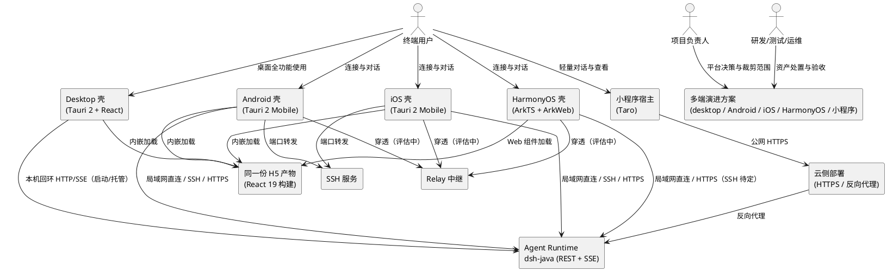

---

# 4. DFX 约束

## 4.1 性能

1. 移动 App 冷启动到"可操作界面"（能发起连接或进入上次会话）的时间，在中端机型上不得超过 2.5 秒。
2. 从点击发送到收到首个流式字节的时间，相对桌面端同网络条件下不得劣化超过 20%；劣化时必须能在诊断信息中区分"网络原因"与"客户端原因"。
3. 会话列表首屏（200 条以内）渲染时间不得超过 800 毫秒，滚动不得出现持续掉帧（低于 45 FPS 超过 1 秒）。
4. 移动端安装包在包含 WebView 资源、不包含 Agent Runtime 的前提下，Android 不得超过 30 MB，iOS 不得超过 45 MB。
5. 移动端前台常驻内存不得超过 300 MB；后台超过 5 分钟必须释放流式连接与解码缓冲。
6. 小程序首包体积必须满足所选平台的主包限制（默认按 2 MB 主包、20 MB 总包校验），超出时必须拆分或裁剪。
7. HarmonyOS 壳冷启动到"H5 首屏可交互"（本地产物、已连接配置可读）的时间，在中端机型上不得超过 3.0 秒；其中 Web 容器创建到首屏渲染不得超过 1.5 秒。
8. HarmonyOS HAP 安装包在包含 H5 资源、不包含 Agent Runtime 的前提下不得超过 40 MB。
9. 同一份 H5 产物在四类宿主的首屏渲染耗时差异，相对桌面端同机型条件下不得劣化超过 50%；超出时必须在诊断信息中标注宿主与内核版本。

## 4.2 可靠性

1. 网络切换（Wi-Fi ↔ 蜂窝）导致的连接中断，必须在 30 秒内自动恢复；恢复失败必须给出"重试 / 切换连接"入口。
2. 流式连接连续 120 秒无任何字节时，必须主动断开并转为对账；对账成功视为本轮完成，不向用户抛错。
3. 重连必须支持按 `afterSeq` 续传，服务端重放缺失区间；客户端不得重复渲染已确认事件。
4. 移动端在离线状态下必须能查看最近一次加载成功的会话列表与消息内容，并明确标注"离线/可能不是最新"。
5. 同一连接配置连续失败 3 次后，必须进入退避状态（1s → 15s 封顶），并允许用户手动立即重试。
6. App 崩溃率（会话维度）不得高于 0.5%；流式期间崩溃必须留下可导出的诊断日志。
7. Web 容器渲染进程异常退出时，宿主必须能重建容器并恢复到中断前的会话，不得停留在白屏；重建失败必须提供"返回连接页/重启应用"入口。
8. 宿主不支持流式读取时，必须自动降级为"请求-对账"模式（按 `afterSeq` 轮询补齐），业务结果不得缺失，界面必须标注"实时性受限"。
9. 宿主进入后台超过 5 分钟时，必须释放流式连接；重新进入前台时必须先对账再允许发送，禁止在未对账状态下续写消息。

## 4.3 安全性

1. 公网连接必须使用 HTTPS；禁止在公网使用明文 HTTP 传输鉴权凭据与对话内容。
2. 客户端必须支持 `X-API-Key` 与 `Authorization: Bearer` 两种凭据形态，并与服务端 `harness.auth.api-keys` 对齐。
3. 设备凭据必须存储在系统安全存储（iOS Keychain / Android Keystore/EncryptedSharedPreferences / HarmonyOS 系统安全存储）；禁止以明文写入普通配置文件、Web 存储或日志。
4. 设备配对码必须一次性有效，默认有效期不超过 10 分钟；配对成功后服务端必须能单独吊销某台设备。
5. 日志与诊断导出必须脱敏：禁止出现 API Key、模型密钥、SSH 私钥、完整配对码、对话正文全文。
6. 移动端禁止默认开放"任意地址 + 任意凭据"的静默连接；用户必须显式确认连接目标（扫码或手动输入）。
7. 近场直连场景下，Agent 的对外监听必须由用户显式开启，且必须启用鉴权；禁止在无鉴权状态下监听非回环地址。
8. 小程序必须遵守平台域名白名单与网络权限约束，禁止绕过平台审核的动态域名下发。
9. HarmonyOS 壳加载的 H5 页面必须运行在受限容器中：禁止开启任意本地文件路径访问（仅允许加载应用自有资源与用户显式选择的文件）；原生桥必须按白名单方法暴露，禁止把通用"执行命令/读取任意路径"能力注入页面。
10. 原生桥调用必须可鉴别来源与版本：页面侧必须携带桥协议版本；壳侧必须拒绝未知版本与未声明方法的调用，并记录审计事件（不含凭据明文）。
11. H5 产物不得在 URL、查询参数、日志或页面全局变量中携带长期凭据；凭据只能经安全存储读取后由适配层注入请求头。
12. 明文 HTTP 仅允许用于回环与用户显式确认的局域网地址；HarmonyOS/iOS 的传输策略必须显式声明，禁止为"图省事"全局放开任意明文域名。

## 4.4 可维护性

1. 多端必须共享同一套协议 SDK 与契约 fixtures；任一端不得私自分叉协议模型。
2. 平台适配层必须以统一接口暴露原生能力；新增端时只允许新增实现，不允许修改业务组件中的端判断分支。
3. 每日构建必须覆盖 desktop、Android、iOS、HarmonyOS、小程序五个目标；任一目标构建失败必须在 1 个工作日内可见。
4. 每个发布版本必须生成"端 × 协议版本 × Agent 最低版本"的兼容矩阵。
5. 关键链路的失败必须可定位：连接、配对、流式、审批、文件能力五类事件必须有独立诊断标识。
6. 新增功能必须同步更新能力裁剪矩阵；矩阵未更新视为需求未完成。
7. 同一份 H5 产物必须带唯一内容标识（内容哈希 + 构建提交 + 构建时间），desktop / Android / iOS / HarmonyOS 四个宿主的构建记录必须能证明使用了同一标识。
8. 平台适配层契约必须单一维护；新增能力时必须同时补充契约条目、各端实现状态与降级说明，禁止只在某一端实现后合入。
9. 诊断信息必须包含宿主类型、壳版本、H5 产物哈希、桥协议版本、Web 容器内核版本五项，缺一视为诊断不可用。

## 4.5 兼容性

1. 客户端与 Agent 的契约版本必须保持向后兼容；`contractVersion` 不一致时，客户端必须给出明确提示并限制不兼容功能，不得静默错误。
2. desktop 与 mobile 必须能在同一 Agent 上同时在线；服务端既有接口语义不得因移动端接入而改变。
3. 移动端最低系统版本：Android 8.0（API 26）及以上、iOS 15.0 及以上；低于下限必须给出明确不支持提示。
4. 小程序必须声明支持的基础库最低版本，并在低版本上提供降级页面。
5. 多端版本发布必须遵循"先服务端兼容、再客户端放量"的顺序；服务端不得依赖某一端的新版本才能工作。
6. 既有 `dsh-java-mobile` 用户的连接配置与本地缓存不得在未提示的情况下被清除；迁移必须提供一次性说明。
7. HarmonyOS 最低支持版本为 HarmonyOS NEXT（API 12 / 5.0.0）及以上；低于下限必须给出明确不支持提示，不得安装后白屏。
8. Android/iOS 采用 Tauri 2 Mobile 的最低系统版本保持 Android 8.0（API 26）与 iOS 15.0；壳升级不得抬高该下限，除非同步更新能力裁剪矩阵与发布说明。
9. 同一份 H5 产物必须兼容四个宿主的 Web 内核基线（Chromium 内核基线 + WKWebView 基线）；引入新 Web 特性时必须提供能力探测与降级路径，不得以"桌面可用"作为唯一验证依据。
10. H5 产物必须支持在非站点根路径下加载（资源引用不得依赖固定域名根路径）；宿主更换加载基址或分发方式时不得要求重新构建业务代码。

---

# 5. 核心能力

## 5.1 多端形态与共享边界

### 5.1.1 业务规则

1. **形态职责必须明确**：desktop 必须保持全功能工作台定位；App（Android / iOS / HarmonyOS 三端独立壳）必须是"可独立完成对话与审批的移动客户端"；小程序必须是"轻量查看与轻交互入口"。
   a. 验收条件：查看能力裁剪矩阵 → 每项功能在 desktop、Android、iOS、HarmonyOS、小程序五个宿主上均有明确的"完全支持/降级/不支持"取值，不存在空值。
2. **共享层必须收敛为四类资产**：业务界面组件、协议 SDK、类型与契约、业务规则与模型；四类资产必须由单一仓库/单一发布单元维护。
   a. 验收条件：检查依赖关系 → 各端引用同一份协议 SDK 与同一份 fixtures，不存在复制粘贴的协议模型。
3. **共享 UI 必须分级**：业务界面必须按"纯展示组件（L0）/带业务语义组件（L1）/页面容器（L2）"分级，L0/L1 必须可直接复用，L2 允许按端重写。
   a. 验收条件：抽查任意业务组件 → 组件归属级别清晰，L2 重写不影响 L0/L1 复用。
4. **差异化能力必须显式声明**：原生能力、布局、离线深度、发布渠道必须按端声明，禁止在共享组件内隐式判断平台。
   a. 验收条件：检索共享组件 → 不存在 `if (platform === ...)` 形式的能力分支，平台差异由适配层注入。
5. **禁止双 UI 栈长期并存**：同一功能不得同时维护 React 与 Kuikly 两套实现并都作为主线。
   a. 验收条件：查看仓库与发布计划 → 每项功能只有一个"主线实现"，另一套明确标注为实验/冻结。
6. **小程序必须复用业务层而非复刻**：小程序的协议调用、数据模型、校验规则必须复用共享 SDK；仅 UI 与平台能力允许重写。
   a. 验收条件：对比小程序与 App 的接口调用代码 → 请求路径、信封处理、事件名完全一致。
7. **平台矩阵必须单一来源**：Android/iOS/HarmonyOS 的技术栈与壳形态必须由本规格"平台决策"章节唯一维护，构建脚本、发布说明与能力矩阵必须与其一致。
   a. 验收条件：抽查任一端构建配置与发布说明 → 技术栈与决策表一致；出现"某端另起 UI 栈"即视为违规。
8. **同一份 H5 产物必须四端共用**：desktop、Android、iOS、HarmonyOS 必须加载同一次构建产出的 React 资源；禁止生成"移动专用"第二份 React 工程或按端打补丁的产物分支。
   a. 验收条件：比对四个宿主内嵌资源的产物哈希 → 完全一致；仓库中不存在第二个承载业务页面的 React 入口工程。

### 5.1.2 交互流程

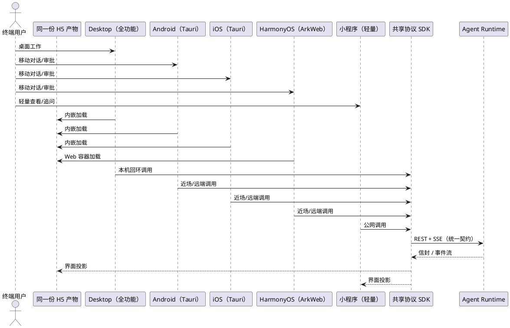

### 5.1.3 异常场景

1. **共享资产版本漂移**
   a. 触发条件：各端引用的协议 SDK 或 fixtures 版本不一致。
   b. 系统行为：构建流水线拒绝产物，标记不兼容；已安装客户端在连接时提示"客户端版本过旧"。
   c. 用户感知："请升级到最新版本"或"当前版本不支持该功能"。
2. **某端能力缺失**
   a. 触发条件：用户在小程序点击"打开本地文件"等不支持能力。
   b. 系统行为：按能力裁剪矩阵执行降级（在线预览/复制链接/提示到 App 操作）。
   c. 用户感知：明确的降级提示，不出现白屏或静默失败。
3. **共享组件被端特逻辑污染**
   a. 触发条件：代码评审发现共享组件内出现平台判断或原生 API 直调。
   b. 系统行为：评审阻断合并，要求下沉到平台适配层。
   c. 用户感知：无直接感知（质量门禁）。

## 5.2 技术路径选型与演进基线

### 5.2.1 业务规则

1. **必须复用 desktop 的 React 业务界面作为 UI 基线**：不得为移动端从零重写一套业务界面；允许为触控与窄屏做布局适配与少量组件替换。
   a. 验收条件：盘点界面资产 → 对话、审批/问答、侧边栏、设置、产物预览等核心界面均能在移动壳中运行，复用率不低于 70%（按组件数计）。
2. **Android/iOS 壳层已固化为 Tauri 2 Mobile**（2026-11-04 决策）：不得再以 Capacitor、React Native 或 KMP/Kuikly 作为这两端的主路径。
   a. 验收条件：查看两端构建配置 → 壳层为 Tauri 2 Mobile，且业务界面与协议层来自同一份 React/TS 资产。
   b. 例外条件：仅当出现阻断性缺陷（无法构建、关键插件缺失、商店审核不接受）时，允许按变更流程申请切换 Capacitor；切换必须由项目负责人批准并更新平台决策章节，业务界面与协议层不得改动。
3. **禁止选择需要重写 UI 的跨端方案作为主路径**：React Native 等需要把 JSX/CSS 重写为另一套组件体系的方案，不得作为主线；仅允许用于"必须原生渲染"的个别页面。
   a. 验收条件：评审架构方案 → 主路径不存在第二套 UI 组件体系。
4. **小程序必须采用能复用 TS 业务层的方案**：优先 Taro（React 语法）；Kuikly 小程序仅可作为过渡或实验，不得与主路径并行维护同一功能。
   a. 验收条件：对比小程序与 App 的业务代码 → 协议调用与模型定义同源，UI 允许独立。
5. **必须提供"最小验证路径"**：在正式壳层落地前，必须允许用系统浏览器/WebView 直接加载 desktop 构建产物并连接 Agent，用于验证协议与界面可用性。
   a. 验收条件：执行验证 → 无需安装 App 即可完成"连接—对话—流式—审批"闭环（允许功能受限）。
6. **必须记录选型对五项指标的影响**：UI 复用率、原生能力、跨端一致性、维护成本、小程序可行性，每项必须给出定性结论与依据。
   a. 验收条件：查看选型记录 → 五项指标均有结论，且与推荐方案一致。
7. **HarmonyOS 壳固定为方案 1**：必须使用 ArkTS/ArkUI 原生壳 + ArkWeb `Web` 组件加载同一份 H5 产物；禁止把 React 页面翻译为 ArkUI 页面，禁止为鸿蒙单独维护一套业务 UI。
   a. 验收条件：检查鸿蒙工程 → 业务页面全部来自 H5 产物；ArkTS 代码仅包含容器、窗口、权限、原生桥与生命周期逻辑。
8. **方案 1 必须通过可行性前置验证**：在进入鸿蒙开发前，必须以最小验证页确认"加载同一份产物 + 连接 Agent + 流式或对账 + 原生桥调用"四件事可用；未通过项必须给出降级方案，不得带未验证假设进入实现。
   a. 验收条件：输出鸿蒙可行性验证记录 → 列明每项能力的"通过/降级/阻断"结论与证据（设备型号、系统版本、容器内核版本）。

**候选路径对比（决策依据）**

| 路径 | 适用平台 | UI 复用率 | 原生能力 | 跨端一致性 | 维护成本 | 小程序可行性 | 结论 |
| --- | --- | --- | --- | --- | --- | --- | --- |
| A. React + Tauri 2 Mobile | Android / iOS | 高（约 80–90%，需适配层与响应式） | 中（移动插件可用，Git/文件需自研或降级） | 很高（同 React/TS 栈） | 低（单一前端栈） | 低（Tauri 不出小程序，需 Taro 另出） | **已决策（主路径）** |
| B. React + Capacitor | Android / iOS | 高（约 85–95%） | 高（相机/文件/通知/安全存储插件成熟） | 高 | 低–中 | 低（同 A，需 Taro） | 仅作为阻断性缺陷时的回退，不属于主路径 |
| C. React + React Native | 全平台 | 低（仅可复用 `lib/` 逻辑，UI 需重写） | 高 | 中（渲染差异明显） | 中–高（双 UI 栈） | 低 | 不推荐 |
| D. 延续 KMP/Kuikly | 全平台 | 0（与 desktop 不同栈） | 高（SSH/Relay/扫码已具备） | 中–高 | 中（但与 desktop 双栈） | 中（Kuikly 小程序 Beta） | 冻结，仅保留原生能力参考 |
| E. React + ArkTS 壳 + ArkWeb | HarmonyOS | 很高（加载同一份 H5，UI 零重写） | 中（取决于原生桥覆盖度） | 很高（同 React/TS 栈与产物） | 低–中（多一个壳要维护桥） | 不适用 | **已决策（方案 1）** |

**推荐结论（2026-11-04 决策后）**：
1. Android / iOS = A（Tauri 2 Mobile + 同一份 React 19 产物 + 复用 TS 协议层），Capacitor 仅在阻断性缺陷时按变更流程回退。
2. HarmonyOS = E（ArkTS 壳 + ArkWeb 加载同一份 H5 产物），仅重写壳层与原生桥，UI 与业务层零重写。
3. 小程序 = Taro 复用协议 SDK 与模型、UI 轻量重写（与 App 属不同交付形态，不属于"双 UI 栈并行"）。
4. Kuikly/KMP 页面栈冻结为实验分支；其 SSH / Relay / 安全存储 / 扫码原生能力作为桥实现的参考资产保留。

### 5.2.2 交互流程

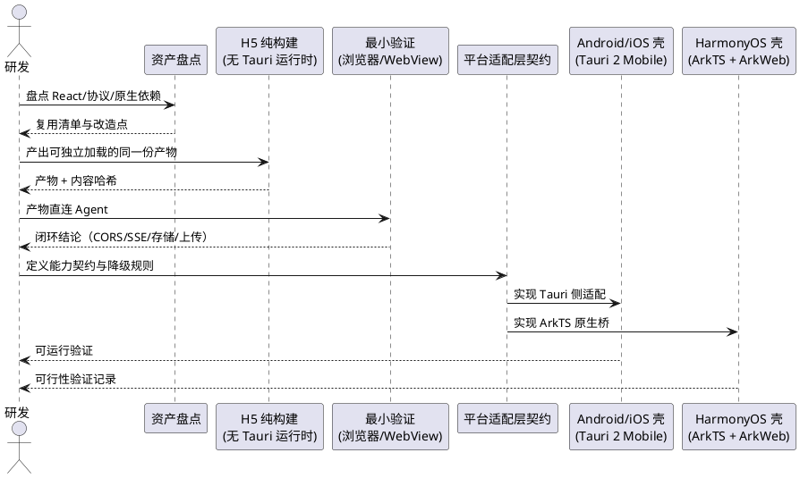

### 5.2.3 异常场景

1. **Tauri Mobile 构建受阻**
   a. 触发条件：Android/iOS 无法完成构建、关键插件缺失或审核不接受。
   b. 系统行为：提交决策变更申请；经批准后按预案切换 Capacitor，业务界面与协议层保持不变，仅替换壳与适配实现。
   c. 用户感知：发布节奏延后，功能范围不变。
2. **最小验证发现协议不兼容**
   a. 触发条件：浏览器/WebView 直连时出现 CORS、混合内容拦截、SSE 挂断、鉴权失败。
   b. 系统行为：记录为协议或容器适配缺陷，进入 P1 修复；不得用"改用原生重写"绕过。
   c. 用户感知：验证结论标注"未通过"及具体阻塞点。
3. **鸿蒙 Web 容器能力缺口**
   a. 触发条件：ArkWeb 对 POST SSE、Blob 下载、`<input type="file">`、自定义 scheme 资源加载中的任一项不支持。
   b. 系统行为：按预置降级路径处理（流式→对账、下载→系统分享/浏览器、上传→原生选择器回传、资源→同源托管），并把结论写入可行性记录。
   c. 用户感知：功能可用但有"实时性受限/需二次确认"的明确提示；阻断项则在发布前拦截。
4. **UI 适配工作量超预期**
   a. 触发条件：窄屏下核心流程不可用（侧边栏挤压、输入框遮挡、长列表卡顿）。
   b. 系统行为：按 L2 页面容器重写，保留 L0/L1 组件；同步更新能力裁剪矩阵。
   c. 用户感知：移动端可用，桌面端不受影响。

## 5.3 Agent 承载点与连接管理

### 5.3.1 业务规则

1. **移动端不得以内嵌 JVM 作为产品方案**：iOS 明确不支持；Android 端侧内嵌仅允许作为受控实验，且不得进入发布包。
   a. 验收条件：检查发布产物 → 不包含 JRE/JAR/Agent Runtime；安装包体积符合 4.1 约束。
2. **必须支持"连接已有 Agent"作为唯一产品路径**：连接目标至少覆盖桌面端托管 Agent、局域网自建 Agent、云侧 Agent 三类。
   a. 验收条件：在三类目标上分别完成"连接—对话—流式—审批"闭环。
3. **必须提供连接配置管理**：用户可以新增、编辑、删除、切换连接配置，并看到每个配置的通道类型、最近连通状态与最后使用时间。
   a. 验收条件：新增两个配置并来回切换 → 会话列表按配置隔离，状态展示正确。
4. **近场连接必须由桌面端显式开启**：桌面端必须提供"允许移动设备连接"的开关，开启后才对外监听；关闭后已连接设备必须在下一次请求时被拒绝。
   a. 验收条件：关闭开关 → 手机发起请求返回未授权/不可达；重新开启并配对后可恢复。
5. **公网连接必须走 HTTPS 且具备设备凭据**：云侧部署必须提供 TLS 入口；客户端禁止在公网配置中接受明文地址。
   a. 验收条件：配置 `http://` 公网地址 → 客户端阻断并提示"公网连接必须使用 HTTPS"。
6. **必须支持 SSH 端口转发作为远端通道**：允许用户通过 SSH 把远端 Agent 端口映射到本机回环后连接。
   a. 验收条件：使用既有 SSH 能力（目标端口可配置）连接远端 Agent → 完成对话闭环。
7. **多端并发必须遵循单写多读**：同一会话允许多端查看；同一时刻只允许一个端提交消息，其他端提交时必须被拒绝或排队并给出提示。
   a. 验收条件：桌面端与手机同时向同一会话发消息 → 仅一方成功，另一方收到"会话正在其他设备运行"提示。
8. **连接状态必须可观测**：客户端必须展示"未连接 / 连接中 / 已连接 / 重连中 / 鉴权失败 / 不可达"六种状态之一，不得只显示转圈。
   a. 验收条件：断开网络 → 状态在 5 秒内变为重连中/不可达，并给出操作入口。
9. **禁止在未配对状态下持久保存凭据**：配对失败、凭据失效时必须清除本地凭据并回到配对流程。
   a. 验收条件：服务端吊销设备 → 客户端下次请求收到 401 后清除凭据并要求重新配对。
10. **Android / iOS / HarmonyOS 连接能力必须一致**：三端必须支持同一批连接通道与配对流程；鸿蒙首版至少支持局域网直连与公网 HTTPS，SSH/Relay 是否可用按 7.2 结论执行。
    a. 验收条件：在鸿蒙与 Android 上分别执行同一配对流程 → 连接配置、状态机、错误提示一致；差异项必须在能力矩阵中标明。
11. **鸿蒙的 SSH/Relay 缺失必须可降级**：当鸿蒙壳未提供 SSH 端口转发或 Relay 通道时，连接页必须隐藏对应入口并给出替代方式（HTTPS / 局域网 / 在桌面端完成）。
    a. 验收条件：在无 SSH 实现的鸿蒙构建中查看连接页 → 不出现不可用入口；选择被隐藏通道时不会产生未处理异常。
12. **连接与凭据能力不得依赖 Web 容器特性**：连接配置、凭据读写、状态机必须由宿主侧（Tauri 命令或 ArkTS 原生桥）提供，H5 层不得把凭据存入 URL、Cookie 或可被页面脚本任意读取的全局变量。
    a. 验收条件：审查鸿蒙与 Tauri 实现 → 凭据仅存在于安全存储，H5 只能获得"引用标识"或按需注入的请求头。

**Agent 承载方案对比（决策依据）**

| 方案 | 可行性 | 说明 | 结论 |
| --- | --- | --- | --- |
| M1 连接桌面端托管 Agent（近场） | 高 | 复用 desktop 已托管的内嵌 Agent；需显式开关、配对与鉴权 | **主路径（个人/小团队）** |
| M2 连接云侧 dsh-java（公网 HTTPS） | 高 | 已有 Docker 部署能力；需 TLS、域名、配额、审计 | **主路径（多人/远程）** |
| M3 连接局域网自建 Agent（NAS/开发机） | 高 | 与 M1 同构，仅连接目标不同 | 支持 |
| M4 Android 端侧内嵌 Agent | 低 | Spring Boot/JVM 在 Android 上需整体改造，包体与稳定性不可接受 | 实验性，不承诺 |
| M5 iOS 端侧内嵌 Agent | 不可行 | 系统禁止启动子进程，无 JVM | 明确不做 |
| M6 浏览器/WebView 打开 Agent Web 控制台 | 中 | 零客户端成本，原生能力弱、离线弱 | 仅作验证，不作为发布形态 |

### 5.3.2 交互流程

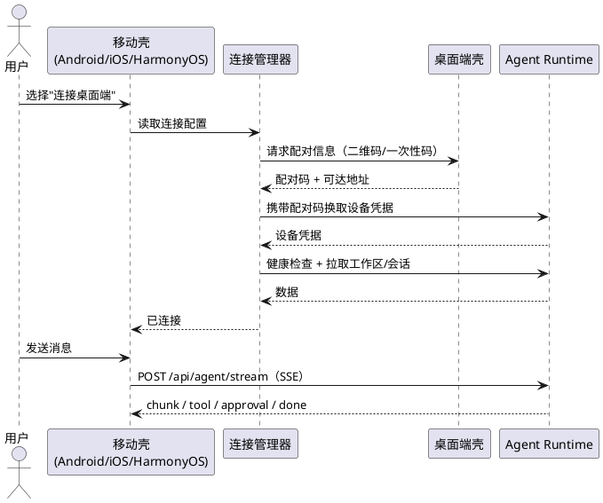

### 5.3.3 异常场景

1. **Agent 不可达**
   a. 触发条件：地址错误、Agent 未启动、网络不通。
   b. 系统行为：5 秒内标记不可达，展示排查建议（检查地址、确认桌面端已开启、检查网络）。
   c. 用户感知："无法连接到智能体服务"及可执行的操作入口。
2. **配对码过期或已使用**
   a. 触发条件：超过有效期或已被其他设备使用。
   b. 系统行为：拒绝配对，清除临时状态，要求重新生成。
   c. 用户感知："配对码已失效，请在桌面端重新生成"。
3. **公网明文地址**
   a. 触发条件：用户输入 `http://` 的公网地址。
   b. 系统行为：阻断保存，提示必须使用 HTTPS 或改用 SSH 隧道。
   c. 用户感知："公网连接必须使用 HTTPS"。
4. **并发写冲突**
   a. 触发条件：两个端同时向同一会话提交。
   b. 系统行为：服务端保持单写；后到方收到冲突响应，客户端转为只读并提示。
   c. 用户感知："该会话正在另一台设备上运行"。
5. **凭据失效**
   a. 触发条件：服务端吊销设备或更换 API Key。
   b. 系统行为：清理本地凭据，回到配对流程，不自动重试。
   c. 用户感知："授权已失效，请重新配对"。
6. **网络切换**
   a. 触发条件：Wi-Fi 与蜂窝切换、进入弱网。
   b. 系统行为：指数退避重连；流式中断转对账；恢复后按 `afterSeq` 续传。
   c. 用户感知：短暂"重连中"提示，恢复后消息不重复、不丢失。
7. **容器阻断明文请求**
   a. 触发条件：H5 页面处于安全上下文，向 `http://` 局域网地址发起请求被混合内容策略拦截。
   b. 系统行为：识别为容器策略问题而非服务不可达；优先切换到宿主提供的原生传输通道，或提示改用 HTTPS/SSH。
   c. 用户感知：不得笼统显示"网络错误"，必须提示"当前环境不允许明文连接，请改用 HTTPS 或检查壳配置"。
8. **容器不支持流式读取**
   a. 触发条件：`fetch` 返回体无法增量读取或读取中断。
   b. 系统行为：转对账模式，并记录容器内核与失败特征。
   c. 用户感知："实时回复不可用，正在按快照同步"。

## 5.4 UI 复用与平台适配层

### 5.4.1 业务规则

1. **业务界面必须可脱离 Tauri 运行时运行**：`dist` 产物在没有任何 `@tauri-apps/*` 可用的环境中必须能启动、渲染并完成连接与对话；所有 Tauri 依赖必须收敛到适配层实现，业务组件禁止直接引用。
   a. 验收条件：用普通浏览器加载 `dist`（不注入任何 Tauri 对象）→ 页面不白屏、不抛未捕获异常，核心界面可交互；检索业务组件 → 不存在直接 import `@tauri-apps/api`、`plugin-http`、`plugin-updater` 的代码。
2. **平台适配层必须按 5.10 的能力契约实现**：至少覆盖网络传输、凭据与安全存储、文件选择与读写、文件导出与分享、外部打开、系统通知、剪贴板、网络状态、应用版本、生命周期与深链、Git（可选）、更新（可选）。
   a. 验收条件：逐项对照 5.10 契约 → 每个能力在 desktop / Android / iOS / HarmonyOS / 小程序上均有"已实现 / 明确降级 / 不支持"状态，不存在未处理调用。
3. **移动端必须做窄屏与触控适配**：核心流程（连接、会话列表、对话、审批/问答、发送）必须在 360px 宽度下可用，触控目标不小于 44×44pt。
   a. 验收条件：在 360×640 视口完成完整对话闭环，无横向滚动、无遮挡、无不可点击元素。
4. **必须处理安全区与键盘**：刘海屏/底部指示条不得遮挡输入区；键盘弹出时输入框必须保持可见。
   a. 验收条件：真机验证输入区不被遮挡，键盘收起后布局回正。
5. **必须支持深色模式与系统字体缩放**（至少不破版）。
   a. 验收条件：切换系统深色/放大字体 → 核心页面可读、无重叠。
6. **必须保留桌面端原有交互**：适配层改造不得改变桌面端快捷键、右键菜单、拖拽、窗口行为。
   a. 验收条件：desktop 回归用例全部通过。
7. **必须提供统一的错误与加载态**：适配层调用失败必须转为业务可理解的提示，禁止把原生异常直接抛给界面。
   a. 验收条件：模拟文件不存在/无权限/用户取消 → 界面给出对应提示，不出现堆栈。
8. **适配层必须支持能力探测**：每个能力必须可返回"已实现/不支持/未授权"三态，业务层据此决定入口展示与降级路径，禁止靠 try/catch 猜测。
   a. 验收条件：在缺少 SSH 的鸿蒙构建、无通知权限的设备、无剪贴板的容器中分别探测 → 返回状态正确，界面入口同步变化。
9. **鸿蒙必须通过原生桥实现同一契约**：H5 层不得出现 `if (isHarmonyOS)` 之类的端判断；鸿蒙差异只能由壳注入的桥实现与能力探测结果体现。
   a. 验收条件：检索 H5 产物源码 → 无 HarmonyOS/ArkWeb 相关端判断分支；移除鸿蒙桥后，页面按"不支持"降级而非崩溃。

### 5.4.2 交互流程

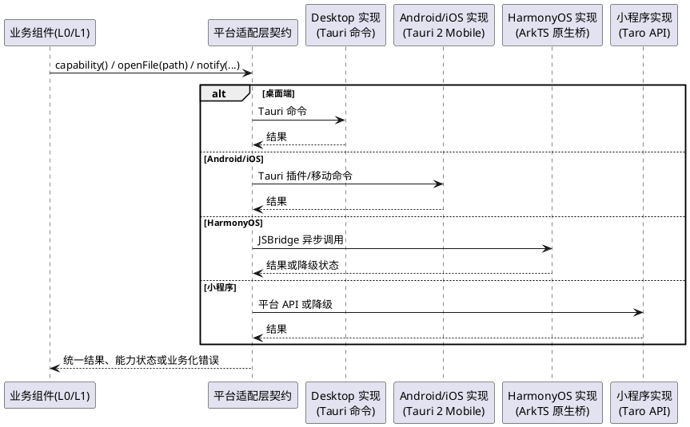

### 5.4.3 异常场景

1. **原生能力不可用**
   a. 触发条件：目标端无对应插件或权限被拒。
   b. 系统行为：返回"不支持/未授权"结构化结果，界面展示降级入口。
   c. 用户感知："当前设备不支持该操作，可在桌面端完成"。
2. **用户取消**
   a. 触发条件：文件选择/分享面板被取消。
   b. 系统行为：按"取消"处理，不记为错误、不弹错误提示。
   c. 用户感知：无打扰返回。
3. **路径不可访问**
   a. 触发条件：移动端沙箱无法访问桌面端本地路径。
   b. 系统行为：识别为跨端路径不可用，改为服务端产物下载/预览。
   c. 用户感知："该文件位于桌面端，已为你打开在线预览"。
4. **适配层遗漏**
   a. 触发条件：业务组件直接调用原生 API。
   b. 系统行为：构建期静态检查失败，阻断合并。
   c. 用户感知：无（质量门禁）。
5. **原生桥未注入或版本不匹配**
   a. 触发条件：H5 先于桥加载完成，或页面要求的桥协议版本高于壳实现。
   b. 系统行为：适配层返回"桥不可用/版本不兼容"结构化状态，核心页面进入只读或降级模式；不得反复重试导致卡死。
   c. 用户感知："部分功能暂不可用，请升级应用"或"正在初始化"。
6. **能力探测与实际调用不一致**
   a. 触发条件：探测报告支持，但真实调用因权限、系统策略或用户设置失败。
   b. 系统行为：以真实调用结果为准，回写能力状态并触发降级；记录诊断事件。
   c. 用户感知：按失败类型给出"去授权/改用其他方式/在桌面端完成"的入口。

## 5.5 协议复用与客户端 SDK

### 5.5.1 业务规则

1. **协议 SDK 必须以"连接"而非"端口"为输入**：所有接口调用必须接受统一连接对象（地址 + 凭据 + 通道类型），不得硬编码 `127.0.0.1:<port>`。
   a. 验收条件：检索客户端代码 → 不存在以裸端口作为业务参数的公开函数。
2. **必须复用既有 REST 与 SSE 契约**：路径、信封、事件名、`seq` 语义必须与 `contractVersion = 1` 一致。
   a. 验收条件：契约测试通过；事件名集合与 fixtures 完全一致。
3. **必须实现流式稳定性防护**：连接超时、空闲看门狗（120s）、主动取消、对账（5s 轮询）、指数退避（1s→15s）。
   a. 验收条件：模拟服务端静默 → 120s 后转对账，消息最终与服务端一致。
4. **必须实现事件去重与顺序保证**：同一会话内按 `seq` 单调应用，重复事件丢弃，缺口触发补拉。
   a. 验收条件：注入重复与乱序事件 → 界面不重复、不回退。
5. **必须统一错误模型**：将 HTTP 状态、信封 `code/info`、网络异常、鉴权失败映射为固定错误类型，供各端共用。
   a. 验收条件：构造 401/403/404/500/超时/断网 → 每类错误有稳定的类型与用户提示。
6. **必须支持能力探测**：客户端连接后必须能识别服务端版本与可用能力，按能力启用/隐藏界面入口。
   a. 验收条件：连接旧版服务端 → 不支持的功能入口隐藏或置灰并说明原因。
7. **禁止在客户端复制服务端业务规则**：会话状态流转、审批策略、工具执行规则必须由服务端决定，客户端只做投影。
   a. 验收条件：审查客户端逻辑 → 不存在自行判定"审批是否通过""任务是否完成"的规则。
8. **网络传输必须可注入**：协议 SDK 只能依赖"传输接口"（执行请求、读取流、取消请求），由宿主注入具体实现；H5 纯构建不得静态依赖 Tauri 的 HTTP 插件。
   a. 验收条件：在浏览器（原生 `fetch`）、Tauri（原生或插件通道）、鸿蒙（`fetch` 或原生桥）三种注入下，同一业务用例通过；检索协议层 → 不存在绕过传输接口的裸 `fetch` 调用。
9. **流式能力必须可探测并可降级**：SDK 必须能识别当前宿主是否支持增量读取；不支持时切换为对账模式，且不改变事件应用与去重逻辑。
   a. 验收条件：强制关闭增量读取 → 会话仍能完整显示回复，事件不重复、顺序正确。
10. **请求地址必须来自连接对象**：协议层不得内置回环地址或端口，不得依据宿主类型拼接不同地址。
   a. 验收条件：检索协议层 → 无 `127.0.0.1`、`localhost`、`8090` 等硬编码；同一连接对象在四端产生相同请求路径。

### 5.5.2 交互流程

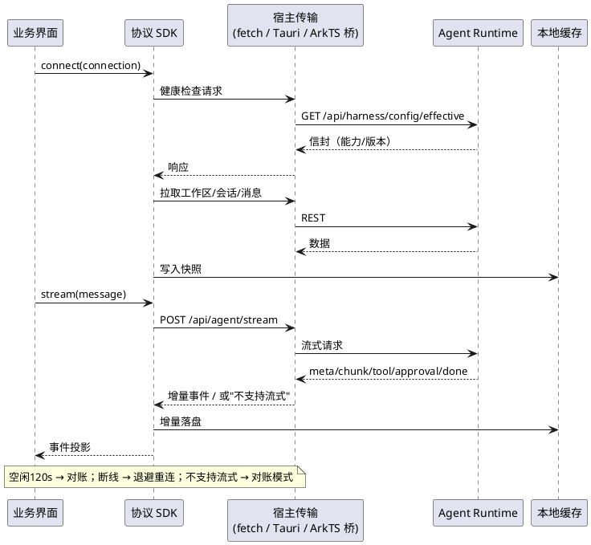

### 5.5.3 异常场景

1. **SSE 连接挂起**
   a. 触发条件：请求已发出但响应体不返回（WebView/代理常见）。
   b. 系统行为：15 秒连接超时；已建立后 120 秒无字节触发空闲中断；随后对账。
   c. 用户感知："网络不稳，正在恢复"，恢复后消息补齐。
2. **信封错误**
   a. 触发条件：服务端返回 `code != "00000"`。
   b. 系统行为：按错误模型转换，保留 `info` 作为可展示原因，记录诊断上下文。
   c. 用户感知：业务化错误提示，不出现原始 JSON。
3. **鉴权失败**
   a. 触发条件：401/403。
   b. 系统行为：停止自动重试，清理凭据，跳转配对/设置。
   c. 用户感知："授权失效，请重新连接"。
4. **契约版本不匹配**
   a. 触发条件：客户端与服务端 `contractVersion` 不一致。
   b. 系统行为：限制不兼容功能，展示版本说明与升级建议。
   c. 用户感知："客户端与服务端版本不兼容"。
5. **事件缺口**
   a. 触发条件：`seq` 跳号。
   b. 系统行为：暂停投影，按 `afterSeq` 补拉，补齐后继续。
   c. 用户感知：短暂加载提示，最终内容完整。
6. **宿主不支持增量读取**
   a. 触发条件：容器内核或桥实现无法提供流式响应体（鸿蒙 Web 容器实测不支持 POST SSE 等）。
   b. 系统行为：自动切换对账模式，禁止重试同一流式请求多次；诊断中记录"流式不可用"。
   c. 用户感知："实时回复不可用，正在同步结果"，最终内容完整。
7. **容器拦截跨源或混合内容**
   a. 触发条件：页面安全上下文与 Agent 地址不同源，或 HTTPS 页面请求 HTTP 地址。
   b. 系统行为：优先切换宿主原生传输；否则提示使用同源托管或 HTTPS，并记录容器策略错误码。
   c. 用户感知：可执行的配置建议，而非"网络错误"。

## 5.6 鉴权与设备配对

### 5.6.1 业务规则

1. **必须提供设备配对入口**：桌面端必须能生成一次性配对信息（二维码/短码），移动端必须能扫码或输入短码完成配对。
   a. 验收条件：从生成到配对成功不超过 60 秒；配对成功后设备出现在"已授权设备"列表。
2. **配对必须绑定设备身份**：每台设备必须有稳定标识，服务端可单独吊销，不影响其他设备。
   a. 验收条件：吊销设备 A → 设备 B 仍可正常使用。
3. **凭据必须可轮换**：服务端更换 API Key 后，已配对设备必须能通过重新配对或刷新机制恢复，不得要求重装应用。
   a. 验收条件：轮换 Key 后执行刷新 → 连接恢复。
4. **必须展示授权状态**：设置页必须列出已连接设备、最后活跃时间与吊销入口。
   a. 验收条件：查看列表 → 信息完整，吊销操作有二次确认。
5. **小程序鉴权必须遵守平台约束**：登录态由平台提供，Agent 凭据不得暴露在小程序前端可读的全局变量中。
   a. 验收条件：审查小程序存储 → 不含长期有效的 Agent 主凭据，使用短期令牌或服务端代理。
6. **禁止共享主凭据**：多设备不得共用同一个长期主 Key；必须为每台设备签发独立凭据。
   a. 验收条件：检查配对记录 → 每设备凭据唯一，可独立吊销。
7. **各端必须使用系统安全存储**：Android 使用 Keystore/加密存储，iOS 使用 Keychain，HarmonyOS 使用系统安全存储能力；禁止使用普通 preferences、WebView localStorage 或明文文件保存长期凭据。
   a. 验收条件：检查设备文件系统与容器存储 → 找不到可读的长期凭据明文；卸载重装后旧凭据不可恢复。
8. **扫码配对必须在鸿蒙可用**：鸿蒙壳必须提供扫码或手动输入两条配对路径；扫码权限被拒时必须仍能手动输入。
   a. 验收条件：拒绝相机权限 → 手动输入路径可用并完成配对。

### 5.6.2 交互流程

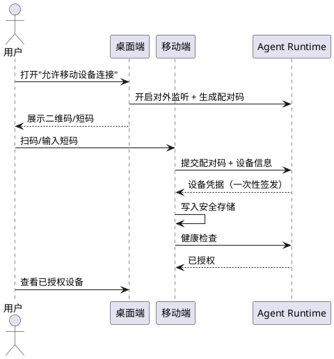

### 5.6.3 异常场景

1. **配对码暴力尝试**
   a. 触发条件：短时间大量错误配对请求。
   b. 系统行为：限流并临时失效当前配对码，记录审计事件。
   c. 用户感知："尝试过于频繁，请重新生成配对码"。
2. **设备丢失**
   a. 触发条件：用户在桌面端吊销设备。
   b. 系统行为：吊销立即生效；设备下次请求返回 401 并清理本地凭据。
   c. 用户感知："该设备已被移除授权"。
3. **安全存储不可用**
   a. 触发条件：系统密钥库异常或用户关闭生物识别。
   b. 系统行为：拒绝保存长期凭据，退回"每次连接输入"或引导修复。
   c. 用户感知："无法安全保存凭据，请检查系统设置"。
4. **跨端时钟偏差**
   a. 触发条件：配对码/令牌校验依赖时间，设备时钟偏差过大。
   b. 系统行为：返回明确的"时间不同步"错误，而非笼统的无效。
   c. 用户感知："请校准设备时间后重试"。

## 5.7 小程序适配与能力裁剪

### 5.7.1 业务规则

1. **小程序必须声明功能范围**：至少覆盖"查看会话列表、查看消息、发送文本消息、查看流式回复、处理审批/问答（简版）"；文件系统、Git、插件管理、数字人编排默认不支持。
   a. 验收条件：对照能力矩阵逐项验证，超出范围的功能入口不出现。
2. **小程序必须复用协议 SDK 与模型**：不得为小程序另写一套请求封装。
   a. 验收条件：请求路径、信封处理、事件解析与 App 完全一致。
3. **必须处理平台网络限制**：所有请求域名必须在小程序后台白名单内；禁止运行时下发未知域名。
   a. 验收条件：真机预览 → 无"域名不在白名单"错误。
4. **必须使用平台登录态**：用户身份由平台登录提供，Agent 侧通过短期令牌或服务端代理鉴权。
   a. 验收条件：未登录时引导登录；登录后自动恢复连接。
5. **必须支持订阅消息**：长任务完成/审批待处理时，允许用户订阅通知。
   a. 验收条件：触发完成事件 → 用户收到订阅消息（已授权前提下）。
6. **包体必须满足平台限制**：主包与总包体积必须在上限内；超出时必须拆分或裁剪非核心页面。
   a. 验收条件：构建产物体积检查通过。
7. **必须提供"在 App 中打开"引导**：需要原生能力的操作，必须提供跳转 App 的明确入口。
   a. 验收条件：点击受限能力 → 展示引导，不出现功能不可用的死路。

### 5.7.2 交互流程

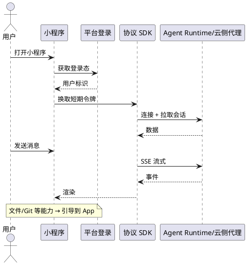

### 5.7.3 异常场景

1. **平台限制导致能力不可用**
   a. 触发条件：涉及本地文件、后台长连接等平台禁止能力。
   b. 系统行为：隐藏入口或提供 App 引导。
   c. 用户感知：明确的替代路径。
2. **登录态失效**
   a. 触发条件：平台会话过期。
   b. 系统行为：暂停请求，重新登录后恢复；不丢失已输入草稿。
   c. 用户感知："请重新登录"。
3. **域名白名单缺失**
   a. 触发条件：新增 Agent 域名未配置。
   b. 系统行为：请求失败并记录明确诊断；阻断发布。
   c. 用户感知："服务暂不可用"。
4. **包体超限**
   a. 触发条件：主包/总包超过平台阈值。
   b. 系统行为：构建失败，要求拆分或裁剪。
   c. 用户感知：无（发布阻断）。

## 5.8 发布与版本联动

### 5.8.1 业务规则

1. **必须建立多端版本矩阵**：desktop、Android、iOS、HarmonyOS、Agent（dsh-java）的兼容关系必须显式维护，至少覆盖"当前版 / 前一版 / 最低支持版"；小程序单独维护基础库与契约兼容范围。
   a. 验收条件：任一新版本发布 → 矩阵更新，兼容组合可查。
2. **必须遵循"服务端先行"**：协议扩展必须先由服务端提供向后兼容能力，客户端再放量；禁止客户端先依赖未上线的服务端能力。
   a. 验收条件：发布记录 → 服务端上线时间早于客户端放量时间。
3. **必须支持灰度与回滚**：移动端必须能通过远程配置关闭问题功能；desktop 必须保留自动更新与回滚路径。
   a. 验收条件：关闭某功能开关 → 各端入口同步隐藏；重新开启后恢复。
4. **必须提供诊断与反馈入口**：用户可一键导出诊断信息（脱敏），包含连接类型、版本、错误码、最后 N 条事件类型（不含正文）。
   a. 验收条件：导出文件可读、无敏感信息、足以定位连接/流式问题。
5. **发布说明必须标注能力变化**：新增/降级/移除的功能必须在发布说明中逐项列出。
   a. 验收条件：抽查发布说明 → 与能力裁剪矩阵一致。
6. **禁止静默强制升级**：不得在用户不知情时阻断旧版本；旧版本必须能继续使用兼容功能，并收到升级提示。
   a. 验收条件：使用旧版本连接新服务端 → 核心对话可用，不兼容功能有提示。
7. **H5 产物哈希必须进入发布记录**：每个宿主版本必须记录其内嵌或加载的产物哈希，发布前必须校验四个宿主一致（允许壳版本不同，不允许产物不同）。
   a. 验收条件：读取四个宿主的发布元数据 → 产物哈希一致；不一致时发布流水线阻断。
8. **壳与 H5 必须版本解耦且互相声明兼容范围**：壳必须声明其支持的产物版本区间与桥协议版本；产物必须声明其要求的最低桥协议版本。
   a. 验收条件：用旧壳加载新产物 → 页面给出"请升级应用"或进入兼容模式，不白屏、不静默错乱。
9. **HarmonyOS 发布必须完成专项回归**：上架前必须验证 Web 容器加载、原生桥、安全存储、通知/分享、文件选择、前后台切换与异常恢复；未通过项必须在发布说明中列为已知限制。
   a. 验收条件：鸿蒙发布检查单全部有结论（通过/已知限制/阻断），阻断项为 0。

### 5.8.2 交互流程

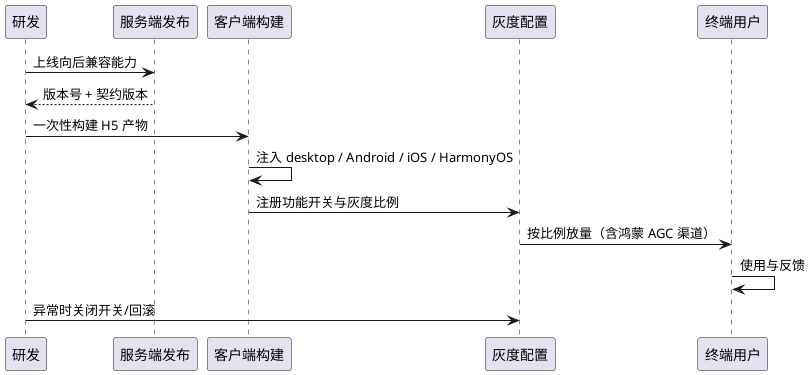

### 5.8.3 异常场景

1. **版本矩阵失配**
   a. 触发条件：客户端版本高于服务端支持范围。
   b. 系统行为：限制新功能，保留核心对话，提示升级服务端或降级客户端。
   c. 用户感知："部分功能不可用，请联系管理员升级服务"。
2. **灰度功能异常**
   a. 触发条件：开关打开后错误率超阈值。
   b. 系统行为：自动或手动关闭开关，回滚到旧路径。
   c. 用户感知：功能恢复原状，无数据丢失。
3. **强制升级争议**
   a. 触发条件：安全漏洞需要强制升级。
   b. 系统行为：仅对受影响的旧版本阻断高风险操作，其余功能可用；展示明确原因。
   c. 用户感知："为保障安全，请升级后继续使用该功能"。
4. **诊断信息泄露**
   a. 触发条件：导出内容包含敏感字段。
   b. 系统行为：导出前执行脱敏检查，命中即阻断并记录。
   c. 用户感知："导出失败，请稍后重试或联系支持"。
5. **四端产物不一致**
   a. 触发条件：某宿主内嵌了旧产物或另建分支产物。
   b. 系统行为：发布流水线比对哈希失败，阻断发布；已发布端在诊断中标注"产物不一致"。
   c. 用户感知：无直接感知（发布阻断）；若已上线，则按功能异常处理并回滚该端。
6. **壳与 H5 版本错配**
   a. 触发条件：壳版本过旧、桥协议不满足产物要求。
   b. 系统行为：产物进入兼容模式或只读模式，禁用依赖新桥的能力；上报诊断事件。
   c. 用户感知："部分功能暂不可用，请升级应用"。
7. **鸿蒙上架审核不通过**
   a. 触发条件：审核认为壳内远程内容或权限声明不合规。
   b. 系统行为：按审核意见关闭或调整对应能力（如改为在线预览、去除敏感权限），并更新能力矩阵；不得以隐藏功能绕过审核。
   c. 用户感知：对应功能降级，其余功能不受影响。

## 5.9 同一份 H5 产物的单一事实源

### 5.9.1 业务规则

1. **必须一次构建、四处消费**：H5 产物必须由 `dsh-java-desktop` 的 React 工程在发布流水线中构建一次，分别内嵌到 desktop、Android、iOS、HarmonyOS 的安装包；禁止为任一端单独执行"移动端构建"或维护独立分支产物。
   a. 验收条件：对比四个宿主内嵌资源的内容哈希 → 完全一致；构建日志显示只有一次前端构建任务。
2. **产物清单必须固定且可审计**：产物至少包含入口 HTML、脚本、样式、字体与图标、静态图片；必须排除 sourcemap、测试夹具、开发期调试开关与任何本地绝对路径。
   a. 验收条件：解包检查 → 清单与预期一致，无 `.map`、无 `/Users/...` 类路径、无测试数据。
3. **产物必须与加载基址无关**：所有资源引用必须支持相对路径加载；在"应用私有资源目录""自定义 scheme""Agent 同源托管"三种基址下均可正确加载入口、脚本、样式与图标。
   a. 验收条件：分别以三种基址加载 → 页面完整渲染，控制台无 404；不得要求产物部署在域名根路径。
4. **产物必须能在无 Tauri 运行时启动**：当页面环境不存在任何 Tauri 对象时，适配层必须落到"Web 降级实现"，页面不得白屏、不得抛未捕获异常。
   a. 验收条件：普通浏览器打开产物 → 首屏可用；控制台无 "invoke is not a function" 类错误。
5. **禁止任何形式的 UI 分叉**：不得新建第二个承载业务页面的 React 工程，不得用构建变量把同一页面编译成两套互不兼容的版本，不得按端复制组件。
   a. 验收条件：仓库扫描 → 仅一个业务前端入口；组件目录中不存在 `xxx.mobile.tsx` 之类的端专属副本（布局适配样式除外）。
6. **端差异只能运行时注入**：平台差异必须通过"能力探测 + 适配实现 + 布局/主题变量"表达，禁止在业务组件内做端类型判断或条件编译。
   a. 验收条件：随机抽查 10 个业务组件 → 无宿主类型判断；移除任一端的适配实现后，页面按能力缺失降级。
7. **产物必须自描述版本**：产物必须携带内容哈希、构建时间、源码提交标识与契约版本，并可在"关于/诊断"页读取。
   a. 验收条件：查看诊断页 → 四项齐全，且与发布记录一致。
8. **产物必须可离线加载**：入口与首屏关键资源必须来自本地包内，不得依赖 CDN 或远程脚本；离线启动不得白屏。
   a. 验收条件：断网冷启动 → 首屏可渲染并展示"离线/未连接"状态。
9. **产物不得动态加载远程可执行代码**：禁止 `eval`、远程脚本注入、远程热更新补丁；升级只能整包替换。
   a. 验收条件：静态扫描与运行时网络监控 → 无远程脚本请求、无动态代码执行。
10. **存储访问必须经适配层**：页面不得直接假设 `localStorage` 永久可用；会话草稿、界面偏好等本地状态必须通过适配层封装的存储能力读写，并在不可用时退化为内存态。
    a. 验收条件：禁用 Web 存储后启动 → 页面可用，仅提示"本地记录不可保存"，不崩溃。
11. **产物体积必须受控**：首屏关键资源（入口 HTML + 首屏 JS/CSS）压缩后不得超过 1 MB；完整产物压缩后不得超过 4 MB；超出必须拆分或裁剪并记录。
    a. 验收条件：构建产物报告 → 两项阈值均满足，超出即构建失败。
12. **产物分发模式必须可切换且不改变内容**：默认内嵌到各端安装包；允许额外由 Agent 以同源方式托管同一份产物用于浏览器验证或鸿蒙同源加载，两种模式的产物必须完全一致。
    a. 验收条件：对比内嵌产物与托管产物哈希 → 一致；切换分发模式不需要改业务代码。

### 5.9.2 交互流程

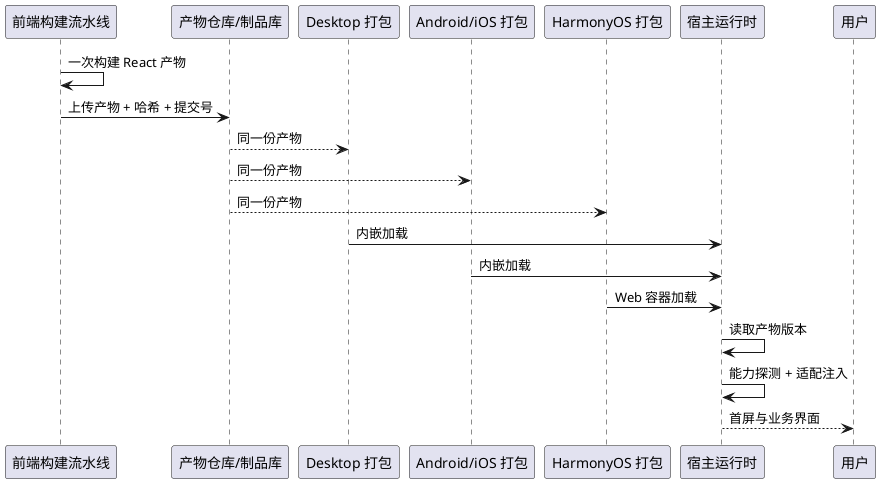

### 5.9.3 异常场景

1. **产物加载失败**
   a. 触发条件：资源缺失、哈希不匹配、加载基址配置错误。
   b. 系统行为：宿主展示内置错误页，提供"重试加载 / 打开诊断 / 回退到连接页"；不得停留在空白页。
   c. 用户感知："界面加载失败"及可操作入口。
2. **无 Tauri 运行时**
   a. 触发条件：在普通浏览器或鸿蒙容器中加载产物。
   b. 系统行为：适配层切换到 Web/原生桥实现；不可用能力返回 `UNSUPPORTED`。
   c. 用户感知：核心对话可用，受限能力有明确说明。
3. **本地存储不可用**
   a. 触发条件：容器禁用 DOM 存储、存储配额耗尽、隐私模式。
   b. 系统行为：界面偏好与会话草稿退化为内存态；会话数据仍以服务端为准。
   c. 用户感知："本地记录不可保存，不影响对话"。
4. **产物版本不一致**
   a. 触发条件：某端使用了旧产物或另建产物。
   b. 系统行为：发布阻断；已发布端在诊断中标记，按功能异常回滚该端。
   c. 用户感知：若已上线则表现为功能差异，需通过升级修复。
5. **体积超预算**
   a. 触发条件：新增依赖导致产物超过阈值。
   b. 系统行为：构建失败，要求拆分、按需加载或替换依赖。
   c. 用户感知：无（发布阻断）。

## 5.10 平台适配层能力契约

### 5.10.1 业务规则

1. **契约必须是业务层访问原生能力的唯一入口**：业务组件与协议层只能调用契约方法，禁止直接引用 Tauri API、ArkTS 桥对象、Taro API 或浏览器专有 API。
   a. 验收条件：静态检查 → 业务目录不存在平台原生 API 引用；违规即阻断合并。
2. **契约必须以能力为单位、与端无关**：同一能力在五类宿主上使用同一方法语义与同一返回结构；端差异只能体现在实现状态与降级说明。
   a. 验收条件：对照附录 D → 每个能力项均有唯一标识、输入语义、返回状态与各端实现状态。
3. **统一返回模型**：每个能力必须返回以下状态之一：`OK`（成功，带结果）、`UNSUPPORTED`（该宿主不提供）、`DENIED`（权限被拒）、`CANCELLED`（用户取消）、`FAILED`（执行失败，带可展示原因与诊断码）。
   a. 验收条件：构造五类结果 → 界面分别给出正确表现；`CANCELLED` 不得弹错误提示。
4. **所有原生调用必须异步、可超时、可取消**：默认超时 15 秒；文件选择、网络请求、分享等长操作必须支持取消；超时与取消必须可区分。
   a. 验收条件：模拟无响应 → 15 秒返回 `FAILED`（超时）；用户取消 → 返回 `CANCELLED`。
5. **必须提供能力探测**：契约必须暴露"当前宿主能力表"，包含能力标识、状态（`AVAILABLE` / `DEGRADED` / `UNAVAILABLE`）、桥协议版本与宿主标识。
   a. 验收条件：在五类宿主（desktop / Android / iOS / HarmonyOS / 小程序）分别读取能力表 → 与实际调用结果一致；H5 页面据此渲染入口。
6. **桥协议必须版本化并双向校验**：页面在调用前必须声明其要求的桥协议版本；壳必须拒绝低于/高于支持范围的调用并返回明确状态。
   a. 验收条件：用不兼容版本调用 → 返回 `UNSUPPORTED`（含版本诊断），页面进入兼容模式。
7. **凭据能力必须最小暴露**：契约只允许"保存 / 读取引用 / 删除 / 存在性检查 / 以引用发起请求"；读取到的明文只允许在内存中用于当次请求，禁止写入日志、URL、Web 存储或诊断导出。
   a. 验收条件：审查实现与日志 → 无凭据明文落盘；诊断导出不含凭据。
8. **文件能力必须使用"宿主令牌"而非跨端路径**：移动端不得承诺可访问桌面端绝对路径；路径类输入必须由宿主签发令牌或返回 `UNSUPPORTED`；跨端文件访问必须转为服务端产物下载/预览。
   a. 验收条件：把桌面路径传给移动端 → 返回 `UNSUPPORTED` 并触发在线预览降级。
9. **文件选择与导出必须成对可用**：提供"选择文件/目录""导出到用户可见位置""系统分享"三类能力；任一端缺失时必须提供替代路径（分享、下载链接、在线预览）。
   a. 验收条件：在鸿蒙与 Android 上分别执行"选择文件→上传"和"导出→分享"→ 均完成或给出明确降级。
10. **通知能力必须遵守权限与前台策略**：通知发送前必须检查权限；被拒时不得反复请求，必须引导到系统设置；前台可见时不得重复打扰。
    a. 验收条件：拒绝通知权限 → 不再弹系统弹窗，界面提供"去设置"入口。
11. **生命周期与网络状态必须可订阅**：契约必须提供前台/后台、网络可用性、网络类型变化的事件订阅与取消订阅；事件必须去重且顺序稳定。
    a. 验收条件：切换前后台/断网重连 → 业务层收到一次对应事件，无重复风暴。
12. **深链必须安全**：深链只允许携带"连接目标标识/配对码引用"等非敏感参数；禁止携带长期凭据；非法参数必须被拒绝并提示。
    a. 验收条件：构造含凭据的深链 → 被拒绝且记录审计；合法深链可直达连接页。
13. **可选能力不得阻断主流程**：Git、自动更新、剪贴板读取等可选能力不可用时，核心流程（连接、对话、流式、审批）必须仍可用。
    a. 验收条件：关闭全部可选能力 → 主流程闭环通过。
14. **契约变更必须同步矩阵**：新增/修改能力必须同步更新附录 D 与能力裁剪矩阵，并标注各端实现状态；未同步视为需求未完成。
    a. 验收条件：抽查最近一次能力变更 → 契约、矩阵、发布说明三处一致。

**能力分组（能力级契约，详细矩阵见附录 D）**

| 能力组 | 能力项 | 语义要点 | 桌面 | Android | iOS | HarmonyOS | 小程序 |
| --- | --- | --- | --- | --- | --- | --- | --- |
| 传输 | `transport.request` / `transport.stream` / `transport.cancel` | 执行 REST/流式请求，支持超时、取消、鉴权头注入 | 原生传输 + 回退通道 | 原生/插件 | 原生/插件 | fetch 或原生桥 | 平台请求 |
| 凭据 | `credential.save` / `read` / `delete` / `exists` | 安全存储中的引用式凭据 | 系统凭据库 | Keystore | Keychain | 系统安全存储 | 平台短期令牌 |
| 文件 | `file.pick` / `readText` / `readBinary` / `writeText` / `stat` / `listDir` | 宿主令牌或受限路径；目录能力按端降级 | 完整 | 选择器 + 沙箱 | 选择器 + 沙箱 | 选择器 + 沙箱 | 不支持/在线预览 |
| 导出分享 | `file.export` / `share.open` | 保存到用户可见位置或调用系统分享 | 另存为 | SAF/分享 | 文件 App/分享 | 系统分享/文件 | 不支持 |
| 外部打开 | `external.openUrl` / `openFile` / `reveal` | 打开链接/文件/定位文件 | 完整 | 链接+文件 | 链接+文件 | 链接+文件 | 链接（受限） |
| 通知 | `notify.send` / `notify.permission` | 权限检查与本地通知 | 完整 | 完整 | 完整 | 完整 | 订阅消息 |
| 剪贴板 | `clipboard.write` / `read` | 文本读写 | 完整 | 完整 | 完整 | 完整 | 平台 API |
| 网络状态 | `net.status` / `net.onChange` | 可用性与类型变化 | 完整 | 完整 | 完整 | 完整 | 平台 API |
| 应用信息 | `app.version` / `update.check` | 壳版本与更新检查 | 完整 | 商店更新 | 商店更新 | 应用市场更新 | 不适用 |
| 生命周期 | `lifecycle.onForeground` / `onBackground` | 前后台事件 | 窗口事件 | 应用事件 | 应用事件 | Ability 事件 | 平台事件 |
| 深链 | `deeplink.onOpen` / `deeplink.parse` | 安全参数解析与路由 | 完整 | 完整 | 完整 | 完整 | 场景值 |
| Git | `git.branch` / `branches` / `switch` / `changes` / `diff` | 工作区版本信息 | 完整 | 不支持 | 不支持 | 不支持 | 不支持 |
| 诊断 | `diagnostics.export` | 脱敏诊断包导出 | 完整 | 完整 | 完整 | 完整 | 受限 |

### 5.10.2 交互流程

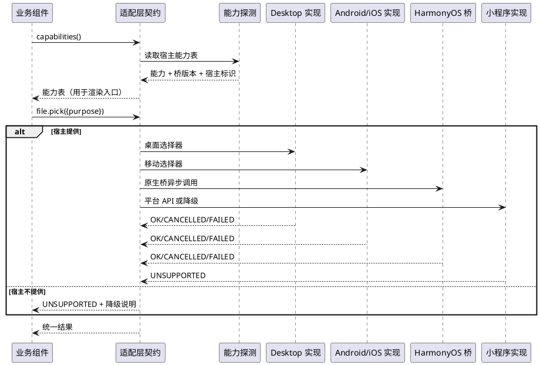

### 5.10.3 异常场景

1. **能力不支持**
   a. 触发条件：宿主未实现某能力。
   b. 系统行为：返回 `UNSUPPORTED` 与降级说明；界面隐藏入口或替换为替代方式。
   c. 用户感知："当前设备不支持，可在桌面端完成"。
2. **权限被拒**
   a. 触发条件：相机、通知、存储等权限被用户拒绝。
   b. 系统行为：返回 `DENIED`，不重复弹窗；提供"去设置"入口与手动替代路径。
   c. 用户感知："未获得权限，可手动输入/稍后开启"。
3. **调用超时**
   a. 触发条件：原生实现无响应或系统服务卡死。
   b. 系统行为：15 秒返回 `FAILED`（超时诊断码）；释放等待状态，避免重复点击累积。
   c. 用户感知："操作超时，请重试"。
4. **用户取消**
   a. 触发条件：文件选择/分享面板被取消。
   b. 系统行为：返回 `CANCELLED`，不记错误、不弹提示。
   c. 用户感知：无打扰返回。
5. **桥版本不匹配**
   a. 触发条件：页面要求版本高于壳支持。
   b. 系统行为：返回 `UNSUPPORTED`，禁用依赖新能力的入口；上报诊断。
   c. 用户感知："请升级应用以使用该功能"。
6. **返回数据超限**
   a. 触发条件：读取大文件/大图片导致内存或桥传输超限。
   b. 系统行为：拒绝一次性传输，改用分块/流式/宿主内预览；返回 `FAILED` 并说明。
   c. 用户感知："文件过大，已改为在线预览/分享"。

## 5.11 HarmonyOS ArkTS 壳（方案 1）

### 5.11.1 业务规则

1. **壳层职责必须单一**：ArkTS 壳只负责网页容器、窗口与生命周期、权限声明、原生桥、错误恢复与系统集成；禁止在壳内实现会话、消息、审批、连接状态机等业务逻辑。
   a. 验收条件：审查 ArkTS 代码 → 无业务数据模型与业务规则；删除 H5 产物后壳仅展示错误页，不产生"半套业务界面"。
2. **必须加载同一份 H5 产物**：壳不得内置另一套页面或另一份构建产物；加载基址（应用私有资源、沙箱目录、同源托管地址）必须可配置且与产物清单一致。
   a. 验收条件：比对 HAP 内资源哈希与产物清单 → 一致；不存在第二份入口 HTML。
3. **Web 容器必须显式启用必要能力并限制非必要能力**：必须启用脚本执行与 DOM 存储；必须限制任意本地文件访问、跨应用访问与多窗口；必须显式设置混合内容策略、缓存策略、缩放与媒体自动播放策略。
   a. 验收条件：容器配置检查 → 必要项开启、危险项关闭；页面刷新后本地偏好仍生效（DOM 存储可用）。
4. **权限声明必须最小化且与功能对应**：网络权限必需；相机仅在扫码时申请；通知、网络状态、文件访问按能力启用；禁止申请与功能无关的权限。
   a. 验收条件：权限清单逐项对应到能力矩阵；无孤立权限；拒绝任一可选权限后主流程仍可用。
5. **明文 HTTP 必须受控**：仅允许回环、局域网与用户显式确认的地址；公网必须 HTTPS；壳必须显式声明传输策略，禁止全局放开任意明文域名。
   a. 验收条件：配置公网 `http://` 地址 → 被阻断并提示；局域网明文在用户确认后可连接。
6. **JSBridge 必须安全、版本化、可探测**：壳必须注入单一命名空间与协议版本；方法必须白名单化；异步调用必须带请求标识与超时；禁止提供通用"执行命令/读取任意路径/动态执行脚本"能力。
   a. 验收条件：调用未声明方法 → 被拒绝并记录审计；页面可在启动时读取桥版本与能力表。
7. **桥必须覆盖契约中的鸿蒙必需能力**：安全存储、文件选择、文件导出/分享、通知、剪贴板、网络状态、外部打开、应用版本、生命周期、深链、诊断导出；Git/自动更新可返回 `UNSUPPORTED`。
   a. 验收条件：逐项执行附录 D 中的鸿蒙列 → 每项有 `OK/UNSUPPORTED/DENIED/CANCELLED/FAILED` 的实测结论。
8. **鉴权必须复用安全存储**：凭据只存系统安全存储；桥只提供引用式读写与"按引用发起请求"；禁止把凭据写入 Web 存储、Cookie、URL 或日志。
   a. 验收条件：检查 HAP 沙箱与 Web 存储 → 无凭据明文；清除应用数据后必须重新配对。
9. **文件选择必须支持 H5 原生入口**：页面触发文件选择时，壳必须完成选择并把结果回传页面；取消必须回传 `CANCELLED`；大文件必须走受限传输或宿主内处理。
   a. 验收条件：在页面点击"选择文件"→ 系统选择器出现并可完成一次上传；取消无错误提示。
10. **上传与下载必须有明确路径**：上传必须支持表单与二进制；下载必须落到用户可见位置或调用系统分享；不支持时须提供"复制链接/在线预览"降级。
    a. 验收条件：分别执行一次文件上传、一次产物下载 → 成功或明确降级，无静默失败。
11. **前后台必须与流式策略联动**：进入后台时必须通知页面暂停流式并释放连接；回到前台必须先对账再允许发送；禁止依赖后台长连接保活。
    a. 验收条件：切后台 5 分钟后返回 → 不出现重复消息、不出现"假流式"，连接状态正确恢复。
12. **系统交互必须完整**：安全区避让、键盘避让、返回键、深色模式、系统字体缩放、横竖屏策略必须定义；返回键在页面可后退时后退，否则按两次退出或最小化。
    a. 验收条件：真机验证输入区不被键盘遮挡、返回键行为符合定义、放大字体不破版。
13. **白屏与崩溃必须可恢复**：容器渲染异常、资源加载失败、桥初始化失败必须展示内置错误页，并提供"重新加载 / 返回连接页 / 导出诊断"；不得无限白屏。
    a. 验收条件：注入资源 404 与桥异常 → 错误页出现且三个入口可用。
14. **禁止远程可执行代码与热更新**：不得从网络加载脚本补丁；H5 与壳只能通过应用市场整包更新。
    a. 验收条件：抓包与静态检查 → 无远程脚本、无动态代码执行。
15. **深链必须可用且安全**：支持通过系统链接打开连接页或指定会话；参数不得包含凭据；非法链接必须拒绝。
    a. 验收条件：合法深链直达目标页面；含凭据的链接被拒绝并记录。
16. **诊断必须可导出**：壳必须能导出包含宿主类型、系统版本、容器内核版本、壳版本、产物哈希、桥版本、最近错误码的脱敏诊断包。
    a. 验收条件：导出文件满足 4.4 第 9 条的五项要求且无敏感信息。

### 5.11.2 交互流程

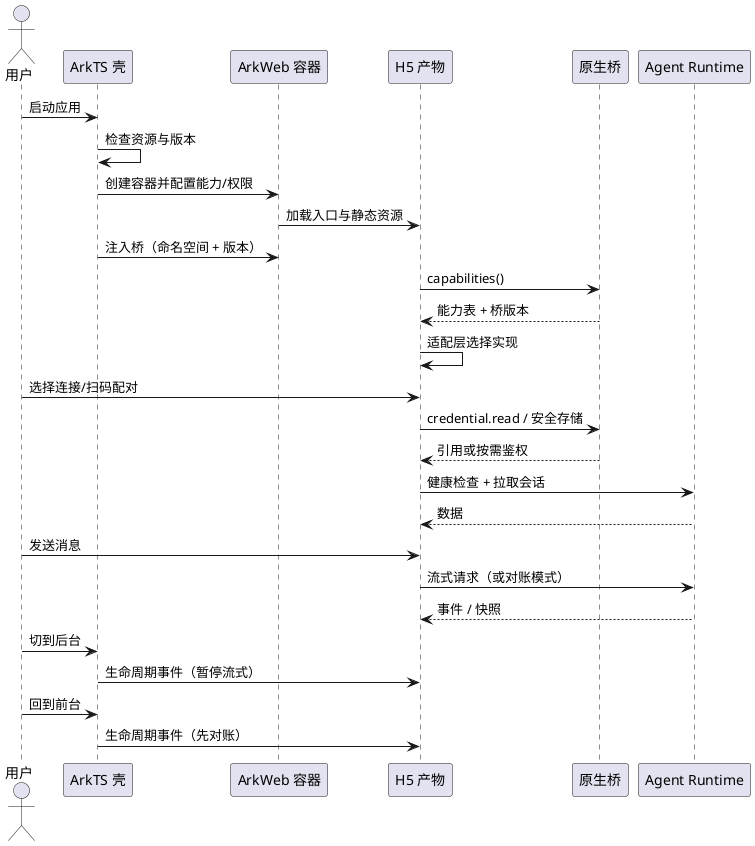

### 5.11.3 异常场景

1. **资源加载失败/白屏**
   a. 触发条件：入口缺失、资源路径错误、产物损坏。
   b. 系统行为：展示内置错误页，提供重新加载、返回连接页、导出诊断。
   c. 用户感知："界面加载失败"，可一键重试。
2. **桥未注入或版本不匹配**
   a. 触发条件：注入时机晚于页面脚本、页面要求版本过高。
   b. 系统行为：页面进入兼容/只读模式；壳记录诊断；不得反复重载。
   c. 用户感知："部分功能暂不可用，请升级应用"。
3. **明文或混合内容被拦截**
   a. 触发条件：容器策略禁止 HTTP，或页面安全上下文请求 HTTP。
   b. 系统行为：优先切换原生传输；否则提示改用 HTTPS 或调整连接方式。
   c. 用户感知：可执行的连接建议。
4. **流式不被支持**
   a. 触发条件：容器无法增量读取 POST 响应。
   b. 系统行为：自动转对账模式，并在诊断中标注容器内核版本。
   c. 用户感知："实时回复不可用，正在同步结果"。
5. **文件选择未回调**
   a. 触发条件：容器未实现选择回调或回调异常。
   b. 系统行为：超时后返回 `FAILED`，提示改用"从相册/文件 App 选择"或"在桌面端操作"。
   c. 用户感知：明确失败原因与替代路径。
6. **下载失败**
   a. 触发条件：无写入权限、目标目录不可用、文件过大。
   b. 系统行为：回退到系统分享或复制下载链接。
   c. 用户感知："已复制下载链接，可在浏览器中打开"。
7. **安全存储不可用**
   a. 触发条件：系统安全存储异常或用户未设置锁屏。
   b. 系统行为：拒绝保存长期凭据，退回"每次连接输入"或引导修复。
   c. 用户感知："无法安全保存凭据，请检查系统设置"。
8. **渲染进程崩溃**
   a. 触发条件：容器渲染进程异常退出。
   b. 系统行为：重建容器并恢复到连接页或上次会话；连续崩溃两次则停止自动重建并提示导出诊断。
   c. 用户感知："界面已恢复"，或"请重启应用并反馈诊断"。
9. **后台被冻结导致断连**
   a. 触发条件：系统冻结应用、回收网络。
   b. 系统行为：回前台先对账、再恢复输入；未完成的对账不得允许发送。
   c. 用户感知："已重新同步"，消息不重复。
10. **非法深链**
   a. 触发条件：参数缺失、包含凭据、指向未知目标。
   b. 系统行为：拒绝打开目标页，回到首页并记录审计。
   c. 用户感知："链接无效或已过期"。

---

# 6. 数据约束

## 6.1 连接配置

1. **配置标识**：必填，客户端内唯一，创建后不可变。
2. **展示名称**：必填，1–40 字符，允许中文、字母、数字、空格与常见符号。
3. **通道类型**：必填，取值属于 `LOCAL`、`LAN`、`SSH`、`RELAY`、`HTTPS`。
4. **服务地址**：必填，必须为合法 URL；`HTTPS` 通道必须为 `https://`；`LOCAL` 必须为回环地址。
5. **鉴权方式**：必填，取值属于 `API_KEY`、`BEARER`、`PAIRING_TOKEN`。
6. **凭据引用**：必填，指向安全存储中的条目；禁止在此字段保存明文凭据。
7. **最近连通状态**：必填，取值属于 `UNKNOWN`、`OK`、`AUTH_FAILED`、`UNREACHABLE`。
8. **最后使用时间**：可空；为空表示从未成功连接。

## 6.2 设备配对记录

1. **设备标识**：必填，全局唯一，由服务端签发。
2. **设备名称**：必填，1–60 字符，默认取系统设备名。
3. **平台类型**：必填，取值属于 `DESKTOP`、`ANDROID`、`IOS`、`HARMONYOS`、`MINI_PROGRAM`。
4. **配对时间**：必填，服务端时间。
5. **最后活跃时间**：必填，服务端时间，用于展示与过期清理。
6. **状态**：必填，取值属于 `ACTIVE`、`REVOKED`、`EXPIRED`。
7. **凭据指纹**：必填，用于识别与轮换；不得保存凭据明文。

## 6.3 工作区与会话视图

1. **工作区标识**：必填，以路径为业务主键，同一 Agent 内唯一。
2. **工作区名称**：必填，1–80 字符。
3. **会话标识**：必填，服务端 `sessionId`，在接口中作为 `agentId` 使用。
4. **会话标题**：必填，1–200 字符；允许用户自定义并优先展示。
5. **会话归属工作区**：可空；为空表示未归属项目。
6. **最后消息摘要**：可空，长度不超过 200 字符。
7. **更新时间**：必填，用于排序；同一时间戳按会话标识稳定排序。
8. **本地缓存范围**：必须按连接配置隔离；不同配置的会话与消息不得混用。

## 6.4 能力开关矩阵

1. **功能标识**：必填，全局唯一，采用稳定的点分命名。
2. **桌面端取值**：必填，取值属于 `FULL`、`DEGRADED`、`NONE`。
3. **Android 取值**：必填，取值属于 `FULL`、`DEGRADED`、`NONE`。
4. **iOS 取值**：必填，取值属于 `FULL`、`DEGRADED`、`NONE`。
5. **HarmonyOS 取值**：必填，取值属于 `FULL`、`DEGRADED`、`NONE`。
6. **小程序取值**：必填，取值属于 `FULL`、`DEGRADED`、`NONE`。
7. **降级说明**：当任一端为 `DEGRADED` 时必填，描述替代方式。
8. **最低支持版本**：可空；填写时表示低于该版本不提供该功能。
9. **依赖的桥协议版本**：可空；填写时表示该功能依赖某一最低桥版本（仅 App/HarmonyOS 适用）。

## 6.5 版本清单

1. **端类型**：必填，取值属于 `DESKTOP`、`ANDROID`、`IOS`、`HARMONYOS`、`MINI_PROGRAM`、`AGENT`。
2. **版本号**：必填，语义化版本。
3. **契约版本**：必填，当前为 `1`。
4. **兼容范围**：必填，列出可互通的其他端版本区间。
5. **发布时间**：必填。
6. **状态**：必填，取值属于 `CURRENT`、`SUPPORTED`、`DEPRECATED`、`BLOCKED`。

## 6.6 H5 产物清单

1. **产物标识**：必填，全局唯一，建议采用内容哈希前缀。
2. **内容哈希**：必填，对完整产物按稳定算法计算；四个宿主必须一致。
3. **源码提交标识**：必填，对应前端仓库的提交号。
4. **构建时间**：必填，ISO 时间。
5. **契约版本**：必填，当前为 `1`；与产物内协议 SDK 一致。
6. **要求的最低桥协议版本**：必填，用于壳与产物兼容校验。
7. **分发形态**：必填，取值属于 `EMBEDDED`（内嵌安装包）、`HOSTED`（同源托管）；两种形态内容必须一致。
8. **资源清单**：必填，列出入口与关键资源及其相对路径；不得包含绝对路径或本地用户名。
9. **体积**：必填，记录首屏关键资源与完整产物的压缩后体积。

## 6.7 平台适配能力项

1. **能力标识**：必填，稳定的点分命名，与附录 D 一致。
2. **能力语义**：必填，描述输入、输出与副作用，不得绑定某端实现。
3. **返回状态**：必填，取值属于 `OK`、`UNSUPPORTED`、`DENIED`、`CANCELLED`、`FAILED`。
4. **各端实现状态**：必填，每一端取值属于 `AVAILABLE`、`DEGRADED`、`UNAVAILABLE`。
5. **降级说明**：当任一端为 `DEGRADED` 或 `UNAVAILABLE` 时必填。
6. **桥协议版本**：必填，标识该能力从哪个版本开始可用。
7. **超时与取消语义**：必填，标明是否支持超时、是否支持取消。

---

# 7. 假设与待确认事项

## 7.1 已核验事实基线

1. desktop 采用「壳 + 服务端」架构：Tauri 2（Rust）负责进程托管与本机能力，React 19 负责界面，Agent 能力由内嵌 `dsh-java-app.jar`（Spring Boot，standalone + H2）经 `127.0.0.1` HTTP/SSE 提供。
2. desktop 壳在启动时生成随机 API Key，并以 `--harness.auth.api-keys=<key>` 注入 JAR；前端对回环请求自动附带 `X-API-Key`。服务端 `ApiKeyAuthInterceptor` 在未配置 Key 时放行，配置后校验 `X-API-Key` 或 `Bearer`。
3. desktop 壳已具备外部 Agent 复用模式（`DSH_AGENT_URL` / 默认探测 8090 / `DSH_AGENT_MODE=managed`），说明"壳可连接远程 Agent"已被验证。
4. desktop 前端对 Tauri 的直接依赖集中在 13 个文件、16 处 import（`invoke`、`plugin-http`、`plugin-updater`、`getCurrentWindow`、`getVersion`），业务组件大多无原生依赖，具备抽适配层的基础。
5. `src-tauri/lib.rs` 已带 `#[cfg_attr(mobile, tauri::mobile_entry_point)]`，且 `src-tauri/icons` 已包含 Android/iOS 全套图标，说明 Tauri 2 Mobile 迁移路径已被预留。
6. desktop 前端 CSS 现有断点以 900/960/980/1180/1280px 为主，未提供手机宽度（360–430px）适配，移动端需要新增窄屏布局。
7. dsh-java 提供 `/api/agent/stream`（SSE，15s keepalive）、`/api/harness/console/sessions`、`/api/harness/config/effective`、`/api/agent/workspaces`、审批/提问 pending 与 resolve/answer、数字人、协作房间事件流等接口；响应统一为 `{code, info, data}` 信封。
8. dsh-java 已具备 Docker 部署能力（`Dockerfile`、`dsh-java-release` 启动脚本），云侧承载可行；当前未配置 TLS，公网接入需要反向代理或网关补齐。
9. 客户端契约 v1 已定义 desktop/mobile 共用的接口映射、事件名、领域模型与 fixtures；`contractVersion = 1` 为当前唯一版本。
10. `dsh-java-mobile` 当前为 KMP + Kuikly，约 1.58 万行共享 Kotlin，页面以 `DshHomePage`（3287 行）、`DshConnectionSetupPage`、`DshWebViewPage` 为主；传输仍为 DeepSeek Harness JSON-RPC + WebSocket（默认 3080），不具备连接 dsh-java 的能力。
11. `dsh-java-mobile` 已实现 Android/iOS 的 SSH 端口转发（目标端口可配置）、扫码 Relay、安全存储、前台服务与网络切换处理，可作为"远端连接"资产复用。
12. `dsh-java-mobile` 的 `settings.gradle.kts` 声明了 `h5App`、`miniApp`，但目录不存在；Kuikly 官方支持 Web/小程序（Beta），可作为小程序过渡方案。
13. `dsh-java-mobile` 的 Android 清单已允许 cleartext（`cleartextTrafficPermitted=true`），公网场景必须改为仅 HTTPS。
14. desktop 的 `dist/index.html` 以绝对路径引用 `/assets/index-*.js`、`/assets/index-*.css` 与 `/dsh-icon.png`（Vite 默认基址为 `/`）。这意味着当前产物**不能直接在非站点根路径下加载**；鸿蒙 `rawfile`、自定义 scheme 或子路径托管均会 404，必须改为相对基址或等价方案。这是"同一份 H5 产物"落地的首要阻塞点。
15. desktop 前端**没有路由库**（无 `react-router`，无 `pushState/replaceState`），页面切换由应用状态驱动，属单页应用。因此"HarmonyOS 需 history 还是 hash 路由"当前不构成阻塞；但若未来引入路由，必须使用 hash 或相对基址，禁止依赖服务端 history 回退。
16. dsh-java 的 CORS 配置为 `allowedOriginPatterns("*")`、`allowedMethods` 含 `POST/OPTIONS`、`allowedHeaders("*")`、`exposedHeaders("*")`、`allowCredentials(false)`。鉴权使用 `X-API-Key` 或 `Authorization: Bearer` 请求头，**不依赖 Cookie**。结论：纯 H5 跨源 `fetch` 在协议层可行；`allowCredentials(false)` 也意味着无法使用 Cookie 会话，符合现有鉴权形态。
17. 流式实现为 `POST /api/agent/stream`（`text/event-stream`）配合 `fetch` + `response.body.getReader()` 读取，**不是 `EventSource`**；`/api/gateway/stream` 与协作房间事件流同样走 POST/GET SSE + 读取流。因此 Web 容器必须支持"读取响应体增量"，而不是仅支持 EventSource。
18. `src-tauri/src/lib.rs` 实际注册 **26 个命令**（原文"约 30 个"应修正），可分为四类：进程托管与状态 3 个（`start_agent`/`stop_agent`/`agent_status`）、Git 5 个、本地文件与目录 8 个、系统能力与凭据 10 个（通知、外部打开、定位、另存为、凭据读写删、文件选择）。
19. 移动端（含鸿蒙）可直接复用语义的命令：`send_notification`、`open_external`、`open_local_file`、`save_local_file_as`、`save/read/delete_credential`、`pick_local_file`；必须替换或降级的：进程托管三件套、Git 五件套、`reveal_local_file`、目录树/文件元数据（移动端无桌面文件系统语义）。
20. `ohosApp` 当前**没有任何 ArkWeb `Web` 组件使用**，入口为 Kuikly 页面容器（`Index.ets`）；已声明 `INTERNET`、`GET_NETWORK_INFO`、`GET_WIFI_INFO`、`CAMERA` 权限，`network_config.json` 允许明文流量，`compatibleSdkVersion = 5.0.0(12)`（HarmonyOS NEXT API 12）。这意味着鸿蒙 Web 容器与桥均为**新建**，不是改造既有页面。
21. `androidApp` 已具备 SSH 隧道、Relay、扫码、WebSocket 模块与安全存储；`iosApp` 已具备 Keychain、SSH、Relay、扫码与本地网络权限声明；`ohosApp` 具备 SSH Key 存储、Relay 运行时等原生模块。这些是**原生能力实现的参考资产**，可迁移到 Tauri 插件或 ArkTS 桥，但其 Kuikly 页面不属于主线 UI。
22. dsh-java 的 `src/main/resources/static` 当前托管的是**旧版 Web 控制台**（`app.js`/`app.css`/`index.html`），不是 React `dist`；若要采用"Agent 同源托管 H5"的分发模式，需要新增产物托管与入口路由（属设计层工作，不在本阶段展开）。
23. `dsh-java-mobile` 的 `settings.gradle.kts` 声明了 `h5App`、`miniApp` 模块但目录不存在，属于无效声明；不应作为"已有 H5 能力"的证据。
24. desktop 前端大量使用 `localStorage`（30 余处、`dsh-*` 键），承载界面偏好、草稿、会话缓存与排序等状态。鸿蒙 Web 容器必须启用 DOM 存储且允许持久化，否则这些状态会丢失；但凭据类数据不得依赖该存储。
25. desktop 的 Rust 依赖包含 `tauri-plugin-updater`、`tauri-plugin-process`、`rfd`、`notify-rust`，其中更新器、`rfd` 文件对话框与 `notify-rust` 为桌面专属；移动端必须替换实现或标记 `UNSUPPORTED`，不能直接复用。
26. 现有 `tauri-plugin-http` 的角色是"原生 fetch 失败后的 IPC 转发回退"（`http.ts` 按源记忆 60 秒）。在纯 H5 环境中该插件不存在，适配层必须提供"无插件"路径；Tauri 移动端是否保留该回退需实测混合内容策略后决定。
27. desktop 前端**不使用任何构建期环境变量**（`import.meta.env` / `VITE_*` 出现 0 次），也不存在全局 `BASE_URL` 概念；Agent 地址完全由 `127.0.0.1:<port>` 或连接配置拼出。结论：鸿蒙壳不需要注入 API 基址；需要区分配置的是"H5 产物加载基址"与"Agent 连接对象"两件事，前者属宿主配置，后者属业务配置。
28. `agent-client.ts` 中有 **5 处绕过 `httpFetch` 的裸 `fetch` 调用**（健康检查 2 处、REST 请求、插件 JAR 分析、扩展上传），`digital-human-client.ts` 直接使用 `plugin-http`。结论：仅改造 `http.ts` 不足以实现"传输可注入"，必须把协议层所有请求入口收敛到传输接口，否则纯 H5 构建在鸿蒙/浏览器中仍会走错通道。

## 7.2 待确认事项

> **已关闭事项（2026-11-04）**：原"目标平台优先级 / 鸿蒙是否在范围内 / 鸿蒙选型"已由平台决策关闭，不再作为待确认项。以下仅保留**实现层未决**问题。

1. **Agent 承载主路径**：以"连接桌面端（近场）"为主，还是以"云侧部署"为主，或两者都必须在首版支持？
2. **是否接受"移动端无本地 Agent"**：产品是否认可"手机必须连到某个 Agent 才能使用"这一前提？
3. **小程序功能边界**：小程序是"轻量查看 + 追问"，还是必须与 App 功能对齐？是否必须支持审批操作？
4. **Kuikly/KMP 资产处置细节**：是否同意将 Kuikly 页面栈冻结、仅把 SSH/Relay/安全存储/扫码作为桥实现参考？`ohosApp` 的 Kuikly 入口是否直接替换为 ArkWeb 容器？
5. **桌面端对外开放策略**：是否允许桌面端 Agent 监听局域网？由用户显式开关还是默认关闭？是否需要"仅配对设备可访问"的网络层限制？
6. **公网部署形态**：是否已有域名、证书、反向代理与配额方案？是否需要多租户/计费？
7. **应用商店合规**：是否接受"WebView/ArkWeb 壳 + 远程 Agent"的审核解释？iOS 是否需要"无远程内容"的审核模式？HarmonyOS 是否需要为 AGC 准备单独的隐私与权限说明？
8. **鉴权终态**：继续使用 `X-API-Key`，还是统一演进为设备级 Bearer Token + 刷新机制？
9. **版本联动责任**：desktop / Android / iOS / HarmonyOS / server 的发版节奏由谁统一？是否接受"服务端先行、客户端滞后"的窗口期？
10. **Relay 通道**：现有 Relay 面向 DeepSeek Harness 插件，是否为 dsh-java 新建中继网关，还是首版仅提供 SSH + 局域网 + 公网三种通道？
11. **文件与产物能力**：移动端是否必须支持"保存到相册/文件 App/系统分享"，还是允许仅在线预览？
12. **鸿蒙 Web 容器实测结论（P0 必做）**：ArkWeb 对以下各项的支持度必须逐项实测并记录设备与系统版本：POST SSE 增量读取、`<input type="file">` 文件选择、Blob/大文件下载、`resource://rawfile` 或自定义 scheme 加载、DOM 存储持久化、HTTPS 页面请求 HTTP 局域网地址（混合内容）。
13. **JSBridge 方案**：采用"启动时注入命名空间对象"还是"容器拦截 + 消息通道"；同步/异步边界；是否复用现有 ArkTS 原生模块（`DshSshKeyStore`/`DshRelayRuntime`/`DshTcpHttp`）；桥方法命名与版本策略。
14. **H5 产物分发模式**：默认内嵌 `rawfile`；是否需要同时支持"由 dsh-java 同源托管"（可消除 CORS 与混合内容问题，但引入服务端静态托管与更新通道）；如采用托管，缓存与离线策略如何定义。
15. **产物基址改造方案**：为满足相对路径加载，采用"构建基址改为相对路径"还是"宿主注入重写规则/拦截请求"；两种方案对桌面端现有打包是否有影响。
16. **鸿蒙 SSH/Relay 是否首版提供**：现有 ArkTS/Kotlin 资产可迁移，但涉及后台长连接与权限；若不提供，需确认"仅局域网 + HTTPS"是否满足首版用户场景。
17. **鸿蒙签名与发布**：AGC 证书与 profile 管理、包名是否沿用 `net.linlan.dsh`、版本号体系、内测分发渠道、是否与 Android/iOS 共用发布节奏。
18. **Tauri Mobile 传输与混合内容策略**：Android `http://tauri.localhost` 页面请求内网 `http://` Agent、iOS `tauri://localhost` + ATS，是否允许明文；是否保留 `plugin-http` 作为回退；需要真机实测矩阵。
19. **壳与 H5 的更新关系**：默认随整包更新；是否允许"同源托管 + 独立更新 H5"（涉及审核、安全与回滚），若允许必须定义版本兼容与回滚策略。

## 7.3 风险

1. **Tauri 2 Mobile 成熟度风险**：移动端插件生态、iOS 审核与构建稳定性仍不如 Capacitor 成熟，可能在 P2 阶段触发壳层切换。
2. **UI 复用被高估风险**：desktop 界面为宽屏三栏布局，窄屏下可能需要重写大量 L2 容器，实际复用率可能低于 70%。
3. **近场连接安全风险**：桌面端开放监听后，若鉴权或配对实现不当，可能被同网段设备探测；必须坚持"显式开启 + 强制鉴权 + 一次性配对"。
4. **公网明文风险**：dsh-java 当前无 TLS 配置，若直接暴露 8090，将导致凭据与对话明文传输。
5. **双 UI 栈维护风险**：若 Kuikly 与 React 长期并行，将出现功能不同步与人力分散；必须以"单一主线"约束。
6. **小程序平台限制风险**：域名白名单、包体限制、后台长连接限制可能导致流式体验与 App 不一致。
7. **契约漂移风险**：mobile 当前内嵌 fixtures 镜像为手写副本，升级 `contractVersion` 时容易漏同步；必须改为单一事实源校验。
8. **并发写冲突风险**：同一会话多端同时写入可能导致消息交错或重复；单写多读策略需要在服务端有明确实现，不能仅靠客户端自律。
9. **存量用户迁移风险**：`dsh-java-mobile` 用户已有 Relay/SSH 配置与本地缓存，切换到新壳后若处理不当会造成"数据消失"感知。
10. **鸿蒙 Web 容器能力差异风险**：ArkWeb 对 POST SSE、下载、文件选择、自定义 scheme 的行为与桌面 Chromium 不完全一致；若未在 P0 实测即进入开发，可能在 P6 集中暴露，导致返工或被迫引入原生页面（违反"不引入第二套 UI 栈"）。
11. **单一产物被"好心"分叉风险**：为绕过鸿蒙差异而复制一份 React 工程或按端打补丁，是本次决策最大破坏点；必须用构建哈希校验与仓库扫描强约束。
12. **原生桥攻击面风险**：桥若暴露通用能力（读写任意路径、执行命令、动态执行脚本），等同于把系统权限交给页面；必须白名单化、版本化、最小化。
13. **混合内容与 ATS 风险**：Tauri 移动端页面处于安全上下文，请求局域网 `http://` 可能被系统或容器拦截；iOS ATS、Android cleartext、鸿蒙传输策略三处均需显式配置与实测，否则"连接桌面端"主路径在真机不可用。
14. **产物绝对路径风险（已证实）**：当前 `dist` 使用 `/assets/...` 绝对引用，直接放入 `rawfile` 或子路径会 404；若只在桌面验证通过即认为"产物可复用"，会在鸿蒙首屏即失败。
15. **Web 存储依赖风险**：界面偏好与会话草稿依赖 `localStorage`，鸿蒙容器若未启用 DOM 存储或系统清理缓存，会造成"设置丢失/草稿丢失"的体验问题；必须经适配层降级而不是直接信任。
16. **产物体积风险**：`echarts`、`xlsx`、`mammoth`、`highlight.js` 等重依赖已在前端，移动端包体与首屏体积可能超预算；必须在 P1 建立体积门禁。
17. **鸿蒙审核风险**：以 Web 容器承载远程 Agent 界面可能被质疑"动态内容/远程代码"；必须明确"界面代码随包、仅数据远程"，且禁止远程脚本与热更新。

## 7.4 完成定义（本阶段验收口径）

满足以下全部条件，视为本阶段需求规格完成：

1. 产出**desktop 可复用资产清单**，至少覆盖：React 业务组件与页面、协议 SDK（`agent-client.ts`/`http.ts`/`room-feed.ts`）、类型定义、契约 fixtures、Tauri 命令能力（按 26 个命令逐项分类）、构建与发布脚本、移动端图标与 `mobile_entry_point` 预留。
2. 产出**平台矩阵**，明确 Android/iOS 使用 Tauri 2 Mobile、HarmonyOS 使用 ArkTS 壳 + ArkWeb 加载同一份 H5 的技术栈、状态、支持范围与产物形态（见附录 C）。
3. 产出**"同一份 H5 产物"的单一事实源定义**与可行性结论，覆盖：构建一次多处消费、无 Tauri 运行时启动、加载基址无关、体积门禁、版本哈希、禁止 fork、分发模式。
4. 产出**平台适配层能力契约**（能力级，不写实现），逐项给出返回状态、超时/取消语义、各端实现状态与降级说明（见 5.10 与附录 D）。
5. 产出**HarmonyOS ArkTS 壳的职责边界与验收标准**，覆盖容器加载、权限、明文策略、桥注入、鉴权、文件/通知/分享/生命周期/深链、白屏与崩溃恢复（见 5.11 与附录 F）。
6. 产出**Agent Runtime 承载方案**，明确"移动端不内嵌 JVM"的边界，给出近场、云侧、局域网自建、端侧实验四类方案的可行性与推荐顺序。
7. 产出**多端共享边界**，明确 desktop / Android / iOS / HarmonyOS / 小程序共享什么、差异化什么，并给出可执行的能力裁剪矩阵。
8. 产出**分阶段演进路线**，每阶段包含目标、主要工作、前置依赖、出口标准与回滚点；鸿蒙阶段单列为 P6，可与 iOS（P5）并行。
9. 产出**与 `dsh-java-mobile` 既有资产的关系判定**，逐模块标注"保留 / 改造 / 冻结 / 废弃"，并说明理由（见附录 E）。
10. 产出**待确认事项清单**，每项包含影响范围与默认建议，供项目负责人决策；已由平台决策关闭的事项不得再列为待确认。
11. 文档中显式标注"取代 `mobile_debug/spec.md` 中直连 dsh-java 的技术前提"，避免后续设计与实现引用失效结论。
12. 产出**事实核验清单**，至少覆盖：`@tauri-apps` 依赖文件与处数、`lib.rs` 命令数量与分类、CORS/SSE/鉴权形态、`dist` 路径引用、前端路由形态、`ohosApp` 现状与权限、存量宿主资产清单。

---

# 附录 A：desktop 可复用资产清单（盘点结论）

| 资产 | 位置 | 复用方式 | 复用程度 |
| --- | --- | --- | --- |
| 业务界面组件 | `src/components/*.tsx`（29 个，约 1.34 万行） | L0/L1 直接复用；L2 容器按端重写 | 高 |
| 主容器与状态编排 | `src/App.tsx`（4076 行） | 拆分"连接/Runtime 获取"与"业务编排"后复用 | 中–高 |
| 协议客户端 | `src/lib/agent-client.ts`（725 行） | 入参由 `port` 改为连接对象，传输改为可注入 | 高 |
| HTTP 封装 | `src/lib/http.ts`（74 行） | 抽象"原生 fetch / 插件回退 / 桥传输"三通道与鉴权头注入 | 高 |
| 房间事件流 | `src/lib/room-feed.ts`（291 行） | 复用重连/续传/对账逻辑；无原生依赖 | 高 |
| 数字人客户端 | `src/lib/digital-human-client.ts`（830 行） | 复用协议层，`invoke`/`plugin-http` 下沉 | 中–高 |
| 类型定义 | `src/types.ts`（290 行） | 作为共享类型基线 | 高 |
| 契约测试 | `tests/unit/contract.test.ts` | 扩展为五端共用契约校验 | 高 |
| H5 产物 | `dist/`（HTML + assets） | 作为四端唯一产物；需改为相对基址 | 高（改造后） |
| `@tauri-apps` 依赖面 | 13 个文件、16 处 import | 全部下沉到适配层；H5 产物不得静态依赖 | 改造重点 |
| Tauri 命令能力 | `src-tauri/src/lib.rs`（1890 行，**26 个已注册命令**） | 按 5.10 能力契约分类映射，桌面保留实现 | 中（移动端重写实现） |
| 进程托管/端口分配/鉴权注入 | `lib.rs` 的 `start_agent`/`find_free_port`/`generate_api_key` | 仅 desktop 保留；移动端替换为连接管理 | 低（移动端不复用） |
| 桌面专属系统能力 | `rfd`、`notify-rust`、`tauri-plugin-updater`、`tauri-plugin-process` | 移动端标记 `UNSUPPORTED` 或替换实现 | 低 |
| Agent 打包与资源准备 | `scripts/prepare-runtime.mjs`、`package.json` 的 `agent:*` | 仅 desktop 与云侧复用 | 低（移动端不打包 Agent） |
| 移动端图标与入口预留 | `src-tauri/icons/android`、`icons/ios`、`mobile_entry_point` | 直接用于 Android/iOS 壳；鸿蒙图标另出 | 高 |
| 构建与发布流水线 | `tauri:build`、更新配置 | 桌面保留；移动端与鸿蒙另建商店流水线 | 中 |

# 附录 B：分阶段演进路线（建议）

| 阶段 | 目标 | 主要工作 | 前置依赖 | 出口标准 |
| --- | --- | --- | --- | --- |
| P0 基线与决策 | 冻结前提，避免返工 | 资产盘点、契约冻结、平台矩阵固化、能力矩阵初版、**鸿蒙 Web 容器实测清单**、**产物基址验证** | 无 | 平台决策与可行性记录评审通过；未通过项有降级结论 |
| P1 协议与适配层 | 让 React 业务层与壳解耦 | 连接对象抽象、传输可注入、平台适配层契约、H5 产物相对基址与哈希、desktop 回归 | P0 | 四端加载同一产物哈希一致；desktop 全量回归通过；静态检查生效 |
| P2 Android 跑通（Tauri） | 验证"同一套 UI 可跑在 Tauri 手机壳" | Tauri 2 Mobile 工程、窄屏布局、混合内容/明文策略、连接桌面端 Agent | P1 | Android 真机完成"连接—对话—流式—审批"闭环 |
| P3 鉴权与配对 | 让近场/远端连接可控 | 配对码/二维码、设备凭据（Keystore/Keychain）、吊销、TLS 要求 | P1、P2 | 配对、吊销、失效恢复三场景通过 |
| P4 移动能力与裁剪 | 达到可发布质量 | 文件分享、通知、离线缓存、错误与加载态、能力降级、体积门禁 | P2、P3 | 能力矩阵全项有结论；崩溃率与体积达标 |
| P5 iOS | 覆盖第二平台 | ATS/本地网络权限、Keychain、审核合规、TestFlight | P4 | TestFlight 闭环通过 |
| P6 HarmonyOS（方案 1） | 覆盖鸿蒙，验证"同一产物 + 新壳" | ArkWeb 容器、权限与明文策略、JSBridge、安全存储/文件/通知/分享/生命周期/深链、白屏与崩溃恢复 | P1；建议与 P5 并行（桥实现可独立于 iOS 进度） | 鸿蒙真机完成"加载—连接—对话（流式或对账）—审批—文件/通知"闭环；附录 F 全部通过 |
| P7 小程序 | 覆盖轻量入口 | Taro 复用 SDK/模型、域名白名单、订阅消息 | P1、P3 | 真机预览与核心流程通过 |
| P8 发布与联动 | 持续可运营 | 多端版本矩阵、产物哈希校验、灰度开关、诊断导出、回滚、鸿蒙 AGC 上架 | P4、P5、P6、P7 | 首个正式版本发布并可回滚；四端产物一致 |

**阶段说明**：
1. 原 P0–P7 编号顺延：鸿蒙单列为 P6，小程序由原 P6 调整为 P7，发布由原 P7 调整为 P8。
2. P6 与 P5 可并行，但 P6 的桥实现依赖 P1 的适配层契约；P6 不得早于 P1 启动。
3. P0 中的"鸿蒙 Web 容器实测"是 P6 的**准入条件**：若 SSE/上传/下载/资源加载中任一项被判定为"阻断"，必须先给出降级方案并评审，方可进入 P6。
# 附录 C：平台矩阵（2026-11-04 决策，含桌面与小程序对照）

| 维度 | Desktop | Android | iOS | HarmonyOS | 小程序 |
| --- | --- | --- | --- | --- | --- |
| 状态 | 既有，全功能 | 主路径（独立壳） | 主路径（独立壳） | 主路径（独立壳，方案 1） | 轻量入口 |
| 前端 | React 19 + TS | 同一份 H5 产物 | 同一份 H5 产物 | 同一份 H5 产物 | Taro（React 语法） |
| 壳层 | Tauri 2（Rust） | Tauri 2 Mobile（Rust + Kotlin 插件） | Tauri 2 Mobile（Rust + Swift 插件） | ArkTS/ArkUI + ArkWeb `Web` | 平台宿主 |
| 原生桥 | Tauri 命令（26 个） | Tauri 命令 / 移动插件 | Tauri 命令 / 移动插件 | ArkTS 命名空间桥（版本化白名单） | 平台 API |
| 构建产物 | 桌面安装包（内嵌 `dist` + Agent 资源） | APK/AAB（内嵌 `dist`） | IPA（内嵌 `dist`） | HAP（内嵌 `dist`，可选同源托管） | 小程序包 |
| 分发渠道 | 官网/自动更新 | Google Play / 国内商店 | App Store / TestFlight | 华为应用市场（AGC） | 微信/支付宝等 |
| 更新方式 | 自动更新 + 整包 | 商店整包 | 商店整包 | 应用市场整包 | 平台版本发布 |
| 最低系统 | macOS 10.15 / Windows 10 | Android 8.0（API 26） | iOS 15.0 | HarmonyOS NEXT API 12（5.0.0） | 平台基础库下限待定 |
| 支持范围 | 全部能力（文件、Git、多窗口、Agent 托管） | 对话、审批、连接、文件分享、通知；Git 不支持 | 同 Android；Keychain、ATS 例外 | 对话、审批、连接（局域网/HTTPS）；文件/通知/分享；SSH/Relay 待定；Git 不支持 | 查看、追问、简版审批；文件/Git 不支持 |
| 与 Agent 关系 | 可托管本机 Agent | 仅连接 | 仅连接 | 仅连接 | 仅连接（经代理/短期令牌） |
| 是否允许内嵌 Agent | 是 | 否（实验性除外） | 否 | 否 | 否 |

> 说明：表中"App"在三端语境下指 Android/iOS/HarmonyOS 三个独立壳；三者共享同一份 H5 与同一套协议 SDK，但各自维护壳层与原生桥。

# 附录 D：平台适配能力矩阵（能力级契约）

> 状态取值：`A` = 可用，`D` = 降级可用，`N` = 不支持（返回 `UNSUPPORTED`）。实现细节不在本表展开。

| 能力标识 | 语义要点 | 超时 | 取消 | Desktop | Android | iOS | HarmonyOS | 小程序 | 降级说明 |
| --- | --- | --- | --- | --- | --- | --- | --- | --- | --- |
| `transport.request` | 执行 REST 请求并剥离信封 | 15s | 是 | A | A | A | A | A | 网络失败统一映射错误类型 |
| `transport.stream` | 读取流式响应体增量 | 连接 15s / 空闲 120s | 是 | A | A | A | A/D（待实测） | D | 不支持增量则转对账模式 |
| `transport.cancel` | 取消进行中的请求 | — | — | A | A | A | A | A | — |
| `credential.save` | 写入安全存储并返回引用 | 15s | 否 | A | A | A | A | N | 小程序使用短期令牌/服务端代理 |
| `credential.read` | 按引用读取（仅内存使用） | 15s | 否 | A | A | A | A | N | 不可用时每次连接手动输入 |
| `credential.delete` | 删除引用对应凭据 | 15s | 否 | A | A | A | A | N | — |
| `credential.exists` | 判断引用是否存在 | 5s | 否 | A | A | A | A | N | — |
| `file.pick` | 选择文件/目录，返回宿主令牌 | 用户操作 | 是 | A | A | A | A（待实测） | N | 不支持则改用在线预览/桌面操作 |
| `file.readText` | 读取受限文本 | 15s | 是 | A | D（沙箱） | D（沙箱） | D（沙箱） | N | 跨端路径不可用时转服务端产物 |
| `file.readBinary` | 读取二进制（受限大小） | 15s | 是 | A | D | D | D | N | 超限转分享/预览 |
| `file.writeText` | 写入宿主可写位置 | 15s | 否 | A | D | D | D | N | 不可写则导出到分享 |
| `file.stat` / `file.listDir` | 元数据/目录列表 | 15s | 是 | A | D | D | D | N | 目录树能力仅桌面完整 |
| `file.export` | 导出到用户可见位置 | 用户操作 | 是 | A | A | A | A | N | 用系统分享或下载链接替代 |
| `share.open` | 调用系统分享 | 用户操作 | 是 | A | A | A | A | N | 复制链接/引导到 App |
| `external.openUrl` | 打开外部链接 | 10s | 否 | A | A | A | A | A | 受限域名用复制链接 |
| `external.openFile` | 用系统应用打开文件 | 用户操作 | 是 | A | A | A | A | N | 改为在线预览 |
| `external.reveal` | 在文件管理器中定位 | 10s | 否 | A | N | N | N | N | 移动端无对应语义 |
| `notify.send` | 发送本地通知 | 10s | 否 | A | A | A | A | D（订阅消息） | 无权限时仅站内提示 |
| `notify.permission` | 查询/请求通知权限 | 用户操作 | 否 | A | A | A | A | N | 拒绝后引导系统设置 |
| `clipboard.write` | 写文本到剪贴板 | 5s | 否 | A | A | A | A | A | — |
| `clipboard.read` | 读取剪贴板文本 | 5s | 否 | A | A/D（隐私提示） | A/D（隐私提示） | A/D | D | 不可读时改为粘贴到输入框 |
| `net.status` | 查询网络可用性与类型 | 5s | 否 | A | A | A | A | A | — |
| `net.onChange` | 订阅网络变化 | — | 是 | A | A | A | A | A | — |
| `app.version` | 读取壳版本与构建标识 | 5s | 否 | A | A | A | A | N | 页面显示 H5 版本 |
| `update.check` | 检查更新 | 15s | 否 | A | D（跳商店） | D（跳商店） | D（跳应用市场） | N | 仅提示，不强制 |
| `lifecycle.onForeground` / `onBackground` | 订阅前后台 | — | 是 | A | A | A | A | A | — |
| `deeplink.onOpen` / `parse` | 接收并解析深链 | — | — | A | A | A | A | D（场景值） | 非法参数拒绝并提示 |
| `git.branch` / `branches` / `switch` / `changes` / `diff` | 工作区版本信息 | 15s | 是 | A | N | N | N | N | 移动端隐藏入口，提示在桌面操作 |
| `diagnostics.export` | 导出脱敏诊断包 | 用户操作 | 是 | A | A | A | A | D | 不可导出时展示可复制摘要 |

# 附录 E：`dsh-java-mobile` 存量资产处置矩阵

| 资产 | 位置 | 处置 | 理由与去向 |
| --- | --- | --- | --- |
| Kuikly 页面栈 | `shared/src/commonMain`（`DshHomePage` 等） | **冻结** | 与 React 主线双栈；不再接受新功能，不进入发布包 |
| KMP 协议层 | `shared/src/sseMain`（Ktor SSE/WebSocket） | **冻结（参考）** | 协议单一事实源改为 TS SDK；Ktor 实现仅作行为参考 |
| SSH 隧道 | `shared` + `androidApp/ssh` + `iosApp/DshSshTunnel.m` + `ohosApp/DshSshKeyStore.ets` | **保留能力，重写接口** | 连接能力资产；P3 起迁为 Tauri 插件或 ArkTS 桥；首版鸿蒙是否提供见 7.2 |
| Relay 客户端/中继 | `shared/DshRelayModule`、各宿主 Relay 模块 | **保留能力，重写接口** | 远端穿透资产；需评估是否适配 dsh-java |
| 安全存储 | `DshLocalStore.*`、Keychain/Keystore/Asset 实现 | **改造** | 迁移为适配层 `credential.*` 实现，仅存引用 |
| 扫码配对 | 各宿主扫码页/模块 | **改造** | 保留扫码能力，接入新连接流程 |
| `androidApp` 壳 | `KuiklyRenderActivity`、渲染适配器、图标资源 | **替换 + 冻结** | 壳由 Tauri 2 Mobile 替换；Kotlin 模块可作为 Tauri 插件参考；图标可复用 |
| `iosApp` 壳 | `iOSApp.swift`、Kuikly 渲染控制器、扩展模块 | **替换 + 冻结** | 壳由 Tauri 2 Mobile 替换；Swift/ObjC 的 Keychain/SSH/Relay 可作为插件参考 |
| `ohosApp` 壳 | `EntryAbility.ets`、`Index.ets`（Kuikly） | **改造** | Kuikly 入口替换为 ArkWeb 容器；保留 `kuikly/native/*` 作为 ArkTS 桥参考 |
| `ohosApp` 权限与网络配置 | `module.json5`、`network_config.json` | **改造** | 权限按能力最小化；明文策略收紧为"回环/局域网/用户确认" |
| Android 明文配置 | `network_security_config.xml` | **改造** | 公网仅 HTTPS；明文仅限内网，需与 `transport` 策略一致 |
| iOS ATS/本地网络声明 | `Info.plist` | **改造** | 保留本地网络用途说明；按审核要求收紧 ATS，禁止无限放开 |
| `h5App` / `miniApp` 声明 | `settings.gradle.kts` | **移除或标注无效** | 目录不存在，避免误判为已有 H5 能力 |
| Tauri 移动图标与入口 | `dsh-java-desktop/src-tauri/icons`、`mobile_entry_point` | **复用** | Android/iOS 壳直接使用 |
| `mobile_debug/spec.md` | `docs/specs/mobile_debug` | **保留为事实参考** | 其"直连 dsh-java"技术结论已被本文取代 |

# 附录 F：HarmonyOS 壳验收清单（方案 1）

| 编号 | 检查项 | 验证方法 | 通过标准 | 对应章节 |
| --- | --- | --- | --- | --- |
| H-01 | 加载同一份产物 | 比对 HAP 内资源哈希与产物清单 | 哈希一致，无第二份入口 | 5.9 / 5.11 |
| H-02 | 非根路径加载 | 以应用私有资源目录加载 | 入口、JS、CSS、图标均无 404 | 5.9 / 4.5 |
| H-03 | 无 Tauri 运行时启动 | 鸿蒙容器内启动 | 无未捕获异常，首屏可用 | 5.9 |
| H-04 | Web 容器能力配置 | 检查容器配置 | 脚本与 DOM 存储启用；任意文件访问关闭 | 5.11 |
| H-05 | 权限最小化 | 对照能力矩阵检查 `module.json5` | 无孤立权限；拒绝可选权限后主流程可用 | 5.11 / 4.3 |
| H-06 | 明文策略 | 配置公网 `http://` 与局域网 `http://` | 公网阻断；局域网经确认可连 | 5.11 / 4.3 |
| H-07 | 桥注入与版本 | 启动后读取能力表 | 命名空间、版本、能力表可读；未知方法被拒 | 5.11 / 5.10 |
| H-08 | 桥安全 | 尝试调用未声明方法与任意路径读取 | 被拒绝并记录审计 | 5.11 / 4.3 |
| H-09 | 安全存储 | 保存/读取/删除凭据；清除数据后重连 | 明文不落盘；清除后需重新配对 | 5.11 / 5.6 |
| H-10 | 文件选择 | 页面触发选择并上传 | 选择器出现；取消返回 `CANCELLED` | 5.11 / 5.10 |
| H-11 | 文件导出/分享 | 导出一个产物并分享 | 落到可见位置或系统分享成功 | 5.11 / 5.10 |
| H-12 | 通知 | 授权/拒绝两种状态 | 授权可收到；拒绝后引导设置且不重复弹窗 | 5.11 / 5.10 |
| H-13 | 连接与对话 | 局域网 + HTTPS 各完成一次 | 连接—对话—审批闭环 | 5.11 / 5.3 |
| H-14 | 流式或对账 | 观察回复是否增量；禁用流式再测 | 增量可用；不可用则对账补齐且提示"实时性受限" | 5.11 / 4.2 |
| H-15 | 前后台 | 切后台 5 分钟后返回 | 不重复消息；先对账后允许发送 | 5.11 / 4.2 |
| H-16 | 系统交互 | 键盘、安全区、返回键、深色、字体缩放 | 输入区不遮挡；行为符合定义；不破版 | 5.11 / 5.4 |
| H-17 | 白屏与崩溃恢复 | 注入资源 404 / 桥异常 / 渲染进程崩溃 | 错误页出现且三个入口可用；可恢复会话 | 5.11 / 4.2 |
| H-18 | 诊断导出 | 导出诊断包 | 含宿主、系统、内核、壳版本、产物哈希、桥版本；无敏感信息 | 5.11 / 4.4 |
| H-19 | 深链 | 合法链接与含凭据链接 | 合法直达；非法拒绝并审计 | 5.11 / 4.3 |
| H-20 | 禁止远程代码 | 抓包 + 静态检查 | 无远程脚本、无动态执行、无热更新 | 5.11 / 5.9 |
