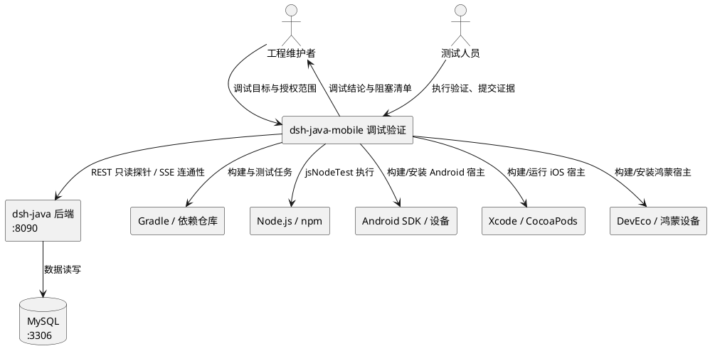
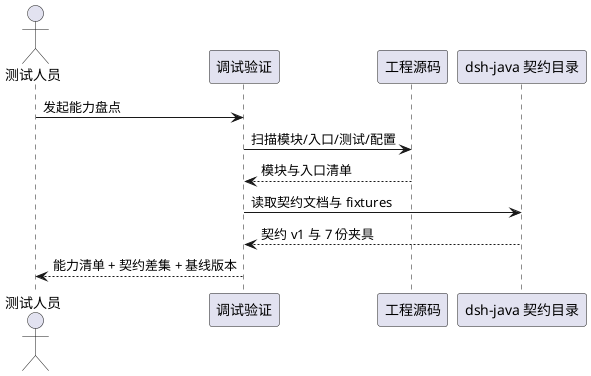
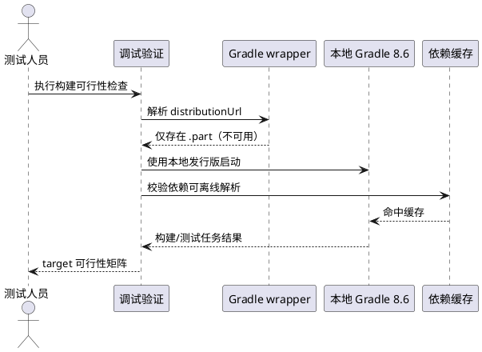
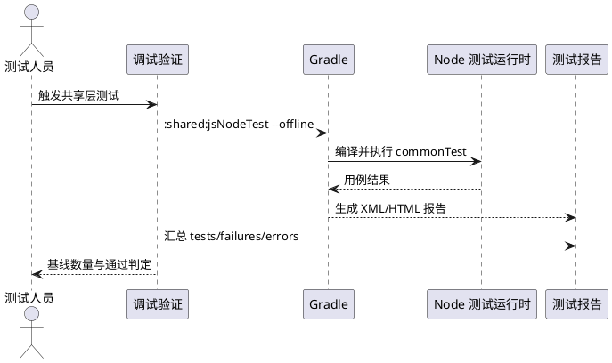
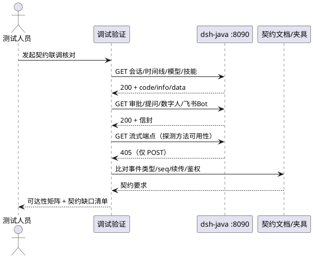
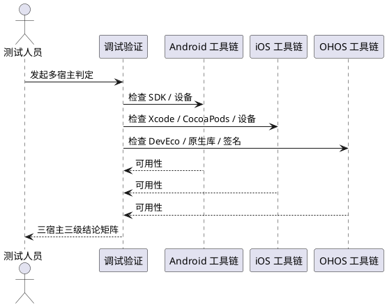
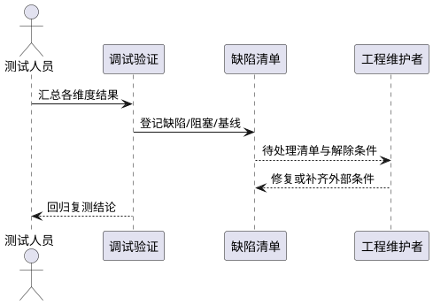
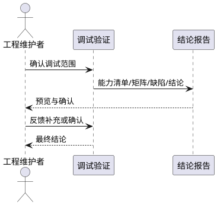

# dsh-java-mobile 功能调试需求规格

> 文档类型：需求规格说明（Spec）
> 目标工程：`/Users/mac/Workspace/linlannet/dsh-java-mobile`
> 关联后端：`/Users/mac/Workspace/linlannet/dsh-java`（0.2.2，默认端口 8090）
> 说明：本文档只描述"调试什么、怎样算调试完成"，不含业务代码实现与架构改造方案。

---

# 1. 组件定位

## 1.1 核心职责
本组件负责对 dsh-java-mobile 工程执行可复现的功能调试验证，判定其构建、测试、契约与多宿主运行能力是否可用，并输出带证据的结论与阻塞清单。

## 1.2 核心输入
1. 调试任务指令：来源为工程维护者，内容为调试目标、期望覆盖的宿主与是否允许真实后端联调。
2. 工程源码与配置：来源为 dsh-java-mobile 仓库，内容为 KMP 共享层、四个宿主工程、Gradle 构建脚本、本地测试用例。
3. 契约基线：来源为 dsh-java 仓库 `docs/spec/0.2.2/contract`，内容为客户端契约 v1 文档与 7 份 canonical fixtures。
4. 后端运行实例：来源为本机 dsh-java 服务，内容为 REST 响应（`code/info/data` 信封）与 SSE 事件流。
5. 本地工具链与缓存：来源为开发机，内容为 JDK、Gradle 发行版、依赖缓存、Node、Android SDK、Xcode、DevEco、真机/模拟器。

## 1.3 核心输出
1. 工程能力清单：目标为维护者，内容为模块划分、功能入口、已实现能力与契约缺口。
2. 调试维度矩阵：目标为维护者，内容为每个维度的可执行性、优先级、前置条件与证据。
3. 可运行性判定：目标为发布/测试人员，内容为各 target（android/ios/ohos/js）"可构建/不可构建"结论及原因。
4. 缺陷与阻塞清单：目标为维护者，内容为问题描述、严重级、证据、解除条件。
5. 调试结论报告：目标为项目负责人，内容为"通过/有条件通过/阻塞"的总体判定与待确认事项。

## 1.4 职责边界
本组件不负责以下事项：
1. 不实现 B 方案接入改造（新增 `DshJavaHostRepository` 及 REST + SSE 直连），该事项属研发实现任务。
2. 不修改任何业务代码、构建脚本、契约夹具或测试用例。
3. 不修复 dsh-java 后端缺陷，不调整后端端口、鉴权或数据源配置。
4. 不替代各宿主的手工 UI 验收（交互体验、相机扫码、SSH 真机连通性由人工确认）。
5. 不生成技术设计与编码任务拆解（由后续阶段负责）。
6. 不执行会产生模型调用费用或数据写入的接口，除非获得明确授权。

---

# 2. 领域术语

**KMP（Kotlin Multiplatform）**
: 指以一套 Kotlin 代码编译到 Android、iOS、JS、OpenHarmony 等多个平台目标的工程组织方式。

**Kuikly**
: 指本工程采用的跨端 UI 框架，负责页面渲染与原生模块桥接；共享层页面以 `@Page` 注解注册。

**宿主（Host App）**
: 指承载共享层页面的原生应用工程，本工程包含 `androidApp`、`iosApp`、`ohosApp` 三个宿主。

**B 方案**
: 指 mobile 直连 dsh-java 后端的接入方案，传输为 REST + SSE，替代原有的 DeepSeek Harness JSON-RPC + WebSocket 方案。
: 备注：截至本规格编写时，B 方案仍处于 P1 未实施状态。

**契约 v1**
: 指 desktop 与 mobile 共用的客户端接口契约，以 `contractVersion = 1` 标识，覆盖会话、时间线、流式事件、审批提问、数字人、房间事件、飞书 Bot 七类数据。

**canonical fixtures**
: 指 `dsh-java/docs/spec/0.2.2/contract/fixtures` 下的 JSON 文件，是契约形状的唯一事实源。

**信封（envelope）**
: 指 dsh-java 所有 REST 响应外层统一结构 `{code, info, data}`，客户端必须先剥离信封再消费 `data`。

**连接 scope**
: 指本地缓存隔离单元，取值 `local`、`relay:<hostId>`、`ssh:<profileId>`；不同 scope 的会话与消息互不可见。

**jsNodeTest**
: 指 `:shared` 模块在 Node.js 运行时执行 commonTest 的 Gradle 任务，用于在无 Android/iOS 工具链时验证契约与共享逻辑。

**离线可执行项**
: 指在本机无外网条件下可重复完成的调试动作；与之相对的是"需外部条件项"。

---

# 3. 角色与边界

## 3.1 核心角色
工程维护者：发起调试任务，确认调试范围、授权写接口调用、对结论负责。
测试人员：依据调试矩阵执行验证，记录证据与缺陷。
研发人员：接收阻塞项与缺陷清单，实施修复或补齐外部条件。

## 3.2 外部系统
dsh-java 后端：提供 REST 与 SSE 接口，默认监听 `127.0.0.1:8090`，响应使用 `code/info/data` 信封。
MySQL：后端持久化依赖，默认 `127.0.0.1:3306`。
Gradle 与依赖仓库：提供构建引擎与第三方依赖，受网络可达性影响。
Node.js 与 npm：支撑 JS target 的编译与测试执行。
Android SDK 与设备：支撑 Android 宿主的构建与安装运行。
Xcode 与 CocoaPods：支撑 iOS 宿主的编译与真机运行。
DevEco Studio 与鸿蒙设备：支撑 OpenHarmony 宿主的构建、签名与安装。

## 3.3 交互上下文

---

# 4. DFX约束

## 4.1 性能
1. 增量执行 `:shared:jsNodeTest` 的耗时上限为 5 分钟；冷启动（无构建缓存）上限为 15 分钟。
2. 单个后端 REST 只读探针的超时上限为 6 秒，单端点失败不得阻塞其余探针。
3. 单个宿主的构建尝试（Android/iOS/OHOS）在 20 分钟内无进展时，必须终止并记为阻塞，不得无限等待。

## 4.2 可靠性
1. 所有结论必须附带可复现的命令与原始输出摘要，禁止仅凭推断给出"通过"。
2. 调试流程必须在无外网条件下可重复执行；任何依赖外网的步骤必须显式标注为"需外部条件"。
3. 测试类结论以报告文件为准：失败数、错误数必须为 0 才可判定通过。
4. 同一调试项连续两次结果不一致时，必须记录为不稳定项并保留两次证据。

## 4.3 安全性
1. 调试记录与日志中禁止出现真实 API Key、`appSecret`、数据库口令、SSH 私钥内容。
2. 后端返回的凭据类字段必须保持脱敏状态（如 `[MASKED]`、`secretConfigured`），禁止主动请求明文。
3. 未经授权禁止调用 `POST /api/agent/stream`、审批 resolve、提问 answer、Bot 启停等写接口。
4. 调试过程禁止修改后端数据库中的业务数据。

## 4.4 可维护性
1. 每个调试项必须记录：维度、命令、环境前提、结果、耗时、证据路径、结论。
2. 调试结论必须能映射到具体文件与契约条目，便于后续复现。
3. 阻塞项必须写明解除条件（缺少什么工具、需要谁授权、需要哪个网络条件）。

## 4.5 兼容性
1. 调试不得改变既有契约语义：`contractVersion` 必须保持 1，事件类型白名单不得被改写。
2. 构建工具基线为 Gradle 8.6 + JDK 17；Android/JS/iOS target 的 Kotlin 版本为 2.1.21，OpenHarmony target 为 `2.0.21-KBA-010`。
3. 调试不得改变 `androidApp` 的 `applicationId`、`versionName` 与签名配置。
4. 调试不得改变本地缓存 scope 的命名规则，否则会破坏既有用户缓存隔离。

---

# 5. 核心能力

## 5.1 工程能力盘点与基线冻结
### 5.1.1 业务规则
1. **模块清单必须完整**：调试前必须列出全部 Gradle 模块与目录，并标注实际存在与仅声明的关系。
a. 验收条件：执行模块盘点 → 输出 `shared`、`androidApp`、`iosApp`、`ohosApp`、`buildSrc` 五个实际单元，并记录 `settings.gradle.kts` 中声明但目录不存在的 `h5App`、`miniApp`。
2. **功能入口必须可定位**：必须列出共享层页面入口、连接页、首页、宿主入口 Activity/ViewController/EntryAbility。
a. 验收条件：查阅入口清单 → 能定位到 `RouterPage`、`DshConnectionSetupPage`、`DshHomePage` 及三个宿主的启动入口。
3. **已实现能力必须与源码一致**：能力清单必须以代码为准，不得照抄 README。
a. 验收条件：核对 README 与代码 → 记录至少 3 处不一致（连接方式、默认端口、后端方案）。
4. **契约现状必须冻结**：必须记录 mobile 侧契约测试内嵌的夹具集合与 canonical fixtures 的差集。
a. 验收条件：比对 7 份 fixtures 与 `DshContractTest` → 输出缺失项（`feishu-bots.json` 未被覆盖）。
5. **基线版本必须记录**：必须记录后端版本、契约版本、Android 版本号、依赖版本。
a. 验收条件：查阅配置 → 输出后端 0.2.2、契约 v1、`versionName 0.0.5`、`versionCode 5`、Kotlin 2.1.21。
6. **禁止项**：禁止在盘点阶段改动任何源码、脚本或夹具。
a. 验收条件：盘点结束执行版本库状态检查 → 无业务文件变更。

### 5.1.2 交互流程

### 5.1.3 异常场景
1. **模块声明与目录不一致**
a. 触发条件：`settings.gradle.kts` 声明的模块目录不存在。
b. 系统行为：记录为配置遗留项，继续盘点，不擅自删除声明。
c. 用户感知：清单中标注"仅声明、无目录，不阻塞当前 JS 测试"。
2. **文档漂移**
a. 触发条件：README 描述与源码实现冲突。
b. 系统行为：以源码为准，登记文档漂移项。
c. 用户感知：报告列出漂移点及对应源代码位置。
3. **契约版本不一致**
a. 触发条件：内嵌夹具的 `contractVersion` 与 canonical fixtures 不同。
b. 系统行为：立即标记为契约红灯，暂停后续联调判定。
c. 用户感知：输出"契约版本冲突"结论与两侧版本号。

## 5.2 构建可运行性调试
### 5.2.1 业务规则
1. **构建入口必须明确**：必须区分 Gradle wrapper 入口与本地 Gradle 发行版入口，并记录各自可用状态。
a. 验收条件：检查 `gradle/wrapper/gradle-wrapper.properties` 与本地发行版 → 输出"wrapper 未完成下载（仅 `.part`），本地 `gradle-8.6` 可用"。
2. **离线构建必须优先验证**：在无外网条件下，必须优先使用本地发行版加 `--offline` 执行可用的构建任务。
a. 验收条件：执行离线 `:shared:jsNodeTest` → 返回 `BUILD SUCCESSFUL`，且未触发下载。
3. **各 target 必须给出可行性判定**：必须分别判定 Android、iOS、OpenHarmony、JS 四个 target 的可构建性。
a. 验收条件：检查工具链 → 输出 JS 可构建；Android 缺 SDK；iOS 缺 Xcode；OHOS 缺 DevEco，且原生库目录为空。
4. **构建失败必须归因**：失败项必须归因为"环境缺失""网络不可达""配置缺陷"之一。
a. 验收条件：对每个失败项输出归因类别与证据。
5. **依赖缓存状态必须核验**：必须确认关键依赖是否已在本地缓存，避免误判为"可离线"。
a. 验收条件：检查缓存目录 → 输出 Kuikly、Ktor、kotlinx 依赖存在，Gradle 8.6 发行版位于本地目录。
6. **禁止项**：禁止通过修改 `distributionUrl`、提交发行版压缩包或放宽版本约束来"绕过"构建问题。
a. 验收条件：构建脚本与 wrapper 配置无变更。

### 5.2.2 交互流程

### 5.2.3 异常场景
1. **Wrapper 下载超时**
a. 触发条件：wrapper 发行版未下载完成且无外网。
b. 系统行为：不得重试无上限下载；切换本地发行版或直接判定为阻塞。
c. 用户感知：报告记录 `SocketTimeoutException` 风险与本地替代路径。
2. **离线解析缺依赖**
a. 触发条件：`--offline` 下依赖未命中缓存。
b. 系统行为：停止该 target 的构建，保留缺失依赖清单。
c. 用户感知："缺少依赖 X，需联网或预热缓存"。
3. **KSP 生成符号冲突**
a. 触发条件：JS 测试编译出现同名顶层函数冲突。
b. 系统行为：记录现有规避配置是否生效，不新增构建改动。
c. 用户感知：若冲突复现，标记为配置缺陷并给出复现任务名。
4. **构建资源耗尽**
a. 触发条件：构建进程超时或内存不足。
b. 系统行为：终止进程，记录退出码与最后日志行。
c. 用户感知：判定为"环境不足"，不计入功能缺陷。

## 5.3 单元与契约测试执行
### 5.3.1 业务规则
1. **测试入口必须可独立运行**：共享层测试必须能在无 Android/iOS 工具链时通过 `jsNodeTest` 运行。
a. 验收条件：执行 `:shared:jsNodeTest` → 6 个测试类全部执行，失败数与错误数为 0。
2. **测试基线数量必须记录**：必须记录测试类数与用例数，作为后续回归基线。
a. 验收条件：读取测试报告 → 输出 6 类 90 个用例、0 跳过、0 失败、0 错误。
3. **契约测试必须覆盖全部契约类别**：契约测试覆盖集合必须与 canonical fixtures 对齐。
a. 验收条件：比对覆盖范围 → 当前覆盖 6 类、缺飞书 Bot 契约，登记为缺口。
4. **Android 侧单元测试必须单独判定**：`androidApp` 的 JVM 单测必须作为独立项，不得与共享层测试混同。
a. 验收条件：检查测试源码 → 输出 2 个测试类存在，但因缺 Android SDK 无法执行。
5. **测试结论必须以报告为准**：不得以控制台"看起来通过"替代报告核验。
a. 验收条件：解析 `shared/build/test-results/jsNodeTest/*.xml` → 汇总数值与报告一致。
6. **禁止项**：禁止修改测试用例、断言阈值或跳过测试来获得"绿色"结果。
a. 验收条件：测试源码与测试报告无人工篡改。

### 5.3.2 交互流程

### 5.3.3 异常场景
1. **Node 依赖缺失**
a. 触发条件：npm 软链或 mocha 缺失。
b. 系统行为：先执行依赖准备任务，再重试一次；仍失败则记为环境问题。
c. 用户感知："Node 测试依赖不完整，需预热 npm 依赖"。
2. **测试执行但零用例**
a. 触发条件：测试任务显示成功但无报告。
b. 系统行为：判定为无效通过，重新核对测试源集与过滤条件。
c. 用户感知："未发现用例，结论不可用"。
3. **契约断言失败**
a. 触发条件：夹具字段或枚举与断言不符。
b. 系统行为：输出失败用例名与差异字段，暂停联调判定。
c. 用户感知："契约红灯：字段 X 不符合契约 v1"。
4. **测试不稳定**
a. 触发条件：同一任务重复执行结果不同。
b. 系统行为：连续执行三次并记录差异。
c. 用户感知："不稳定用例清单 + 复现命令"。

## 5.4 客户端与 dsh-java 契约联调
### 5.4.1 业务规则
1. **对接现状必须如实判定**：必须核对 mobile 当前传输层与后端接口族是否匹配。
a. 验收条件：核对协议常量与后端控制器 → 输出 mobile 仍为 JSON-RPC + `events.mux`、后端为 REST + SSE，判定"端到端联调不可达"。
2. **端口必须对齐核对**：必须核对客户端默认端口与后端监听端口。
a. 验收条件：比对配置 → 输出客户端默认 3080、后端 8090，登记为联调阻塞项。
3. **信封必须被显式处理**：联调判定必须确认客户端是否具备剥离 `{code, info, data}` 的能力。
a. 验收条件：检索消费逻辑 → 输出当前无信封剥离实现，记为契约缺口。
4. **只读探针必须覆盖关键资源**：必须对会话、时间线、模型、技能、审批、提问、数字人、飞书 Bot 执行只读探针。
a. 验收条件：执行探针 → 各端点返回 HTTP 200 且 `code = "00000"`；`POST` 类端点以 GET 探测返回 405 视为"端点存在"。
5. **事件流契约必须单独核对**：SSE 事件类型、`seq` 单调性、续传参数、空闲看门狗必须逐项比对契约。
a. 验收条件：比对契约文档与客户端实现 → 输出缺失项（5 秒对账、120 秒看门狗、1s→15s 退避、`afterSeq` 续传）。
6. **鉴权差异必须标注**：必须记录客户端预期鉴权方式与后端实际鉴权状态。
a. 验收条件：无凭据调用只读接口 → 本机回环返回 200，标注"当前无鉴权，契约目标为 Bearer + 设备配对"。
7. **禁止项**：禁止在未授权情况下触发流式对话、审批决议、Bot 启停与配对。
a. 验收条件：调试记录中无写接口调用痕迹。

### 5.4.2 交互流程

### 5.4.3 异常场景
1. **后端未启动**
a. 触发条件：8090 端口不可达。
b. 系统行为：跳过探针，标注"联调待环境"。
c. 用户感知："后端未运行，REST/SSE 维度未验证"。
2. **数据库不可用**
a. 触发条件：后端启动但 MySQL 不可达。
b. 系统行为：只记录启动失败现象，不尝试修复数据源。
c. 用户感知："后端依赖数据库，联调需先恢复 DB"。
3. **契约版本漂移**
a. 触发条件：fixtures 的 `contractVersion` 升级。
b. 系统行为：停止联调判定，先冻结新版本契约。
c. 用户感知："契约版本已变更，需同步客户端镜像"。
4. **写入副作用**
a. 触发条件：误调用写接口。
b. 系统行为：立即停止，记录调用内容与影响面。
c. 用户感知："发生非预期写入，需人工核查数据"。

## 5.5 多宿主运行验证
### 5.5.1 业务规则
1. **宿主必须逐个判定**：Android、iOS、OpenHarmony 必须分别给出"可构建/可安装/可运行"三级结论。
a. 验收条件：检查工具链与设备 → 输出三宿主各自等级与缺失条件。
2. **Android 判定必须基于 SDK 与设备**：Android 宿主只有在 SDK 与设备/模拟器可用时才可判定可安装。
a. 验收条件：检查 `ANDROID_HOME`、SDK 目录、`adb devices` → 缺失则判定为"需外部条件"。
3. **iOS 判定必须基于 Xcode 与 CocoaPods**：iOS 宿主只有在 Xcode、CocoaPods、真机条件满足时才可判定可运行。
a. 验收条件：检查 `xcodebuild`、`pod`、设备 → 缺失则判定为"需外部条件"。
4. **OpenHarmony 判定必须基于 DevEco 与签名**：OHOS 宿主必须同时满足 DevEco 工具链、原生依赖库存在、签名配置。
a. 验收条件：检查 `runOhosApp.sh` 依赖路径与原生库目录 → 输出"缺 DevEco、缺 arm64 原生库"。
5. **真机专属能力必须显式排除**：扫码、相机、SSH、局域网权限必须标注为"仅真机可验"。
a. 验收条件：查阅宿主能力清单 → 输出真机专属能力项。
6. **禁止项**：禁止在无设备条件下声称"已运行验证"。
a. 验收条件：报告中所有"可运行"结论均有设备或模拟器证据。

### 5.5.2 交互流程

### 5.5.3 异常场景
1. **工具链缺失**
a. 触发条件：未安装对应 SDK 或 IDE。
b. 系统行为：标记为外部条件，不尝试自动安装。
c. 用户感知："需安装 X 后复测"。
2. **设备不可用**
a. 触发条件：无真机、模拟器未启动或未授权调试。
b. 系统行为：保留构建结论，运行结论置为"未验证"。
c. 用户感知："构建可判定，运行待设备"。
3. **签名缺失**
a. 触发条件：OHOS 未配置签名或 Android 无有效签名配置。
b. 系统行为：判定为不可安装，列出所需签名材料。
c. 用户感知："需提供签名配置后复测"。
4. **原生库缺失**
a. 触发条件：OHOS 原生依赖库目录为空且构建需联网下载。
b. 系统行为：判定为阻塞，记录下载地址与校验阈值。
c. 用户感知："需联网或预置原生库"。

## 5.6 缺陷与阻塞项管理
### 5.6.1 业务规则
1. **缺陷必须分级**：必须按"阻塞联调/阻塞构建/影响一致性/文档漂移/建议优化"五级归类。
a. 验收条件：每个缺陷条目有唯一等级与证据。
2. **阻塞项必须写解除条件**：每条阻塞必须写明所需工具、网络、授权或代码改动归属。
a. 验收条件：逐条检查 → 无空缺的解除条件。
3. **同一问题不得重复计数**：跨维度出现的同一根因必须合并为一条并关联多个维度。
a. 验收条件：缺陷清单无重复根因条目。
4. **已知基线必须保留**：已通过项必须与缺陷项分开记录，避免回归时丢失可信基线。
a. 验收条件：报告包含"已验证通过"与"未验证/阻塞"两个分区。
5. **禁止项**：禁止把"未验证"表述为"通过"。
a. 验收条件：所有条目状态取值仅限通过、失败、未验证、阻塞。

### 5.6.2 交互流程

### 5.6.3 异常场景
1. **根因不明**
a. 触发条件：失败现象无法定位。
b. 系统行为：登记为"待定位"，保留完整日志与复现步骤。
c. 用户感知："需进一步排查，不纳入通过项"。
2. **外部条件长期不可得**
a. 触发条件：网络或工具链在调试周期内无法满足。
b. 系统行为：标注为"环境性阻塞"，给出离线替代验证方案。
c. 用户感知："该项结论为未验证，不影响其余结论"。
3. **证据丢失**
a. 触发条件：日志或报告未归档。
b. 系统行为：该项结论降级为"待复测"。
c. 用户感知："证据不足，需重跑"。

## 5.7 调试结论输出
### 5.7.1 业务规则
1. **结论必须分级**：总体结论必须为"通过""有条件通过""阻塞"之一。
a. 验收条件：报告首部给出总体结论与判定依据。
2. **通过项必须有证据**：每个"通过"必须附命令、耗时与报告路径。
a. 验收条件：抽查任一通过项 → 可复现。
3. **推荐优先级必须给出**：必须输出可执行项与需外部条件项的分组，并给出执行顺序。
a. 验收条件：报告包含 P0/P1/P2 分组与前置条件。
4. **待确认点必须单列**：范围不明确的事项必须单独列出，不得隐藏在研究结论中。
a. 验收条件：报告包含待确认事项清单与影响说明。
5. **禁止项**：禁止在报告中给出未经核验的性能或兼容性结论。
a. 验收条件：所有量化结论均标注来源（实测/配置/文档）。

### 5.7.2 交互流程

### 5.7.3 异常场景
1. **范围变更**
a. 触发条件：维护者追加宿主或联调要求。
b. 系统行为：新增维度条目，重算优先级，不覆盖原结论。
c. 用户感知："范围变更记录 + 增量结论"。
2. **结论冲突**
a. 触发条件：不同维度对同一能力给出相反结论。
b. 系统行为：以证据更充分者为准，并记录冲突原因。
c. 用户感知："冲突说明与最终采信依据"。

---

# 6. 数据约束

## 6.1 调试记录
1. **记录ID**：必填，全局唯一，按"维度缩写-序号"格式。
2. **维度**：必填，取值属于工程盘点、构建、测试、契约联调、多宿主、缺陷管理之一。
3. **命令**：必填，可复制执行的完整命令；不含交互式步骤。
4. **环境前提**：必填，标注是否需要外网、SDK、设备、后端。
5. **结果**：必填，取值通过、失败、未验证、阻塞。
6. **耗时**：必填，单位秒，允许近似值。
7. **证据路径**：通过项必填，指向报告或日志文件。
8. **结论说明**：必填，不超过 200 字，说明判定理由。

## 6.2 缺陷条目
1. **缺陷ID**：必填，全局唯一。
2. **标题**：必填，一句话描述现象，不写推测性根因。
3. **严重级**：必填，取值阻塞联调、阻塞构建、影响一致性、文档漂移、建议优化。
4. **证据**：必填，至少一条命令输出或文件位置。
5. **解除条件**：必填，注明所需工具、网络、授权或归属方。
6. **关联维度**：必填，可多值，不得为空。

## 6.3 可运行性矩阵条目
1. **目标平台**：必填，取值 Android、iOS、OpenHarmony、JS。
2. **构建结论**：必填，取值可构建、不可构建、未验证。
3. **运行结论**：必填，取值可运行、不可运行、未验证。
4. **缺失条件**：构建或运行不可行时必填，列出缺失的工具或资源。
5. **证据**：必填，指向检测命令输出。

## 6.4 契约差异条目
1. **契约类别**：必填，取值会话列表、时间线、流式事件、审批提问、数字人、房间事件、飞书 Bot。
2. **fixtures 是否存在**：必填，取值是、否。
3. **客户端是否覆盖**：必填，取值是、否、部分。
4. **差异说明**：覆盖为否或部分时必填，描述缺失字段或缺失测试。

---

# 7. 假设与待确认事项

## 7.1 当前事实基线（已核验）
1. 共享层测试可在离线条件下通过：`:shared:jsNodeTest` 实测 `BUILD SUCCESSFUL`，耗时约 36 秒，6 个测试类共 90 个用例，失败 0、错误 0。
2. 本机存在可用 Gradle 8.6 发行版（本地目录），wrapper 目录仅有未完成的 `.part` 文件。
3. dsh-java 后端在本机 8090 运行，MySQL 3306 可达；只读端点返回 `code = "00000"`。
4. 客户端当前仍为 Harness JSON-RPC + `events.mux`，默认端口 3080，尚无 REST + SSE 直连接入。
5. 契约 fixtures 共 7 份，mobile 内嵌镜像覆盖 6 份，缺 `feishu-bots.json`。
6. 本机未检测到 Android SDK、Xcode、DevEco Studio；OHOS 原生库目录为空。

## 7.2 待确认事项
1. **调试范围**：本轮"调试"是指全工程健康体检，还是聚焦某一具体功能（如 B 方案联调、扫码连接、SSH 隧道）。
2. **宿主要求**：是否必须覆盖 Android/iOS/OpenHarmony 真机运行，还是允许仅完成构建与单元测试。
3. **写接口授权**：是否允许调用流式对话、审批决议等写接口（可能产生模型费用与数据变更）。
4. **构建基线处置**：是否允许将本地 Gradle 发行版纳入工程或调整 wrapper 配置（属构建脚本改动）。
5. **契约同步**：是否要求补齐 `feishu-bots` 契约覆盖，以及 `contractVersion` 是否维持 1。
6. **鉴权要求**：后端当前本机回环无鉴权，是否需要按契约目标实现 Bearer + 设备配对。
7. **遗留模块**：`settings.gradle.kts` 中 `h5App`、`miniApp` 是否保留。
8. **文档同步**：README 仍描述扫码/SSH 连 Harness，是否纳入本轮修正范围。

## 7.3 风险
1. B 方案未实现，导致"客户端与后端 REST/SSE 端到端联调"在本轮无法达成，只能完成契约静态核对与后端可达性验证。
2. 无外网时 wrapper 不可用，任何依赖 wrapper 的常规命令都会失败，需显式改用本地发行版。
3. 缺少三端工具链，多宿主运行结论只能停留在"未验证"。
4. OHOS 构建需要联网下载原生库，与"无外网"约束冲突。
5. 契约夹具为手写镜像，存在静默漂移风险，需持续比对。

## 7.4 完成定义（验收口径）
满足以下全部条件视为本阶段调试需求完成：
1. 输出工程能力清单，含模块、入口、已实现能力、契约差集与基线版本。
2. 输出构建可运行性矩阵，覆盖 JS、Android、iOS、OpenHarmony，每项含结论与证据。
3. 共享层测试报告核验完成，记录测试类数、用例数、失败数与耗时。
4. 输出后端只读探针可达性矩阵，覆盖契约所列关键资源端点。
5. 输出契约差异清单，至少包含飞书 Bot 缺失与事件流能力差距。
6. 输出缺陷与阻塞清单，每条含严重级、证据与解除条件。
7. 输出总体结论（通过/有条件通过/阻塞）与待确认事项。